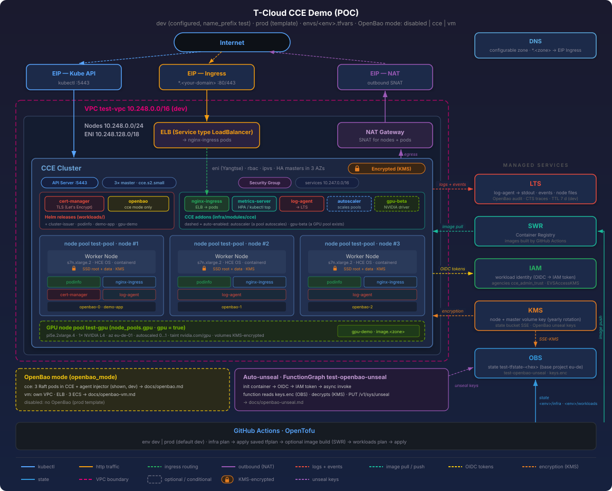

# T-Cloud CCE Demo (POC)

> ⚠️ **Proof of Concept** — This repository is a POC for testing T-Cloud/OTC features and OpenTofu resources. It is **not production-ready** and does **not** represent best practices. Use at your own risk.

Infrastructure-as-Code (OpenTofu + GitHub Actions) for a managed Kubernetes cluster (CCE) on T-Cloud, with two environments (`dev`, `prod`), optional GPU node pool and three OpenBao options (disabled, in-cluster, dedicated VMs).

## Contents

- [Architecture](#architecture)
- [Repository Layout](#repository-layout)
- [Environments](#environments)
- [What Gets Created](#what-gets-created)
- [Prerequisites](#prerequisites)
- [Bootstrap](#bootstrap-run-once-locally)
- [CI Workflows](#ci-workflows)
- [Local Usage](#local-usage)
- [OpenBao Modes](#openbao-modes)
- [Variables](#variables)
- [Outputs](#outputs)
- [Network, Cluster and Security Groups](#network-cluster-and-security-groups)
- [GPU Node Pool](#gpu-node-pool)
- [Logging and Audit](#logging-and-audit)
- [Costs](#costs)
- [Rebuild Procedure](#rebuild-procedure)
- [Security](#security)
- [Troubleshooting](#troubleshooting)

## Architecture



Further documentation (index: [docs/README.md](docs/README.md), diagrams in [docs/diagrams/](docs/diagrams/)):

| Topic | Document |
|---|---|
| Logging and audit (log-agent, LTS, OpenBao audit, CTS) | [docs/logging.md](docs/logging.md) |
| Monitoring options and trade-offs (not implemented) | [docs/monitoring.md](docs/monitoring.md) |
| OpenBao in the cluster (`openbao_mode = "cce"`) | [docs/openbao.md](docs/openbao.md) |
| OpenBao on dedicated VMs (`openbao_mode = "vm"`) | [docs/openbao-vm.md](docs/openbao-vm.md) |
| Auto-unseal with FunctionGraph + KMS (cce mode) | [docs/openbao-unseal.md](docs/openbao-unseal.md) |
| Workload identity (OIDC, no AK/SK in pods) | [docs/workload-identity.md](docs/workload-identity.md) |
| OpenBao demo app (both modes) | [docs/demo-app.md](docs/demo-app.md) |
| GPU node pool + GPU AI playground (image, chat, speech, vision) | [docs/gpu.md](docs/gpu.md) |

---

## Repository Layout

```
├── bootstrap/
│   └── main.tf                    # OBS state bucket + KMS key (local state, base project)
├── infra/                         # Infra stack: VPC, CCE, addons, DNS, NAT, SWR, OpenBao infra
│   ├── backend.tf                 # S3 backend (written by scripts/bootstrap.sh; key per env)
│   ├── envs/
│   │   ├── dev.tfvars             # complete dev configuration
│   │   ├── dev.backend.tfvars     # key = "dev/infra/terraform.tfstate"
│   │   ├── prod.tfvars            # complete prod configuration
│   │   └── prod.backend.tfvars    # key = "prod/infra/terraform.tfstate"
│   ├── terraform.tfvars.example   # every input with its default (documentation only)
│   ├── main.tf                    # providers (project + regional provider)
│   ├── variables.tf
│   ├── resources.tf               # module wiring, CTS tracker
│   ├── logging.tf                 # optional VPC flow log → LTS
│   ├── outputs.tf
│   └── modules/
│       ├── vpc/                   # VPC, node subnet, optional ENI subnet
│       ├── nat/                   # NAT gateway + EIP + SNAT rules (node and ENI subnet)
│       ├── cce/                   # cluster and everything that belongs to it:
│       │   ├── cluster.tf         #   cluster, API EIP
│       │   ├── keypair.tf         #   worker key pair (generated RSA 4096 if no key given)
│       │   ├── encryption.tf      #   KMS key for worker volumes
│       │   ├── iam.tf             #   cce_admin_trust + EVSAccessKMS agencies
│       │   ├── security-group.tf  #   worker security group
│       │   ├── node-pools.tf      #   one node pool per node_pools entry (CPU/GPU)
│       │   ├── addon-versions.tf  #   addon template lookup ("latest" resolution)
│       │   ├── metrics-server.tf  #   metrics-server addon
│       │   ├── autoscaler.tf      #   autoscaler addon
│       │   ├── gpu-addon.tf       #   CCE AI Suite (NVIDIA GPU) addon
│       │   ├── ingress.tf         #   shared ELB + EIP, nginx-ingress addon, wildcard DNS
│       │   ├── lts.tf             #   LTS group + streams
│       │   ├── log-agent.tf       #   log-agent addon
│       │   └── variables.tf, outputs.tf, versions.tf
│       ├── dns/                   # public/private DNS zone
│       ├── swr/                   # SWR organization (random suffix)
│       ├── openbao-unseal/        # cce mode: KMS + OBS + FunctionGraph auto-unseal
│       ├── workload-identity/     # cce mode: IAM OIDC identity provider + mappings
│       └── openbao/               # vm mode: dedicated OpenBao Raft cluster on ECS
├── workloads/                     # Workloads stack (Helm), separate state
│   ├── backend.tf                 # S3 backend + terraform_remote_state of infra
│   ├── envs/                      # dev/prod .tfvars + .backend.tfvars
│   ├── terraform.tfvars.example
│   ├── main.tf                    # helm/kubernetes providers from infra outputs
│   ├── variables.tf, outputs.tf
│   ├── cert-manager.tf            # cert-manager + ClusterIssuer letsencrypt-prod
│   ├── podinfo.tf                 # hello world (hello.<zone>)
│   ├── openbao.tf                 # cce: OpenBao HA + injector; vm: injector + token reviewer
│   ├── demo-app.tf                # OpenBao demo app (both modes)
│   ├── gpu-demo.tf                # GPU AI playground (image, chat, speech, vision)
│   ├── logging.tf                 # log-agent LogConfigs for node log files
│   ├── charts/                    # cluster-issuer, demo-app, gpu-demo
│   ├── demo-app/                  # demo app source (Flask)
│   └── gpu-demo/                  # GPU demo source (FastAPI, diffusers, transformers)
├── docs/                          # detailed docs (index: docs/README.md)
│   └── diagrams/                  # SVG diagrams
├── scripts/
│   ├── bootstrap.sh               # runs bootstrap/, writes backend.tf + envs/*.backend.tfvars
│   ├── openbao-init.sh            # cce mode only: init, unseal, raft join, auth, key upload
│   ├── demo-app-openbao-setup.sh  # both modes: policy, Kubernetes role, demo secret
│   ├── gpu-demo-openbao-setup.sh  # both modes: Hugging Face token → kv/gpu-demo/hf, policy + role
│   ├── upload-unseal-keys.py      # cce mode: KMS-encrypt unseal keys → OBS
│   ├── test-kms-obs.py            # KMS/OBS round-trip test for the unseal setup
│   └── destroy-cleanup.py         # FunctionGraph VPC ports + SWR repositories before destroy
└── .github/workflows/
    ├── deploy.yml                 # Infra → Build Images (optional) → Workloads
    ├── destroy.yml                # Workloads → OpenBao modules → cleanup → Infra
    └── lint.yml                   # fmt/validate, helm lint, ShellCheck, Ruff, actionlint
```

---

## Environments

Both stacks are configured **only** through per-environment files; there is no shared root `terraform.tfvars` any more:

| Stack | Variables | Backend key file | State object |
|---|---|---|---|
| `infra/` | `envs/<env>.tfvars` | `envs/<env>.backend.tfvars` | `<env>/infra/terraform.tfstate` |
| `workloads/` | `envs/<env>.tfvars` | `envs/<env>.backend.tfvars` | `<env>/workloads/terraform.tfstate` |

`<env>` is `dev` or `prod` (validated by the `environment` variable in both stacks). Workloads read the infra outputs from `<environment>/infra/terraform.tfstate` via `terraform_remote_state`, so `environment` in `workloads/envs/<env>.tfvars` must match. In CI, the `environment` input of the Deploy/Destroy workflow selects the files (and sets `TF_VAR_environment`).

`terraform.tfvars.example` documents all inputs but is not read. All configuration lives in `envs/<env>.tfvars`; root `terraform.tfvars` files are gitignored (they would be auto-loaded) and are not used.

### dev (configured) and prod (template)

- **dev** is the deployed environment. It keeps the values of the previous repository layout, so resource names stay `test-…` (cluster `test-cluster`, VPC `test-vpc`, …): `name_prefix = "test"`, tags `managed_by = "terraform"`, `project = "test"` (plus `environment = "dev"`, merged automatically), the existing worker SSH public key.
- **prod** is a **template**: `infra/envs/prod.tfvars` and `workloads/envs/prod.tfvars` start with `# STATUS: template …` and contain example values only. The Deploy and Destroy workflows refuse to run for an environment whose files still contain that line. Fill in real values (CIDRs, zone, sizes, project) and **remove the line** to enable prod.

| Setting | dev | prod (template example) |
|---|---|---|
| `name_prefix` / `tags` | `test` / `managed_by = "terraform"`, `project = "test"` | `tcloud-prod` / `managed_by = "opentofu"`, `project = "tcloud-cce-reference"` |
| `vpc_cidr` / `subnet_cidr` | `10.248.0.0/16` / `10.248.0.0/24` | `10.250.0.0/16` / `10.250.0.0/24` |
| `container_network_type` | `eni` (CCE Turbo, ENI subnet `10.248.128.0/18`) | `overlay_l2` (CCE Standard, `container_cidr` `172.16.0.0/16`) |
| `cluster_flavor` / HA / kube-proxy | `cce.s2.small` / `true` / `ipvs` | `cce.s2.small` / `true` / `ipvs` |
| `node_pools` | `pool` (3 × `s7n.xlarge.2`) + `gpu` (`pi5e.2xlarge.4`, `gpu = true`, autoscaled 0…1, `eu-de-01`, 100 GB root) → `test-pool`, `test-gpu` | `workers` (`s3.xlarge.2`, autoscaled 3…6) |
| `ssh_public_key` | existing public key | `""` (generated key pair) |
| `bind_api_eip` | `true` | `false` |
| `master_volume_encryption`, `node_volume_encryption` | `true`, `true` ([volume encryption](#optional-hardening-volume-encryption)) | `true`, `true` |
| `delete_all_storage`, `delete_all_network` | `true`, `true` | `false`, `false` |
| `reuse_existing_cce_agency`, `reuse_existing_evs_kms_agency` | `true`, `true` | `true`, `true` |
| `create_ingress` | `true` | `false` |
| `create_lts` / `lts_ttl_days` | `true` / `7` | `true` / `30` |
| `create_cts_tracker` / `cts_lts_enabled` / `cts_retention_days` | `true` / `true` / `90` | `true` / `true` / `365` |
| `vpc_flow_log_enabled` | `false` | `false` |
| `create_dns` / `dns_zone_name` | `true` / `tcloud.conmob.t-systems.net.` | `false` / `tcloud.example.invalid.` (placeholder) |
| `openbao_mode` | `cce` (+ `create_openbao_unseal`, `create_workload_identity`); `openbao_vm.version = "2.7.3"` prepared | `disabled` |
| workloads: `create_openbao`, `create_demo_app`, `create_gpu_demo` | `true`, `true`, `true` (`gpu_demo_replicas = 1`) | `false`, `false`, `false` |

> Set `dns_zone_name` and the workload hostnames to a zone you own before enabling ingress, DNS and Let's Encrypt in an environment.

---

## What Gets Created

**Bootstrap** (`bootstrap/`, local state, run once):

| Resource | Details |
|---|---|
| OBS bucket | `<name_prefix>-tfstate-<random>`, versioned, SSE-KMS, non-current versions expire after 90 days |
| KMS key | Encrypts the state bucket, yearly rotation |

Both are always created in the region's **base project** (e.g. `eu-de`), independent of `TF_VAR_otc_project_name`, because OBS SSE-KMS only accepts keys from the base project.

**Infra** (`infra/`):

| Resource | Details |
|---|---|
| VPC + subnets | Node subnet; separate ENI/pod subnet for CCE Turbo when `eni_subnet_cidr` is set |
| NAT gateway + EIP | SNAT for the node subnet (and ENI subnet); size `nat_spec`, bandwidth `nat_eip_bandwidth` |
| CCE cluster | Kubernetes `v1.35`, CCE Standard (`overlay_l2`/`vpc-router`) or CCE Turbo (`eni`), RBAC, optional master volume encryption, `component_configurations` (default `kube-apiserver support-overload=true`) |
| CCE API EIP | Public kubectl endpoint `https://<eip>:5443` (`bind_api_eip`), optional `api_access_trustlist` |
| Worker security group | See [security groups](#security-groups) |
| SSH key pair | `ssh_public_key`, or a generated RSA 4096 key (sensitive output `ssh_private_key_pem`) |
| Node pools | One pool `<name_prefix>-<key>` per `node_pools` entry: flavor, AZ, count/autoscaling, labels, taints, volumes (KMS-encrypted with `node_volume_encryption`); HCE OS 2.0 + containerd by default |
| GPU pools | Pools with `gpu = true` (e.g. `pi5e.2xlarge.4`, 1× NVIDIA L4): label `accelerator=nvidia`, taint `nvidia.com/gpu=present:NoSchedule`, scale from zero |
| KMS key (node volumes) | Dedicated key with yearly rotation when `node_volume_encryption = true` |
| IAM agencies | `cce_admin_trust` and `EVSAccessKMS` (created, or reused — see [prerequisites](#iam-agencies-cce_admin_trust-and-evsaccesskms)) |
| Addons | metrics-server `1.3.132`, autoscaler `1.35.8` (any pool with `autoscaling = true`), nginx-ingress `6.0.24` (controller tag `v1.14.5_6.0.24`), log-agent `1.7.10`, CCE AI Suite `gpu-beta` `2.15.6` (any pool with `gpu = true`) |
| Ingress ELB + EIP | Shared ELB bound to the nginx-ingress Service, wildcard `*.<zone>` record (with `create_dns`) |
| LTS | Log group (`lts_ttl_days`) with the stdout, containerfile, hostfile and event streams used by the CCE console *Logging* tabs (see [Logging and Audit](#logging-and-audit)) |
| DNS zone | Public or private (optional) |
| SWR organization | `<name_prefix>-<random>` for the demo images |
| CTS tracker | System tracker with KMS-encrypted OBS audit bucket, traces also in LTS (`create_cts_tracker`) |
| VPC flow log | Optional flow log of the cluster VPC into its own LTS stream (`vpc_flow_log_enabled`) |
| OpenBao (cce mode) | KMS + OBS + FunctionGraph auto-unseal and OIDC workload identity (optional) |
| OpenBao (vm mode) | Dedicated VPC, NAT, ELB, 3 ECS Raft nodes, bastion, KMS, OBS, agency, LTS |

All resources are tagged with `tags` plus `environment = <environment>`.

**Workloads** (`workloads/`):

| Resource | Details |
|---|---|
| cert-manager | `v1.21.3` + ClusterIssuer `letsencrypt-prod` (HTTP-01 via nginx) |
| podinfo | `6.17.0`, `https://hello.<zone>` (`create_podinfo`) |
| OpenBao (cce mode) | Helm chart `0.30.8` (OpenBao v2.7.3): 3-replica HA Raft + agent injector at `https://openbao.<zone>`, auto-unseal init container |
| OpenBao (vm mode) | Same chart, **injector only** (`externalBaoAddr` = VM URL) + token reviewer ServiceAccount |
| Demo app | Flask app reading/writing OpenBao secrets, `https://demo.<zone>` (both modes) |
| GPU demo | GPU AI playground (image, chat, speech, vision) on the GPU pool, `https://aidemo.<zone>` |

---

## Prerequisites

- **T-Cloud account** with a technical user (AK/SK) and a project, e.g. `eu-de_<project>`
- **GitHub repository** with Actions enabled
- **OpenTofu** >= 1.10 for local runs (CI uses `~1.13`); providers: opentelekomcloud `~> 1.37`, helm `~> 3.3`, kubernetes `~> 3.5`, external `~> 2.4`, random `~> 3.9`, tls `~> 4.1`
- `kubectl`, `jq`, `curl` (scripts, workload identity JWKS lookup), Python 3 (helper scripts)
- **DNS delegation** for a public zone: NS records at your registrar → `ns1.open-telekom-cloud.com`, `ns2.open-telekom-cloud.com`

### Technical user and permissions

1. **IAM → User Groups → Create User Group**
2. **IAM → Users → Create User** — access type *Programmatic access*, member of the group
3. **IAM → Users → <user> → Security Settings → Access Keys → Create** (the SK is shown only once)
4. Domain name: Console → **My Credentials** → *Domain Name*

Roles assigned to the group:

**Project-level** (scope: your project):

| Role | Purpose |
|---|---|
| `Tenant Guest` | Base read access |
| `CCE Administrator`, `CCE Admin` | CCE clusters, node pools, addons |
| `VPC Admin`, `VPC Administrator` | VPC, subnets, EIPs, security groups |
| `ECS Admin`, `Server Administrator` | Worker nodes, OpenBao VMs |
| `ELB Administrator` | Ingress ELB, OpenBao ELB |
| `DNS Administrator` | DNS zones and records |
| `CES Administrator` | Monitoring |
| `NAT Gateway Administrator`, `NAT FullAccess` | NAT gateways |

**All resources** (all existing and future projects):

| Role | Purpose |
|---|---|
| `Security Administrator` | IAM agencies, custom roles, identity providers |
| `OBS Administrator` | State bucket, unseal/snapshot/audit buckets |
| `KMS Administrator` | KMS keys |
| `SWR Administrator` | Container registry |
| `LTS Administrator`, `LTS FullAccess` | Log Tank Service |

Optional features need the corresponding service permissions as well (FunctionGraph for cce auto-unseal, CTS for `create_cts_tracker`).

### IAM agencies (`cce_admin_trust` and `EVSAccessKMS`)

Agencies are domain-wide singletons, but their roles are assigned **per project**:

| Agency | Used by | Required project role (target project) |
|---|---|---|
| `cce_admin_trust` | CCE (creating nodes, ELBs, EVS, …) | `Tenant Administrator` (the module also grants `Tenant Administrator` on `MOS`, `SWR Administrator` on the region project and the domain role when it creates the agency) |
| `EVSAccessKMS` | EVS encryption with customer KMS keys (`node_volume_encryption`) | `KMS Administrator` |

- `reuse_existing_cce_agency = false` / `reuse_existing_evs_kms_agency = false` (variable defaults): OpenTofu creates the agencies with these roles. This fails if they already exist in the account.
- `reuse_existing_* = true` (both committed environments): the existing agencies are used **as is**. The provider cannot add roles to agencies it does not manage, so grant the project role **once per project** yourself: Console → **IAM → Agencies → `cce_admin_trust` / `EVSAccessKMS` → Permissions → Authorize** (project = target project), or use the **Authorize** button that the CCE console shows for the project.

#### Optional hardening: volume encryption

`node_volume_encryption` (variable default `true`) and `master_volume_encryption` are **enabled in dev and prod**. Both environments reuse the existing agencies, so `EVSAccessKMS` needs `KMS Administrator` in the target project (see above; already granted in the dev project). To enable them in another environment, set:

```hcl
node_volume_encryption   = true # dedicated KMS key, yearly rotation; existing nodes may be replaced
master_volume_encryption = true # recreates the cluster
```

Missing roles show up as cluster/node pool creation errors or as nodes stuck in creation with encrypted volumes — see [Troubleshooting](#troubleshooting).

### GitHub environments, secrets and variables

Every workflow job runs in the GitHub **environment** matching the `environment` input (`dev` or `prod`), so secrets and variables can differ per environment. Environment-level values override repository-level ones.

| Scope | Kind | Name | Value |
|---|---|---|---|
| Repository (**Settings → Secrets and variables → Actions**) | Secret | `OTC_ACCESS_KEY` | Access key ID (shared; override per environment if needed) |
| Repository | Secret | `OTC_SECRET_KEY` | Secret access key |
| Repository | Secret | `OTC_DOMAIN_NAME` | Domain name (My Credentials) |
| Environment `dev` (**Settings → Environments → dev**) | Variable | `OTC_PROJECT_NAME` | `eu-de_BLUE_GITHUB` |
| Environment `prod` | Variable | `OTC_PROJECT_NAME` | not set yet — set it to the prod project when prod is configured |

`OTC_PROJECT_NAME` is deliberately **not** set at repository level, so prod can never fall back to the dev project. Environment `prod` only accepts deployments from `main` (deployment branch policy). Required reviewers are not available for private repositories on the free plan; add them if the plan allows.

The workflows map these values to `TF_VAR_otc_access_key`, `TF_VAR_otc_secret_key`, `TF_VAR_otc_domain_name`, `TF_VAR_otc_project_name` and to `AWS_ACCESS_KEY_ID`/`AWS_SECRET_ACCESS_KEY` for the S3 (OBS) backend. Deploy and Destroy stop early if `OTC_PROJECT_NAME` is missing for the selected environment.

> Long-lived AK/SK in GitHub is a POC shortcut. For real use, federate GitHub Actions via an IAM OIDC identity provider instead.

---

## Bootstrap (run once, locally)

```bash
export TF_VAR_otc_access_key="your-ak"
export TF_VAR_otc_secret_key="your-sk"
export TF_VAR_otc_domain_name="your-domain"
./scripts/bootstrap.sh
```

The script:

1. Applies `bootstrap/` (state bucket + KMS key in the region's base project). The bootstrap **state is local** (`bootstrap/terraform.tfstate`, gitignored) — keep a backup; losing it only means re-importing bucket and key.
2. Writes the backend configuration for both stacks (`infra/backend.tf`, `workloads/backend.tf` incl. the `terraform_remote_state` of infra).
3. Writes `envs/dev.backend.tfvars` and `envs/prod.backend.tfvars` for `infra/` and `workloads/` (state keys `<env>/<stack>/terraform.tfstate`).

Commit the regenerated `backend.tf` and `envs/*.backend.tfvars` files (they contain no credentials). Re-running bootstrap after its state was lost creates a **new** bucket name.

To remove the backend later: empty the versioned bucket (all object versions), then `tofu -chdir=bootstrap destroy` with the same `TF_VAR_*` variables.

---

## CI Workflows

All workflows run OpenTofu `~1.13` and share the concurrency group `deploy` (no parallel deploy/destroy).

### Deploy (`.github/workflows/deploy.yml`)

Triggers: manual (**Actions → Deploy → Run workflow**) and pull requests to `main` touching `infra/**` or `workloads/**` (plan only, always `dev`).

| Input | Default | Meaning |
|---|---|---|
| `environment` | `dev` | `dev` or `prod` — selects `envs/<env>.tfvars` / `envs/<env>.backend.tfvars` |
| `apply` | `false` | Apply the plans; without it the run is plan-only |
| `build_images` | `false` | Build and push container images to SWR |

Jobs:

1. **Infra** — *Check configuration* fails early if `OTC_PROJECT_NAME` is missing or if `infra/envs/<env>.tfvars` / `workloads/envs/<env>.tfvars` still contain `# STATUS: template` (prod today). Then `init` with the env backend file, `fmt -check`, `validate`, `plan -var-file=envs/<env>.tfvars -out=tfplan` (plan in the job summary). With `apply`, `tofu apply tfplan` applies **exactly that saved plan**. Exports `swr_organization`, `swr_endpoint` and `gpu_node_pool_enabled` from the infra outputs.
2. **Build Images** (only with `apply` + `build_images`) — logs in to the SWR endpoint from the infra output and pushes `demo-app:<sha>` + `:latest`; `gpu-demo:<sha>` + `:latest` is built **only when a GPU pool exists** (`gpu_node_pool_enabled`).
3. **Workloads** — plans in every run (also plan-only), `-out=tfplan`, and applies exactly that plan with `apply`. Image tags: a fresh build uses the commit SHA, otherwise the currently deployed tag (`demo_app_image_tag` / `gpu_demo_image_tag` outputs) is kept. Runs only if infra succeeded and the image build succeeded or was not requested.

### Destroy (`.github/workflows/destroy.yml`)

Inputs: `environment` (`dev`/`prod`, default `dev`), `apply`, `confirm` (must be `destroy` when `apply` is set). Without `apply` it only shows the destroy plans. The same *Check configuration* step as in Deploy rejects template environments.

Order with `apply`:

1. `tofu destroy` of **workloads** (Helm releases, PVC-backed OpenBao, …).
2. Targeted destroy of `module.openbao_unseal` and `module.openbao_vm` in infra.
3. `scripts/destroy-cleanup.py` — deletes FunctionGraph VPC access ports left in the node subnet and empties the SWR organization (both block the destroy otherwise).
4. Saved destroy plan for the rest of infra (`plan -destroy -out=destroy-final.tfplan`) and `apply` of that plan.

The bootstrap bucket and key are never touched. Deleted KMS keys stay *pending deletion* for 7 days; key aliases carry random suffixes so destroy + redeploy works within that window.

### Lint (`.github/workflows/lint.yml`)

On push to `main`, pull requests and manually:

- `tofu fmt -check -recursive` and `tofu validate` for `bootstrap`, `infra` and `workloads`
- `helm lint` for `cluster-issuer`, `demo-app` (access modes `both`, `api`, `agent`) and `gpu-demo`
- ShellCheck for `scripts/*.sh` and `infra/modules/openbao/files/*.sh`
- Ruff (`E,F,W`) for `scripts`, `workloads/demo-app`, `workloads/gpu-demo`, `infra/modules/openbao-unseal/function`, `infra/modules/openbao/files`
- actionlint for the workflows

---

## Local Usage

```bash
export TF_VAR_otc_access_key="your-ak"
export TF_VAR_otc_secret_key="your-sk"
export TF_VAR_otc_domain_name="your-domain"
export TF_VAR_otc_project_name="eu-de_<project>"
export AWS_ACCESS_KEY_ID="$TF_VAR_otc_access_key"
export AWS_SECRET_ACCESS_KEY="$TF_VAR_otc_secret_key"
ENV=dev

# Infra
cd infra
tofu init -reconfigure -backend-config=envs/$ENV.backend.tfvars
tofu plan  -var-file=envs/$ENV.tfvars -out=tfplan
tofu apply tfplan

# Workloads (after infra)
cd ../workloads
tofu init -reconfigure -backend-config=envs/$ENV.backend.tfvars
tofu plan  -var-file=envs/$ENV.tfvars -out=tfplan
tofu apply tfplan
```

Use `-reconfigure` when switching between `dev` and `prod` in the same working copy. The helper scripts (`openbao-init.sh`, `demo-app-openbao-setup.sh`, `upload-unseal-keys.py`, `test-kms-obs.py`) read `tofu output` from the locally initialized `infra/` / `workloads/` directories, so initialize them for the environment you want to operate on.

> ⚠️ Do **not** set `AWS_SESSION_TOKEN` — OBS rejects the credentials (`InvalidAccessKeyId`).

---

## OpenBao Modes

`openbao_mode` in `infra/envs/<env>.tfvars` is the single source of truth; workloads read it from the infra remote state (output `openbao_mode`). `create_openbao` in workloads only switches the in-cluster parts on or off.

| | `disabled` | `cce` | `vm` |
|---|---|---|---|
| Where OpenBao runs | — | In CCE: Helm chart `0.30.8`, 3 Raft replicas on EVS PVCs | 3 ECS instances (one per AZ) in an own VPC, Raft on encrypted EVS |
| Created by infra | — | `create_openbao_unseal`: KMS + OBS + FunctionGraph; `create_workload_identity`: OIDC IdP | `module.openbao_vm`: VPC, NAT, ELB `:443`/`:8200`, ECS, bastion, KMS, OBS, agency, LTS |
| Created by workloads (`create_openbao = true`) | — | OpenBao server + injector, unseal init container | Injector only (`externalBaoAddr` = `openbao_vm_url`) + `openbao-token-reviewer` SA |
| Unseal | — | FunctionGraph triggered by an init container ([auto-unseal](docs/openbao-unseal.md)) | KMS via ECS agency (`openbao-unseal.service` on every boot) |
| TLS | — | Let's Encrypt via cert-manager at the ingress | Let's Encrypt DNS-01 on the bastion or BYO certificate; verified end-to-end |
| Initialization | — | `scripts/openbao-init.sh` | `sudo bao-init.sh` on the bastion |
| Demo app setup | — | `scripts/demo-app-openbao-setup.sh` (userpass) | `scripts/demo-app-openbao-setup.sh` (AppRole) |
| Docs | — | [openbao.md](docs/openbao.md) | [openbao-vm.md](docs/openbao-vm.md) |

`create_openbao_unseal` and `create_workload_identity` only take effect in `cce` mode.

Typical **cce** flow: Deploy (Apply + Build Images) → `./scripts/openbao-init.sh` → `./scripts/demo-app-openbao-setup.sh`.

Typical **vm** flow: Deploy infra + workloads → `ssh ubuntu@<openbao_vm_bastion_public_ip>` → `sudo bao-init.sh` → export the printed `BAO_ROLE_ID`/`BAO_SECRET_ID` locally → `./scripts/demo-app-openbao-setup.sh`.

---

## Variables

### Credentials (environment variables / GitHub — never in files)

| Variable | GitHub Actions |
|---|---|
| `TF_VAR_otc_access_key` | Secret `OTC_ACCESS_KEY` |
| `TF_VAR_otc_secret_key` | Secret `OTC_SECRET_KEY` |
| `TF_VAR_otc_domain_name` | Secret `OTC_DOMAIN_NAME` |
| `TF_VAR_otc_project_name` | Environment variable `OTC_PROJECT_NAME` (per GitHub environment, no default) |

### Infra (`infra/envs/<env>.tfvars`)

Defaults are the values in `infra/variables.tf`; the committed environment files override many of them (see [Environments](#environments)).

**General**

| Variable | Default | Description |
|---|---|---|
| `environment` | — (required) | `dev` or `prod`; merged into all tags as `environment` |
| `name_prefix` | `tcloud` | Prefix for all resource names (changing it recreates everything) |
| `region` | `eu-de` | T-Cloud region |
| `availability_zones` | `["eu-de-01","eu-de-02","eu-de-03"]` | AZs for the HA masters (node pools choose their AZ via `node_pools[*].az`) |
| `tags` | `managed_by = "opentofu"`, `project = "tcloud-cce-reference"` | Default tags (plus `environment`) |
| `reuse_existing_cce_agency` | `false` | Use an existing `cce_admin_trust` without managing it |
| `reuse_existing_evs_kms_agency` | `false` | Use an existing `EVSAccessKMS` without managing it (only with `node_volume_encryption`) |

**Network**

| Variable | Default | Description |
|---|---|---|
| `vpc_cidr` | `10.248.0.0/16` | VPC CIDR |
| `subnet_cidr` | `""` | Node subnet; empty = `/24` at offset 1 of `vpc_cidr` |
| `eni_subnet_cidr` | `""` | Separate ENI/pod subnet for CCE Turbo (inside `vpc_cidr`); empty = node subnet |
| `container_cidr` | `172.16.0.0/16` | Pod CIDR for `overlay_l2`/`vpc-router` (ignored for `eni`; must not overlap the VPC). Changing it recreates the cluster |
| `service_cidr` | `10.247.0.0/16` | Kubernetes service CIDR. Changing it recreates the cluster |
| `vpc_dns_list` | `["100.125.4.25","100.125.129.199"]` | DNS servers of the subnets |
| `nat_spec` | `"1"` | NAT gateway size `1`…`4` (small … extra-large) |
| `nat_eip_bandwidth` | `100` | NAT EIP bandwidth (Mbit/s) |
| `bastion_cidrs` | `[]` | CIDRs allowed to SSH to workers (no `/0`; empty = no SSH) |
| `nodeport_cidrs` | `[]` | NodePort (30000–32767) sources; empty = `vpc_cidr`, or `0.0.0.0/0` with `create_ingress` on non-`eni` clusters |
| `expose_node_http_ports` | `false` | Open TCP 80/443 on workers to `0.0.0.0/0` (hostNetwork/hostPort only) |

**Cluster**

| Variable | Default | Description |
|---|---|---|
| `cluster_version` | `v1.35` | Kubernetes version |
| `cluster_flavor` | `cce.s1.small` | `cce.s1.*` single master, `cce.s2.*` HA |
| `cluster_type` | `VirtualMachine` | `VirtualMachine` or `BareMetal` |
| `container_network_type` | `overlay_l2` | `overlay_l2`, `vpc-router` or `eni` (CCE Turbo) |
| `high_availability` | `false` | 3 masters across `availability_zones` |
| `kube_proxy_mode` | `iptables` | `iptables` or `ipvs` |
| `bind_api_eip` | `false` | Public API EIP (`https://<eip>:5443`); needed by CI workloads, workload identity and vm-mode Kubernetes auth |
| `api_eip_bandwidth` | `10` | API EIP bandwidth (Mbit/s) |
| `api_access_trustlist` | `[]` | CIDRs allowed to reach the CCE API (empty = unrestricted) |
| `component_configurations` | `{ "kube-apiserver" = { "support-overload" = "true" } }` | CCE component configuration |
| `master_volume_encryption` | `false` | Encrypt master disks. Changing it recreates the cluster |
| `delete_all_storage` | `true` | Delete cluster-created EVS/SFS/OBS on destroy (also force-destroys the CTS bucket) |
| `delete_all_network` | `true` | Delete cluster-created ELBs/ENIs on destroy |
| `cluster_create_timeout` | `"60m"` | Create timeout |
| `cluster_delete_timeout` | `"60m"` | Delete timeout |

**Nodes**

| Variable | Default | Description |
|---|---|---|
| `node_pools` | `{ workers = { flavor = "s3.xlarge.2", count = 3 } }` | Map of node pools, key = pool name suffix (`<name_prefix>-<key>`); attributes below |
| `node_os` | `HCE OS 2.0` | Default OS for all pools |
| `node_runtime` | `containerd` | Default runtime (`containerd` or `docker`) |
| `node_root_volume_type` | `SSD` | Default root volume type (`SATA`, `SAS`, `SSD`, `GPSSD`, `ESSD`) |
| `node_data_volume_type` | `SSD` | Default data volume type |
| `node_volume_encryption` | `true` | Encrypt root/data volumes of all pools with a dedicated KMS key (yearly rotation); needs `EVSAccessKMS` |
| `ssh_public_key` | `""` | Worker SSH key; empty generates an RSA 4096 key pair (output `ssh_private_key_pem`). SSH still needs `bastion_cidrs` |

`node_pools` attributes (only `flavor` is required):

| Attribute | Default | Description |
|---|---|---|
| `flavor` | — | ECS flavor |
| `count` | `1` (autoscaling: `min_count`) | Initial nodes (later changes are ignored; the autoscaler owns the size) |
| `autoscaling` | `false` | Pool autoscaling; any autoscaling pool installs the cluster autoscaler addon |
| `min_count` / `max_count` | `1` (GPU pools `0`) / `2 × count` | Autoscaling bounds; `min_count <= count <= max_count` is checked |
| `az` | `"random"` | `"random"` or an AZ such as `"eu-de-01"` |
| `os`, `runtime`, `root_volume_type`, `data_volume_type` | `node_os`, `node_runtime`, `node_root_volume_type`, `node_data_volume_type` | Per-pool overrides |
| `root_volume_size` / `data_volume_size` | `50` / `100` | GB (40–1024 / 100–32768) |
| `priority` | `1` (GPU pools `0`) | Autoscaler expander priority |
| `scale_down_cooldown` | `15` | Minutes |
| `gpu` | `false` | NVIDIA GPU pool: installs the CCE AI Suite addon, GPU defaults for labels/taints/min/priority |
| `labels` | `{}` (GPU pools `{ accelerator = "nvidia" }`) | Kubernetes node labels |
| `taints` | `[]` (GPU pools `nvidia.com/gpu=present:NoSchedule`) | `{ key, value, effect }`, effect `NoSchedule`, `PreferNoSchedule` or `NoExecute` |

Validation: keys of 1–20 lowercase letters, digits or hyphens; at least one non-GPU pool; on CCE Turbo (`eni`) CPU pools need network-enhanced flavors (`s7n`, `c7n`, `m7n`, `c3n`, …; `s1`–`s3`, `c3`/`c4`, `m3`/`m4` are rejected) and GPU pools `g7`, `pi5e` or `p5e` (Standard: `g6`, `g7`, `p2s`, `p2v`, `p3`, `p5e`, `p5s`, `pi2`, `pi5e`); AZ format; non-negative counts; volume sizes; taint effects.

Example (see `infra/terraform.tfvars.example`):

```hcl
node_pools = {
  workers = { flavor = "s7n.xlarge.2", count = 3 }
  gpu = {
    flavor = "pi5e.2xlarge.4", gpu = true, autoscaling = true
    min_count = 0, max_count = 1, az = "eu-de-01", root_volume_size = 100
  }
  batch = {
    flavor = "c7n.2xlarge.2", autoscaling = true, min_count = 0, max_count = 5
    labels = { workload = "batch" }
    taints = [{ key = "workload", value = "batch", effect = "NoSchedule" }]
  }
}
```

**GPU addon**

| Variable | Default | Description |
|---|---|---|
| `gpu_addon_version` | `2.15.6` | `gpu-beta` addon version or `"latest"` (used when a pool has `gpu = true`) |
| `nvidia_driver_url` | `…/tesla/580.196.07/NVIDIA-Linux-x86_64-580.196.07.run` | NVIDIA driver installed on GPU nodes |

**Addons, ingress, DNS, logging**

Every `*_version` addon variable accepts a pinned version or `"latest"`, which resolves to the newest template for `cluster_version` via `opentelekomcloud_cce_addon_templates_v3` (see output `addon_versions`).

| Variable | Default | Description |
|---|---|---|
| `create_metrics_server` | `true` | metrics-server addon (HPA, `kubectl top`) |
| `metrics_server_version` | `1.3.132` | metrics-server version or `"latest"` |
| `autoscaler_version` | `1.35.8` | Autoscaler version (matches the cluster minor) or `"latest"` |
| `create_ingress` | `false` | nginx-ingress addon + shared ELB + EIP (+ wildcard record with `create_dns`) |
| `nginx_ingress_version` | `6.0.24` | nginx-ingress addon version or `"latest"` |
| `nginx_ingress_controller_tag` | `v1.14.5_6.0.24` | Controller tag `v<controller>_<addon>`; must end with `_<resolved addon version>` — set it explicitly also with `"latest"` |
| `ingress_eip_bandwidth` | `100` | Ingress EIP bandwidth (Mbit/s) |
| `ingress_preserve_client_ip` | `true` | `externalTrafficPolicy: Local` (client IPs kept); `false` = `Cluster` |
| `create_dns` | `false` | Create the DNS zone |
| `dns_zone_name` | `cluster.internal.` | Zone name (trailing dot) |
| `dns_zone_type` | `public` | `public` or `private` |
| `create_lts` | `false` | LTS group + streams + log-agent addon |
| `lts_ttl_days` | `7` | LTS retention (1–365 days) |
| `log_agent_version` | `1.7.10` | log-agent version or `"latest"` |

**Audit (CTS)**

| Variable | Default | Description |
|---|---|---|
| `create_cts_tracker` | `false` | CTS system tracker + KMS-encrypted OBS bucket (fails if the project already has a system tracker) |
| `cts_retention_days` | `365` | Days to keep audit files in OBS |
| `cts_lts_enabled` | `false` | Also ship traces to LTS |
| `vpc_flow_log_enabled` | `false` | Flow log of the cluster VPC into stream `vpc-flow-<prefix>` of the cluster LTS group (needs `create_lts`) |
| `vpc_flow_log_traffic` | `reject` | `all`, `accept` or `reject` |

**OpenBao / workload identity**

| Variable | Default | Description |
|---|---|---|
| `openbao_mode` | `cce` | `disabled`, `cce` or `vm` (see [OpenBao Modes](#openbao-modes)) |
| `create_openbao_unseal` | `false` | cce mode: KMS + OBS + FunctionGraph auto-unseal |
| `create_workload_identity` | `false` | cce mode: OIDC identity provider; requires `bind_api_eip = true` (validated) |
| `openbao_vm` | object, see [openbao-vm.md](docs/openbao-vm.md#configuration) | vm mode: VPC/subnet, AZs, flavor, image, version, TLS, `api_allowed_cidrs`, bastion, LTS, bandwidths |

### Workloads (`workloads/envs/<env>.tfvars`)

| Variable | Default | Description |
|---|---|---|
| `environment` | — (required) | `dev` or `prod`; selects the infra state `<environment>/infra/terraform.tfstate` |
| `cert_manager_version` | `v1.21.3` | cert-manager chart |
| `create_podinfo` | `true` | podinfo at `hello.<zone>` |
| `podinfo_version` | `6.17.0` | podinfo chart |
| `create_openbao` | `false` | In-cluster OpenBao parts for infra's `openbao_mode` (cce: server + injector, vm: injector) |
| `openbao_chart_version` | `0.30.8` | OpenBao Helm chart (both modes) |
| `openbao_replicas` | `3` | cce mode: server replicas (odd) |
| `openbao_hostname` | `openbao` | cce mode: `openbao.<zone>` |
| `openbao_storage_size` | `10Gi` | cce mode: Raft PVC per replica |
| `openbao_audit_enabled` | `true` | cce mode: declarative audit device to stdout (→ LTS); takes effect on the next pod restart |
| `node_log_collection` | `true` | log-agent LogConfigs shipping node log files to the LTS `hostfile` stream |
| `node_log_files` | `/var/log/messages`, `/var/log/secure`, `/var/paas/sys/log/kubernetes/*.log` | Map of LogConfig name → `path` + `pattern` |
| `create_demo_app` | `false` | Demo app (needs OpenBao in cce or vm mode) |
| `demo_app_access_mode` | `both` | `agent` (injected, read-only), `api` (Kubernetes auth + API) or `both` |
| `demo_app_hostname` | `demo` | `demo.<zone>` |
| `demo_app_image_tag` | `latest` | Set by CI to the commit SHA of the last build |
| `create_gpu_demo` | `false` | GPU demo (needs a `gpu = true` pool in infra `node_pools`) |
| `gpu_demo_hostname` | `aidemo` | `aidemo.<zone>` |
| `gpu_demo_replicas` | `1` | `0` lets the autoscaler remove the GPU node |
| `gpu_demo_models` | image `stabilityai/sdxl-turbo`, chat `Qwen/Qwen2.5-3B-Instruct`, stt `openai/whisper-large-v3-turbo`, vision `florence-community/Florence-2-base` | Hugging Face model per tab ([gpu.md](docs/gpu.md)) |
| `gpu_demo_openbao` | `true` | Inject the Hugging Face token from OpenBao (`scripts/gpu-demo-openbao-setup.sh`) |
| `gpu_demo_image_tag` | `latest` | Set by CI to the commit SHA of the last build |

---

## Outputs

**Infra** (`tofu -chdir=infra output`; *s* = sensitive):

| Output | Description |
|---|---|
| `environment`, `otc_project_name` | Environment and project |
| `vpc_id`, `subnet_id`, `security_group_id`, `nat_public_ip` | Network; `nat_public_ip` is the outbound SNAT IP of nodes and pods |
| `cce_cluster_id`, `cce_cluster_name`, `cce_api_endpoint`, `cce_api_endpoint_public` | Cluster and API endpoints (public = `https://<eip>:5443` if bound, else internal) |
| `kubeconfig` (s), `cluster_ca_cert` (s), `client_cert` (s), `client_key` (s) | Cluster access |
| `keypair_name`, `ssh_private_key_pem` (s) | Worker key pair; private key only when generated |
| `node_pool_ids`, `node_volume_kms_key_id` | Node pool IDs keyed by `node_pools` key, volume KMS key |
| `gpu_node_pool_enabled`, `gpu_node_selector`, `gpu_node_tolerations` | Any GPU pool; labels of the first GPU pool (nodeSelector) and `Exists` tolerations for its taints — used by the GPU demo |
| `addon_versions` | Resolved addon versions (null for disabled addons) |
| `ingress_elb_public_ip`, `dns_zone_name`, `lts_group_id`, `lts_hostfile_stream_id`, `cts_audit_bucket` | Ingress, DNS, logging, audit |
| `swr_organization`, `swr_endpoint` | Registry |
| `openbao_mode` | Selected OpenBao mode (read by workloads) |
| `openbao_unseal_kms_key_id`, `openbao_unseal_obs_bucket`, `openbao_unseal_function_urn` | cce auto-unseal |
| `workload_identity_provider_id`, `workload_identity_client_id` | cce workload identity |
| `openbao_vm_url`, `openbao_vm_ca_cert`, `openbao_vm_elb_public_ip`, `openbao_vm_bastion_public_ip`, `openbao_vm_nat_public_ip`, `openbao_vm_ssh_private_key` (s) | vm mode |

**Workloads** (`tofu -chdir=workloads output`):

| Output | Description |
|---|---|
| `app_url`, `demo_app_url`, `gpu_demo_url` | Application URLs |
| `demo_app_image_tag`, `gpu_demo_image_tag` | Deployed image tags (CI keeps them when no image is built) |
| `openbao_mode`, `openbao_url` | Mode from infra; `https://openbao.<zone>` (cce) or `openbao_vm_url` (vm) |
| `openbao_kubernetes_host`, `openbao_kubernetes_ca_cert`, `openbao_token_reviewer_jwt` (s) | vm mode: Kubernetes auth settings consumed by `scripts/demo-app-openbao-setup.sh` |

```bash
tofu -chdir=infra output -raw kubeconfig > ~/.kube/config
tofu -chdir=infra output -raw ssh_private_key_pem > worker.pem && chmod 600 worker.pem
```

---

## Network, Cluster and Security Groups

**Container network modes**

| Mode | Value | Cluster | Pod IPs | Isolation |
|---|---|---|---|---|
| Canal (tunnel) | `overlay_l2` | CCE Standard | `container_cidr` (cluster-internal) | Kubernetes NetworkPolicy |
| VPC router | `vpc-router` | CCE Standard | `container_cidr` (VPC-routed) | — |
| Cloud Native 2.0 (Yangtse) | `eni` | CCE Turbo | ENI IPs from `eni_subnet_cidr` | Security groups per pod |

The network mode, `container_cidr`, `service_cidr` and `master_volume_encryption` are immutable — changing them recreates the cluster. Turbo needs network-enhanced flavors (`s7n`, `c7n`, `m7n`, `c3n`, …); `s1`–`s3`, `c3`/`c4`, `m3`/`m4` are rejected by the `node_pools` validation. See [Node flavor description](https://docs.otc.t-systems.com/cloud-container-engine/api-ref/appendix/node_flavor_description.html).

| Cluster flavor | Masters | Max nodes |
|---|---|---|
| `cce.s1.small` / `cce.s1.medium` | 1 | 50 / 200 |
| `cce.s2.small` / `cce.s2.medium` | 3 (HA) | 50 / 200 |

### Security groups

Worker security group (`<name_prefix>-sg`, default rules removed):

| Rule | Source | Notes |
|---|---|---|
| All egress | — | |
| All ingress | `vpc_cidr` | Node↔node, master↔node, pod ENIs (ENI subnet lies inside the VPC) |
| All ingress | `container_cidr` | Only for non-Turbo clusters (`overlay_l2`, `vpc-router`) |
| TCP 22 | `bastion_cidrs` | Only if set |
| TCP 30000–32767 | `nodeport_cidrs` | Default `vpc_cidr`; `0.0.0.0/0` with `create_ingress` on non-Turbo clusters, because the shared ELB forwards to NodePorts and keeps the client IP |
| TCP 80, 443 | `0.0.0.0/0` | **Opt-in** (`expose_node_http_ports`), only for hostNetwork/hostPort workloads |

Ingress path: on **Turbo**, the ELB forwards directly to the pod ENIs (CCE-managed `<cluster>-cce-eni-*` group), so no node rule is needed; on **Standard** it forwards to `node:NodePort`.

---

## GPU Node Pool

A `node_pools` entry with `gpu = true` (dev: `gpu` → `test-gpu`, `pi5e.2xlarge.4`, autoscaled 0…1 in `eu-de-01`, 100 GB root volume) gets the label `accelerator=nvidia` and the taint `nvidia.com/gpu=present:NoSchedule` by default and installs the CCE AI Suite addon `2.15.6` with NVIDIA driver `580.196.07`; with `autoscaling = true` the cluster autoscaler scales it from zero. The GPU demo takes its nodeSelector/tolerations from the infra outputs `gpu_node_selector` / `gpu_node_tolerations`; CI builds its image only when a GPU pool exists. Details: [docs/gpu.md](docs/gpu.md).

---

## Logging and Audit

The CCE **log-agent** addon ships container stdout, Kubernetes events and node log files to the LTS group `k8s-log-<cluster-id>`; OpenBao writes a declarative audit log, CTS records all OTC API calls (OBS + LTS), VPC flow logs are optional. Details, diagram and how to view the logs: [docs/logging.md](docs/logging.md).

## Costs

Main cost drivers: CCE master flavor (`cce.s2.*` = 3 masters), worker and GPU nodes, EIPs/bandwidth (API, ingress, NAT, and in vm mode ELB, NAT and bastion), NAT gateways (one for CCE, one more in vm mode), ELBs, EVS volumes, KMS keys and LTS/OBS storage. Scale the GPU demo to zero (`gpu_demo_replicas = 0`) when not in use and destroy unused environments.

---

## Rebuild Procedure

### From the previous layout (`apps/`, state keys `cce/terraform.tfstate` and `cce/apps.tfstate`)

The new code uses different state keys (`<env>/infra/…`, `<env>/workloads/…`), so it cannot see the old resources. Tear them down with the **old** code first:

1. **Destroy with the old code** — run **Actions → Destroy** (Apply + `destroy`) from `origin/main` *before* this change is pushed (old state keys `cce/terraform.tfstate`, `cce/apps.tfstate`).
2. **Push the new code.**
3. Optionally re-run `./scripts/bootstrap.sh` (regenerates `backend.tf` and `envs/*.backend.tfvars`; the existing bucket is kept as long as the local bootstrap state exists).
4. **Actions → Deploy** with `environment = dev`, **Apply** and **Build Images** (the new SWR organization is empty). dev keeps `name_prefix = "test"`, so the resources get the same `test-…` names as before.
5. cce mode: `./scripts/openbao-init.sh`, then `./scripts/demo-app-openbao-setup.sh`.

### From scratch (current layout)

1. **Actions → Destroy** (environment, Apply, `destroy`)
2. **Actions → Deploy** (environment, Apply, Build Images)
3. cce mode: `./scripts/openbao-init.sh` + `./scripts/demo-app-openbao-setup.sh`; vm mode: `sudo bao-init.sh` on the bastion + `./scripts/demo-app-openbao-setup.sh`

---

## Security

- Credentials only via environment variables / GitHub secrets; never in files
- State bucket SSE-KMS + versioned; bootstrap state local
- Worker volumes optionally encrypted with a dedicated KMS key (yearly rotation) and master volumes optionally encrypted — enabled in dev and prod, see [optional hardening](#optional-hardening-volume-encryption)
- Worker SSH closed by default; NodePorts limited to the VPC except where the ingress ELB needs them; node 80/443 opt-in
- CCE API internal unless `bind_api_eip`; restrict it with `api_access_trustlist`
- OpenBao unseal keys stored KMS-encrypted in OBS; root tokens revoked after initialization (both modes)
- vm mode: API and bastion CIDRs must not be `/0`, TLS verified everywhere
- Destroy requires typing `destroy`

---

## Troubleshooting

| Symptom | Cause / fix |
|---|---|
| Cluster creation fails with an authorization/agency error | `cce_admin_trust` is missing `Tenant Administrator` in the target project. With `reuse_existing_cce_agency = true` grant it once (IAM → Agencies → `cce_admin_trust` → Permissions, or CCE console → *Authorize*). |
| Nodes with encrypted volumes fail to create / EVS cannot use the KMS key | `EVSAccessKMS` is missing `KMS Administrator` in the target project. With `reuse_existing_evs_kms_agency = true` grant it once (IAM → Agencies → `EVSAccessKMS` → Permissions). |
| `agency … already exists` on apply | The agency exists in the account: set `reuse_existing_cce_agency` / `reuse_existing_evs_kms_agency = true`. Do not flip these switches while the current state manages the agency without first removing it from state. |
| SWR image pull fails | `cce_admin_trust` needs `SWR Administrator` on the region project (set when the module creates the agency). |
| `nginx_ingress_controller_tag must end with _<addon version>` | Set the tag that matches the (resolved) addon version (`spec.versions[].input.basic.tag` of the CCE addontemplates API). |
| `No <addon> addon template found` | Pinned version not available for `cluster_version`; use a listed version or `"latest"`. |
| CTS tracker creation fails | The project already has a system tracker — set `create_cts_tracker = false`. |
| Workloads plan cannot reach the cluster | The API is internal (`bind_api_eip = false`) or `api_access_trustlist` blocks the runner/your IP. |
| OBS `InvalidAccessKeyId` / chunked-encoding errors | Unset `AWS_SESSION_TOKEN`; keep `skip_s3_checksum = true` (set by bootstrap). |
| `Environment 'prod' is not configured yet` in CI | The env files still contain `# STATUS: template`; fill in real values and remove the line. |
| Missing project name | Set `TF_VAR_otc_project_name` locally or the `OTC_PROJECT_NAME` repository variable. |
| OpenBao pods `0/1 Ready` after deploy (cce) | Expected until `./scripts/openbao-init.sh` has run. |
| VM OpenBao unreachable from pods / your machine | Source IP not in `openbao_vm.api_allowed_cidrs` (the CCE NAT EIP is added automatically) — see [openbao-vm.md](docs/openbao-vm.md#troubleshooting). |
| Destroy hangs on subnet/VPC or SWR | Run `scripts/destroy-cleanup.py --network-id <subnet_id> --swr-org <swr_organization>` (done by the Destroy workflow). |

```bash
tofu -chdir=infra output -raw kubeconfig > ~/.kube/config
kubectl get nodes -o wide
kubectl -n kube-system get pods                        # addons
kubectl top nodes                                      # metrics-server
kubectl -n openbao get pods                            # cce: server + injector; vm: injector
kubectl -n openbao exec openbao-0 -c openbao -- bao status   # cce mode
```

CCE console: <https://console.otc.t-systems.com/cce2.0/>
