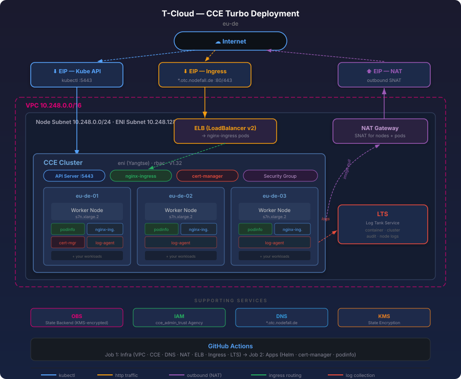

# T-Cloud CCE Deployment — OpenTofu + GitHub Actions

> ⚠️ **Proof of Concept** — This repository is a POC for testing T-Cloud/OTC features and Terraform resources. It is **not production-ready** and does **not** represent best practices. Use at your own risk.

Infrastructure-as-Code for deploying a managed Kubernetes cluster (CCE) on T-Cloud.

## Architecture



## What Gets Created

**Bootstrap** (separate project, run once locally):

| Resource | Details |
|---|---|
| OBS Bucket | OpenTofu state backend (KMS-encrypted, versioned) |
| KMS Key | Encrypts state bucket |

**Infra** (main project — `infra/`):

| Resource | Details |
|---|---|
| VPC + Subnet | Single subnet (or separate ENI subnet for Yangtse) |
| Security Group | Managed by CCE, extended with custom rules |
| CCE Cluster | Kubernetes v1.35 — CCE Standard (overlay_l2/vpc-router) or CCE Turbo (eni/Yangtse) |
| Node Pool | HCE OS 2.0, configurable flavor/count, optional autoscaling |
| SSH Key Pair | From your public key |
| IAM Agency | `cce_admin_trust` — CCE trust delegation |
| DNS Zone | Public or private zone (optional) |
| ELB + EIP | LoadBalancer for nginx-ingress (optional) |
| nginx-ingress | CCE addon 6.0.24 (controller `v1.14.5`) with ELB binding (optional) |
| Wildcard DNS | `*.your-domain` → ELB IP (optional) |
| CCE API EIP | Public kubectl access (optional) |
| NAT Gateway | Internet access for worker nodes |
| LTS Streams | stdout, containerfile, hostfile, event streams in auto-created log group (optional) |
| log-agent | CCE log collection addon 1.7.10 — fluent-bit + otel-collector (optional) |
| SWR Organization | `test-<random>` — container registry for the demo app image (names are unique across all OTC tenants, hence the suffix) |
| KMS Key | `test-openbao-unseal-<random>` — encrypts OpenBao unseal keys at rest (optional) |
| OBS Bucket | `test-openbao-unseal` — stores encrypted unseal keys (optional) |
| FunctionGraph | `test-openbao-unseal` (Python 3.12) — reads OBS, decrypts KMS, unseals OpenBao (optional) |
| Identity Provider | OIDC workload identity — pod-to-API auth without AK/SK (optional) |

**Apps** (separate project — `apps/`):

| Resource | Details |
|---|---|
| cert-manager | v1.21.3 — TLS certificate automation (Let's Encrypt) |
| podinfo | 6.17.0 — hello world app with ingress at `https://hello.<zone>` (optional) |
| OpenBao | Helm chart 0.30.8 (OpenBao v2.7.3) — HA secrets management with Raft storage + Injector at `https://openbao.<zone>` (optional) |
| Demo App | Python Flask app — reads/writes OpenBao secrets, image from SWR, at `https://demo.<zone>` (optional) |

With this repo's zone `otc.nodefall.de`: https://hello.otc.nodefall.de, https://openbao.otc.nodefall.de, https://demo.otc.nodefall.de.

See [OpenBao documentation](docs/openbao.md) for setup & usage.
See [OpenBao Auto-Unseal](docs/openbao-unseal.md) for event-driven unsealing with FunctionGraph + KMS.
See [Workload Identity](docs/workload-identity.md) for OIDC-based pod authentication (no AK/SK).
See [Demo App documentation](docs/demo-app.md) for the OpenBao + SWR demo.

## Prerequisites

- **T-Cloud Account** with AK/SK ([how to create](#otc-credentials--iam-permissions))
- **GitHub repo** with Actions enabled
- **OpenTofu** >= 1.10 for local runs (CI uses ~1.13); providers: opentelekomcloud ~> 1.37, helm ~> 3.3, kubernetes ~> 3.5, external ~> 2.4, random ~> 3.9
- **DNS delegation** (if using custom domain): set NS records at your registrar pointing to `ns1.open-telekom-cloud.com` and `ns2.open-telekom-cloud.com`

---

## T-Cloud Credentials & IAM Permissions

### 1. Create User Group

T-Cloud Console → **IAM → User Groups → Create User Group**

### 2. Create a Technical User

T-Cloud Console → **IAM → Users → Create User**

| Setting | Value |
|---|---|
| Access type | **Programmatic access** only |
| User group | The group from step 1 |

### 3. Create Access Key (AK/SK)

**IAM → Users → your user → Security Settings → Access Keys → Create**

> ⚠️ The Secret Key (SK) is shown **only once**. Save it immediately.

### 4. Required Permissions

Assign to the user group:

**Project-level** (scope: your project, e.g. `eu-de_<project>`):

| Role | Purpose |
|---|---|
| `Tenant Guest` | Base read access |
| `CCE Administrator` | CCE cluster management |
| `CCE Admin` | CCE cluster admin |
| `VPC Admin` | VPC, Subnets |
| `VPC Administrator` | VPC full access |
| `ECS Admin` | Worker node instances |
| `Server Administrator` | Server management |
| `ELB Administrator` | LoadBalancer services |
| `DNS Administrator` | DNS zones |
| `CES Administrator` | Monitoring |
| `NAT Gateway Administrator` | NAT gateway for node internet access |
| `NAT FullAccess` | NAT gateway tagging |
| `RDS Administrator` | RDS (if needed) |

**All resources** (scope: all existing and future projects):

| Role | Purpose |
|---|---|
| `Security Administrator` | IAM agency creation (`cce_admin_trust`) |
| `OBS Administrator` | OpenTofu state bucket |
| `KMS Administrator` | Encryption keys for state bucket |
| `SWR Administrator` | Container image registry |
| `LTS Administrator` | Log Tank Service |
| `LTS FullAccess` | LTS full access |

### 5. Find Your Domain Name

T-Cloud Console → top-right dropdown → **My Credentials** → **Domain Name**

---

## Setup

### GitHub Secrets & Variables

**Settings → Secrets and variables → Actions → Secrets:**

| Secret | Description |
|---|---|
| `OTC_ACCESS_KEY` | Access Key ID |
| `OTC_SECRET_KEY` | Secret Access Key |
| `OTC_DOMAIN_NAME` | Domain name from My Credentials |

**Settings → Secrets and variables → Actions → Variables:**

| Variable | Description |
|---|---|
| `OTC_PROJECT_NAME` | T-Cloud project name, e.g. `eu-de_<project>` |

The workflows pass it as `TF_VAR_otc_project_name: ${{ vars.OTC_PROJECT_NAME }}` and use it for the SWR docker login.
No other secrets or variables needed — everything else lives in `terraform.tfvars`.

---

## Security Best Practice: OIDC (Optional)
Currently, GitHub Actions relies on long-lived `OTC_ACCESS_KEY` & `OTC_SECRET_KEY` credentials. For enterprise and production workloads, it is recommended to set up an **OIDC IdP (OpenID Connect)** inside T-Cloud IAM. 
This allows GitHub Actions to assume a T-Cloud agency without storing static credentials in GitHub Secrets.

---

## Workflows

### 1. Bootstrap (run once, locally)

Creates the OBS bucket + KMS key for OpenTofu state. Uses a separate project (`bootstrap/`) with local state. Both are always created in the region's base project (e.g. `eu-de`), independent of `TF_VAR_otc_project_name`: OBS bucket encryption only accepts KMS keys from the base project.

```bash
export TF_VAR_otc_access_key="your-ak"
export TF_VAR_otc_secret_key="your-sk"
export TF_VAR_otc_domain_name="your-domain"
./scripts/bootstrap.sh
```

This will:
1. Create OBS bucket (KMS-encrypted, versioned) + KMS key
2. Write the S3 backend config to `infra/backend.tf` and `apps/backend.tf`

> ⚠️ Bootstrap state is local on your machine. Keep it safe or re-import if lost.

After bootstrap, commit and push:
```bash
git add infra/backend.tf apps/backend.tf
git commit -m "chore: add backend config from bootstrap"
git push
```

### 2. Deploy (GitHub Actions)

The deploy workflow has three jobs:

1. **Infra** — VPC, CCE, DNS, Ingress, ELB, SWR, auto-unseal (always runs)
2. **Build Images** — builds the demo app image and pushes it to SWR as `:<commit-sha>` and `:latest` (optional)
3. **Apps** — Helm releases: cert-manager, podinfo, OpenBao, demo app (only runs on apply, when Infra succeeded and the image build either succeeded or was not requested)

Actions used: `actions/checkout` v7, `opentofu/setup-opentofu` v2, `docker/setup-buildx-action` v4, `docker/build-push-action` v7.

**Actions → Deploy → Run workflow**

- Run without "Apply" → plan only (also runs on PRs to `main`)
- Run with "Apply" → plan + apply (infra first, then apps)
- Run with "Apply" + "Build Images" → also builds the demo app and rolls it out with the new commit-SHA tag. Without a new build, Apps keeps the currently deployed image tag.

A separate **Lint** workflow runs on every push and PR: `tofu fmt`/`validate` (bootstrap, infra, apps), `helm lint`, ShellCheck, Ruff and actionlint.

After the first deploy, initialize OpenBao and configure the demo app once (manual steps, not part of the pipeline):

```bash
./scripts/openbao-init.sh            # init, unseal, raft join, auth, optional OBS key upload
./scripts/demo-app-openbao-setup.sh  # policy + role demo-app, seed kv/demo/config
```

Subsequent pod restarts unseal automatically (see [OpenBao Auto-Unseal](docs/openbao-unseal.md)).

### 3. Destroy

Tears down apps (Helm releases) first, then infra resources (VPC, CCE, nodes, etc.). Before the full infra destroy it removes the auto-unseal FunctionGraph function and runs `scripts/destroy-cleanup.py`, which deletes the VPC access ports FunctionGraph leaves in the node subnet and empties the SWR organization — otherwise subnet/VPC and SWR deletion hang or fail. Does **not** delete the bootstrap OBS state bucket or KMS key.

Deleted KMS keys stay pending deletion for 7 days. The unseal key alias therefore has a random suffix, so destroy + redeploy works within that window.

To also remove the bootstrap backend: empty the versioned state bucket (all object versions), then `tofu -chdir=bootstrap destroy` with the same `TF_VAR_*` variables as for bootstrapping.

**Actions → Destroy → Run workflow**

- Run without "Apply" → destroy plan only
- Run with "Apply" + type `destroy` in confirm field → executes destroy


### Rebuild from Scratch

1. **Actions → Destroy** — destroy apps + infra
2. **Actions → Deploy** with "Apply" **and "Build Images"** — the SWR organization is new and empty, so the demo app needs a fresh image
3. `./scripts/openbao-init.sh`
4. `./scripts/demo-app-openbao-setup.sh`

### Local Usage

You can run OpenTofu locally instead of through GitHub Actions:

```bash
# Only credentials + project name as env vars — everything else is in terraform.tfvars
export TF_VAR_otc_access_key="your-ak"
export TF_VAR_otc_secret_key="your-sk"
export TF_VAR_otc_domain_name="your-domain"
export TF_VAR_otc_project_name="eu-de_<project>"
export AWS_ACCESS_KEY_ID="$TF_VAR_otc_access_key"
export AWS_SECRET_ACCESS_KEY="$TF_VAR_otc_secret_key"

# Infra
cd infra
tofu init
tofu plan
tofu apply

# Apps (after infra is deployed)
cd ../apps
tofu init
tofu plan
tofu apply
```

> ⚠️ Do **not** set `AWS_SESSION_TOKEN` — OBS will reject the credentials.

---

## Variables

### Credentials & Project (env vars / GitHub Secrets & Variables — never in files!)

| Variable | Example | GitHub Actions |
|---|---|---|
| `TF_VAR_otc_access_key` | `ABCDEF1234567890` | Secret `OTC_ACCESS_KEY` |
| `TF_VAR_otc_secret_key` | `aBcDeFgHiJkLmNoPqRsT...` | Secret `OTC_SECRET_KEY` |
| `TF_VAR_otc_domain_name` | `OTC00000000001000000123` | Secret `OTC_DOMAIN_NAME` |
| `TF_VAR_otc_project_name` | `eu-de_<project>` | Variable `OTC_PROJECT_NAME` |

All other settings (SSH key, cluster config) are in `terraform.tfvars`.

### Infrastructure (`terraform.tfvars`)

| Variable | Default | Description |
|---|---|---|
| `otc_project_name` | — (required) | T-Cloud project name — set via `TF_VAR_otc_project_name` / `OTC_PROJECT_NAME`, not in tfvars |
| `reuse_existing_cce_agency` | `false` | Use an existing `cce_admin_trust` instead of creating or managing it |
| `name_prefix` | `test` | Prefix for all resource names (e.g. `test-cluster`) |
| `tags` | `project = "test"` | Default resource tags |
| `region` | `eu-de` | T-Cloud region |
| `vpc_cidr` | `10.248.0.0/16` | VPC address space |
| `subnet_cidr` | auto `/24` | Node subnet CIDR (must be within VPC) |
| `eni_subnet_cidr` | — | Separate pod subnet for Yangtse (empty = shared with nodes) |
| `bastion_cidrs` | `[]` | CIDRs allowed for SSH to nodes |
| `cluster_version` | `v1.35` | Kubernetes version |
| `cluster_flavor` | `cce.s1.small` | Cluster size (see below) |
| `cluster_type` | `VirtualMachine` | `VirtualMachine` (ECS nodes) or `BareMetal` (BMS nodes) |
| `container_network_type` | `overlay_l2` | Network mode — determines Standard vs Turbo cluster (tfvars: `eni`, see below) |
| `high_availability` | `false` | HA cluster (3 masters across AZs) |
| `kube_proxy_mode` | `iptables` | `iptables` or `ipvs` (tfvars: `ipvs`) |
| `node_flavor` | `s3.xlarge.2` | Worker node ECS flavor (must match cluster type — see below) |
| `node_os` | `HCE OS 2.0` | Worker node OS |
| `node_count` | `3` | Number of worker nodes |
| `ssh_public_key` | — | **Required** — SSH public key |
| `autoscaling_enabled` | `false` | Node pool autoscaling (1 … 2× `node_count`); installs the CCE autoscaler addon |
| `autoscaler_version` | `1.35.8` | CCE autoscaler addon version (must match the cluster minor version) |
| `bind_api_eip` | `false` | Bind public EIP to CCE API (kubectl from internet) |
| `create_dns` | `false` | Create a DNS zone |
| `dns_zone_name` | `cluster.internal.` | DNS zone name (trailing dot!) |
| `dns_zone_type` | `public` | `public` or `private` |
| `create_ingress` | `false` | Install nginx-ingress addon + ELB + wildcard DNS |
| `create_lts` | `false` | Enable CCE log-agent addon for LTS logging |
| `log_agent_version` | `1.7.10` | CCE log-agent addon version |
| `nginx_ingress_version` | `6.0.24` | CCE nginx-ingress addon version |
| `nginx_ingress_controller_tag` | `v1.14.5_6.0.24` | nginx-ingress controller image tag (must match addon version) |
| `create_openbao_unseal` | `false` | KMS + OBS + FunctionGraph auto-unseal for OpenBao |
| `create_workload_identity` | `false` | OIDC workload identity (required for auto-unseal; requires `bind_api_eip = true`) |

### Applications (`apps/terraform.tfvars`)

| Variable | Default | Description |
|---|---|---|
| `create_podinfo` | `true` | Deploy podinfo hello world app (`hello.<zone>`) |
| `podinfo_version` | `6.17.0` | podinfo Helm chart version |
| `cert_manager_version` | `v1.21.3` | cert-manager Helm chart version |
| `create_openbao` | `false` | Deploy OpenBao (HA + Injector) |
| `openbao_chart_version` | `0.30.8` | OpenBao Helm chart version (OpenBao v2.7.3) |
| `openbao_replicas` | `3` | OpenBao server replicas |
| `openbao_hostname` | `openbao` | Subdomain for OpenBao UI (`openbao.<zone>`) |
| `openbao_storage_size` | `10Gi` | Raft PVC size per replica |
| `create_demo_app` | `false` | Deploy the OpenBao demo app |
| `demo_app_hostname` | `demo` | Subdomain for the demo app (`demo.<zone>`) |
| `demo_app_image_tag` | `latest` | Demo app image tag; the Deploy workflow sets the commit SHA of the last image build |

The OTC project name is read from the infra remote state output `otc_project_name`.
Outputs: `app_url`, `openbao_url`, `demo_app_url`.

**Container network modes:**

| Mode | Value | Cluster Type | Pod IPs | Network Isolation |
|---|---|---|---|---|
| **Canal (Tunnel)** | `overlay_l2` | CCE Standard | Cluster-internal only | ✅ Kubernetes NetworkPolicy |
| **VPC Router** | `vpc-router` | CCE Standard | VPC-routable | ❌ none |
| **Cloud Native 2.0 (Yangtse)** | `eni` | CCE Turbo | VPC-routable (ENI) | ✅ Security Groups per pod |

> **CCE Turbo** = `container_network_type = "eni"`. In the T-Cloud Console this creates a "CCE Turbo" cluster; in Terraform it's the same `cce_cluster_v3` resource with `cluster_type = "VirtualMachine"`. Set `eni_subnet_cidr` for a dedicated pod subnet (recommended: `/18` or larger).
>
> **⚠️ Node Flavors:** Standard and Turbo clusters require **different ECS flavors**. Turbo clusters need network-enhanced flavors (e.g. `s7n`, `c7n`, `m7n`, `c3n`) that support sub-ENIs. Standard flavors like `s3` or `c4` will **not work** with Turbo/eni mode. See [Node Flavor Description](https://docs.otc.t-systems.com/cloud-container-engine/api-ref/appendix/node_flavor_description.html) for the full list.

> ⚠️ **Network mode is immutable** — changing it requires a cluster rebuild.

> **Node OS:** Kubernetes v1.35 nodes default to `HCE OS 2.0` (`node_os`). EulerOS 2.9 is not recommended for v1.35.

**Cluster flavors:**

| Flavor | Masters | Max nodes |
|---|---|---|
| `cce.s1.small` | 1 | 50 |
| `cce.s1.medium` | 1 | 200 |
| `cce.s2.small` | 3 (HA) | 50 |
| `cce.s2.medium` | 3 (HA) | 200 |

**Node flavors (must match cluster type):**

| Flavor | vCPU | RAM | Cluster Type | Use case |
|---|---|---|---|---|
| `s3.large.2` | 2 | 4 GB | Standard | Dev/Test |
| `s3.xlarge.2` | 4 | 8 GB | Standard | Production |
| `s7n.large.2` | 2 | 4 GB | Turbo (eni) | Dev/Test |
| `s7n.xlarge.2` | 4 | 8 GB | Turbo (eni) | Production |
| `c7n.xlarge.2` | 4 | 8 GB | Turbo (eni) | Compute-intensive |

---

## Project Structure

```
├── bootstrap/
│   └── main.tf              # OBS bucket + KMS key (local state)
├── infra/               # Infra project (VPC, CCE, DNS, Ingress)
│   ├── backend.tf
│   ├── main.tf
│   ├── variables.tf
│   ├── resources.tf
│   ├── outputs.tf
│   └── modules/
│       ├── vpc/
│       ├── security-group/
│       ├── cce/
│       ├── node-pool/
│       ├── autoscaler/           # CCE autoscaler addon (with autoscaling_enabled)
│       ├── iam/
│       ├── dns/
│       ├── ingress/
│       ├── nat/
│       ├── lts/
│       ├── log-agent/
│       ├── swr/
│       ├── openbao-unseal/       # KMS + OBS + FunctionGraph auto-unseal
│       └── workload-identity/    # OIDC identity provider + mappings
├── apps/                    # Apps project (Helm releases, separate state)
│   ├── backend.tf           # S3 backend + remote_state from infra
│   ├── main.tf              # Provider + locals
│   ├── variables.tf         # App versions + feature flags
│   ├── cert-manager.tf      # cert-manager + ClusterIssuer
│   ├── podinfo.tf           # Hello world app (optional)
│   ├── openbao.tf           # OpenBao HA + Injector (optional)
│   ├── demo-app.tf          # OpenBao demo app (optional)
│   ├── outputs.tf
│   ├── terraform.tfvars
│   └── charts/
│       ├── cluster-issuer/
│       └── demo-app/
├── apps/demo-app/           # Demo app source (Dockerfile + Flask)
├── .github/workflows/
│   ├── deploy.yml           # Infra → Build Images (optional) → Apps
│   ├── destroy.yml          # Destroy apps → unseal function → cleanup → infra
│   └── lint.yml             # fmt/validate, helm lint, ShellCheck, Ruff, actionlint
└── scripts/
    ├── bootstrap.sh
    ├── openbao-init.sh            # One-time OpenBao init + configuration
    ├── demo-app-openbao-setup.sh  # Demo app policy/role + seed secret
    ├── upload-unseal-keys.py      # KMS-encrypt unseal keys → OBS
    └── destroy-cleanup.py         # Remove FunctionGraph VPC ports + SWR repos before destroy
```

---

## Security

- Credentials via environment variables / GitHub Secrets only — never in files
- State bucket is KMS-encrypted + versioned
- CCE API is internal only by default (enable `bind_api_eip` for external kubectl access)
- Security group restricts node access to VPC CIDR + bastion CIDRs
- Destroy workflow requires typing `destroy` to confirm

## Known Issues

- **OBS + S3 backend:** OBS returns HTTP chunked transfer encoding when the AWS SDK v2 sends checksums. Fix: `skip_s3_checksum = true` in backend config (auto-set by bootstrap).
- **CCE first-time authorization:** The `cce_admin_trust` IAM agency must exist before creating a CCE cluster. The IAM module handles this. If it fails, authorize CCE manually in the T-Cloud Console (CCE → Authorize).
- **Existing CCE agency:** Set `reuse_existing_cce_agency = true` when `cce_admin_trust` already exists outside the infra state. This skips IAM management without looking up the agency. Its trust and roles must already be configured. If the current state manages the agency, do not flip the switch without removing the agency from that state first (without destroying it).
- **SWR image pull:** The `cce_admin_trust` agency needs `SWR Administrator` on project level (`eu-de`) so the cluster's `default-secret` can pull images from SWR. This is configured in the IAM module.
- **Missing project name:** `otc_project_name` has no default. Without `TF_VAR_otc_project_name` (locally) OpenTofu prompts/fails; in GitHub Actions the Deploy workflow stops early if the `OTC_PROJECT_NAME` repository variable is not set.
- **OpenBao pods `0/1 Ready` after deploy:** Expected on a fresh cluster until `./scripts/openbao-init.sh` has run.
- **`AWS_SESSION_TOKEN`:** If set in your environment, OBS will reject your AK/SK with `InvalidAccessKeyId`. Unset it before running tofu.

## Troubleshooting

```bash
# Get kubeconfig (uses public IP if bind_api_eip=true)
cd infra
tofu output -raw kubeconfig > ~/.kube/config

# Check nodes
kubectl get nodes -o wide

# Deploy apps locally
cd ../apps
tofu init && tofu apply

# OpenBao status
kubectl exec -n openbao openbao-0 -c openbao -- bao status
kubectl get pods -n openbao

# CCE Console
# https://console.otc.t-systems.com/cce2.0/
```
