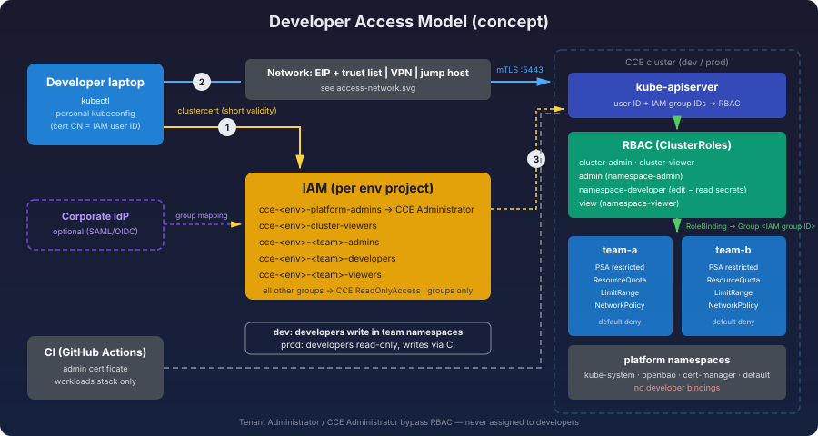
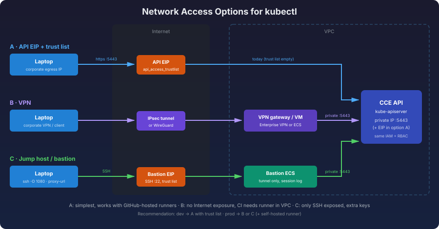

# Developer Access Model (Concept)

How developers can use `kubectl` from their laptops against the CCE clusters, restricted to their team namespaces. **Concept only — nothing in this document is implemented yet.** The current state and a sketch for a later implementation are included.

## Contents

- [Architecture](#architecture)
- [Current State](#current-state)
- [Goals and Decisions](#goals-and-decisions)
- [Layers](#layers)
- [Identity and Authentication (IAM)](#identity-and-authentication-iam)
- [Authorization (Kubernetes RBAC)](#authorization-kubernetes-rbac)
- [Role Matrix dev / prod](#role-matrix-dev--prod)
- [Team Namespaces and Guardrails](#team-namespaces-and-guardrails)
- [Network Access Options](#network-access-options)
- [Developer Workflow](#developer-workflow)
- [Automation and Break-Glass](#automation-and-break-glass)
- [Audit](#audit)
- [Risks and Limitations](#risks-and-limitations)
- [Alternatives](#alternatives)
- [Implementation Sketch (future)](#implementation-sketch-future)
- [References](#references)

## Architecture



## Current State

| Aspect | Today |
|---|---|
| Identities | One: the **admin client certificate** of the cluster creator (`certificate_users[0]` of `opentelekomcloud_cce_cluster_v3`), exposed as infra output `kubeconfig` and used by the workloads stack / CI → full `cluster-admin` |
| Authorization | `authentication_mode = "rbac"` is set, but there are no RBAC bindings for humans |
| Namespaces | Workloads run in `default`, `openbao`, `cert-manager` — no team namespaces |
| Network | API EIP bound (`bind_api_eip = true`) in dev and prod, `api_access_trustlist = []` → reachable from the whole Internet |

Handing out the admin kubeconfig to developers would give every developer full control of the cluster, without individual audit trail and without a way to revoke a single person.

## Goals and Decisions

| Topic | Decision |
|---|---|
| Identity source | **CCE-native IAM**: IAM users (optionally federated from the corporate IdP), grouped in IAM user groups |
| Credentials | Personal kubeconfig/X.509 certificate issued by CCE per IAM user, short validity |
| Authorization | Kubernetes RBAC; subjects are **IAM group IDs** |
| Namespace cut | One namespace per team/project (`team-<name>`) |
| Roles | `cluster-admin`, `cluster-viewer`, `namespace-admin`, `namespace-developer`, `namespace-viewer` |
| Environments | dev: developers may write in their team namespaces; prod: developers read-only, changes only via CI |
| Network | Options documented below; no change for now |

## Layers

| # | Layer | Question | Mechanism |
|---|---|---|---|
| 1 | Network | Can the laptop reach `:5443` at all? | API EIP + `api_access_trustlist`, VPN or jump host |
| 2 | Authentication | Who is it? | Client certificate in the personal kubeconfig (CN = IAM user ID), issued by CCE |
| 3 | IAM authorization | May the user get a kubeconfig / use CCE APIs? | IAM roles (`CCE ReadOnlyAccess`, `CCE FullAccess`, `CCE Administrator`) |
| 4 | Kubernetes authorization | What may the user do in the cluster? | RBAC `RoleBinding` / `ClusterRoleBinding` to IAM group IDs |
| 5 | Guardrails | What may workloads do, how much may they use? | ResourceQuota, LimitRange, Pod Security Admission, NetworkPolicy |

## Identity and Authentication (IAM)

### IAM roles decide whether RBAC applies

CCE combines IAM and Kubernetes RBAC. The IAM role determines whether RBAC is enforced at all:

| IAM role of the user | Kubernetes permissions |
|---|---|
| `Tenant Administrator` | **Full access to all namespaces** — RBAC is bypassed |
| `CCE Administrator` | **Full access to all namespaces** — RBAC is bypassed |
| `CCE FullAccess` / `CCE ReadOnlyAccess` | Only what Kubernetes RBAC grants |

Consequence: developers must **never** get `Tenant Administrator` or `CCE Administrator` in a project with a cluster. `CCE ReadOnlyAccess` is enough to see the cluster in the console and download a personal kubeconfig. The CI user (AK/SK in GitHub) keeps its broad roles but is not used by humans.

### IAM user groups

One IAM group per environment and role, or per environment, team and role for namespace-scoped roles. Users are only added to groups, never bound individually (federated users get a new ID per login, see [Risks](#risks-and-limitations)).

| IAM group | IAM role (project of the env) | Kubernetes binding |
|---|---|---|
| `cce-<env>-platform-admins` | `CCE Administrator` | none needed (bypasses RBAC); optional `cluster-admin` binding for clarity |
| `cce-<env>-cluster-viewers` | `CCE ReadOnlyAccess` | `ClusterRoleBinding` → `cluster-viewer` |
| `cce-<env>-<team>-admins` | `CCE ReadOnlyAccess` | `RoleBinding` in `team-<team>` → `admin` (namespace-admin) |
| `cce-<env>-<team>-developers` | `CCE ReadOnlyAccess` | `RoleBinding` in `team-<team>` → `namespace-developer` |
| `cce-<env>-<team>-viewers` | `CCE ReadOnlyAccess` | `RoleBinding` in `team-<team>` → `view` |

With a federated IdP (SAML/OIDC → IAM identity provider), the IdP group claims are mapped to these IAM groups via the identity provider's mapping rules; group membership is then managed in the corporate directory.

### Personal kubeconfig

Each user downloads their own kubeconfig (console: cluster → *Overview* → *Connection Information* → *kubectl*, or API `POST /api/v3/projects/{project_id}/clusters/{cluster_id}/clustercert`). The client certificate's CN is the IAM user ID; CCE resolves the user's IAM groups and evaluates RBAC against user ID and group IDs.

Validity is selectable (`duration` in days, `duration_minutes`, or `expire_at`; minimum 15 minutes, maximum 5 years). **Recommendation: dev ≤ 30 days, prod ≤ 1 day.**

```bash
# Short-lived kubeconfig via API (IAM token of the developer)
curl -s -X POST \
  -H "X-Auth-Token: $OS_TOKEN" -H "Content-Type: application/json" \
  -d '{"duration_minutes": 480}' \
  "https://cce.eu-de.otc.t-systems.com/api/v3/projects/$PROJECT_ID/clusters/$CLUSTER_ID/clustercert" \
  > ~/.kube/cce-dev.json
```

The returned kubeconfig contains an `internal` and (with EIP) an `external` context. Note that the external cluster entry is generated with `insecure-skip-tls-verify: true`; replace it with the cluster CA (`cluster_ca_cert`) where possible.

#### Option: `otc-auth` CLI

Instead of console download or raw API calls, developers can use [`otc-auth`](https://github.com/iits-consulting/otc-auth) (open-source Go CLI, GPL-3.0, used as a tool only). It handles the IAM login — including MFA, or SSO via an external IdP (SAML/OIDC) — and fetches the CCE kubeconfig with a chosen validity, merging it into the local `~/.kube/config`.

```bash
# Login: IAM user with MFA ...
otc-auth login iam --os-domain-name <domain> --os-user-id <user-id> --os-password <pw> --totp <code> --region eu-de
# ... or SSO via the corporate IdP (federated users, see IAM groups above)
otc-auth login idp-oidc --idp-name <idp> --idp-url <url> --client-id <client-id> --os-domain-name <domain> --region eu-de

# Personal kubeconfig, valid 1 day (default 7), merged into ~/.kube/config
otc-auth cce list --os-domain-name <domain> --region eu-de --os-project-name <project>
otc-auth cce get-kube-config --os-domain-name <domain> --region eu-de --os-project-name <project> \
  --cluster <cluster> --days-valid 1
```

| | Console / `clustercert` API | `otc-auth` |
|---|---|---|
| Login | browser / IAM token by hand | IAM + MFA or IdP SSO from the CLI |
| Validity | free (15 min – 5 years) | in days (`--days-valid`, default 7) |
| kubeconfig handling | manual (file per env) | merged automatically |
| Extra tool | none | one binary per laptop (brew/apt/rpm) |

Recommended for daily use, especially with a federated IdP; the console/API path stays available as fallback. `--server` overrides the API server address (e.g. private IP for the VPN/jump-host options).

## Authorization (Kubernetes RBAC)

### Roles

| Role | Kind / binding | Based on | Scope | Can | Cannot |
|---|---|---|---|---|---|
| `cluster-admin` | built-in, platform team | `cluster-admin` | cluster | everything | — |
| `cluster-viewer` | custom `ClusterRole`, `ClusterRoleBinding` | `view` + cluster-scoped reads | cluster | read workloads in all namespaces, nodes, namespaces, PVs, StorageClasses, CRDs | read Secrets, write anything |
| `namespace-admin` | built-in `admin`, `RoleBinding` | `admin` | team namespace | all namespaced resources incl. Secrets, Roles/RoleBindings inside the namespace | cluster-scoped resources, quotas, other namespaces |
| `namespace-developer` | custom `ClusterRole`, `RoleBinding` | like `edit` | team namespace | Deployments, Pods, Services, Ingresses, ConfigMaps, Jobs, PVCs, `exec`/`port-forward`/logs; **create/update** Secrets | **read** Secrets, RBAC, quotas |
| `namespace-viewer` | built-in `view`, `RoleBinding` | `view` | team namespace | read most resources, logs | Secrets, `exec`, writes |

Built-in `edit` already excludes Roles/RoleBindings but allows reading Secrets. `namespace-developer` is therefore a custom role: `edit` without `get`/`list`/`watch` on Secrets. Secrets should preferably come from OpenBao (agent injector / CSI) anyway, see [demo-app.md](demo-app.md).

### Example manifests

```yaml
# Cluster-wide definition, bound per namespace via RoleBinding
apiVersion: rbac.authorization.k8s.io/v1
kind: ClusterRole
metadata:
  name: namespace-developer
rules:
  - apiGroups: ["", "apps", "batch", "autoscaling", "networking.k8s.io", "policy"]
    resources:
      - pods
      - pods/log
      - pods/exec
      - pods/portforward
      - pods/attach
      - deployments
      - deployments/scale
      - replicasets
      - statefulsets
      - daemonsets
      - jobs
      - cronjobs
      - services
      - endpoints
      - configmaps
      - persistentvolumeclaims
      - serviceaccounts
      - horizontalpodautoscalers
      - ingresses
      - networkpolicies
      - poddisruptionbudgets
    verbs: ["get", "list", "watch", "create", "update", "patch", "delete", "deletecollection"]
  - apiGroups: [""]
    resources: ["secrets"]
    verbs: ["create", "update", "patch", "delete"] # write-only: kubectl create works, kubectl apply (needs get) does not
  - apiGroups: [""]
    resources: ["events", "resourcequotas", "limitranges"]
    verbs: ["get", "list", "watch"]
---
apiVersion: rbac.authorization.k8s.io/v1
kind: ClusterRole
metadata:
  name: cluster-viewer
aggregationRule:
  clusterRoleSelectors:
    - matchLabels:
        rbac.authorization.k8s.io/aggregate-to-view: "true"
    - matchLabels:
        rbac.example.com/aggregate-to-cluster-viewer: "true" # example prefix, use your own domain
rules: [] # filled by the aggregation controller
---
apiVersion: rbac.authorization.k8s.io/v1
kind: ClusterRole
metadata:
  name: cluster-viewer-extras
  labels:
    rbac.example.com/aggregate-to-cluster-viewer: "true" # example prefix, use your own domain
rules:
  - apiGroups: [""]
    resources: ["nodes", "namespaces", "persistentvolumes"]
    verbs: ["get", "list", "watch"]
  - apiGroups: ["storage.k8s.io", "apiextensions.k8s.io"]
    resources: ["storageclasses", "customresourcedefinitions"]
    verbs: ["get", "list", "watch"]
---
# Team binding: IAM group "cce-dev-payments-developers" → namespace team-payments
apiVersion: rbac.authorization.k8s.io/v1
kind: RoleBinding
metadata:
  name: developers
  namespace: team-payments
  annotations:
    CCE.com/IAM: "true"
roleRef:
  apiGroup: rbac.authorization.k8s.io
  kind: ClusterRole
  name: namespace-developer
subjects:
  - apiGroup: rbac.authorization.k8s.io
    kind: Group
    name: 0c96fad22880f32a3f84c009862af6f7 # IAM group ID, not the name
```

`kind: User` with the IAM user ID works as well, but bind groups only. The CCE console (*Permissions* → *Add Permission*) creates equivalent bindings, but bindings managed by OpenTofu are reproducible and reviewable.

## Role Matrix dev / prod

| Persona | dev | prod |
|---|---|---|
| Platform team | `CCE Administrator` (≙ `cluster-admin`) | `CCE Administrator`, personal use only for incidents; changes via CI |
| Team lead / namespace owner | `namespace-admin` in own namespace(s) | `namespace-viewer` in own namespace(s) |
| Developer | `namespace-developer` in own namespace(s) | `namespace-viewer` in own namespace(s) |
| Stakeholder / QA | `namespace-viewer` | `namespace-viewer` (optional) |
| Ops / on-call (read-only overview) | `cluster-viewer` | `cluster-viewer` |
| CI (GitHub Actions) | admin certificate (today) | admin certificate (today) |

In prod, nobody except CI writes into the cluster. Writes needed for incidents use the [break-glass](#automation-and-break-glass) path.

## Team Namespaces and Guardrails

Each team namespace gets the same baseline:

| Object | Purpose | Suggested default |
|---|---|---|
| Labels | ownership and selectors | `team=<name>`, `env=<env>` |
| Pod Security Admission | no privileged pods, no hostPath/hostNetwork | `pod-security.kubernetes.io/enforce: restricted` (or `baseline` if needed) |
| ResourceQuota | cluster resources stay shared fairly; important for the GPU pool | CPU/memory requests/limits, `pods`, `services.loadbalancers: 0`, `requests.nvidia.com/gpu: 0` unless granted |
| LimitRange | defaults for containers without requests/limits | e.g. 100m/128Mi request, 1/1Gi limit |
| NetworkPolicy | isolate teams from each other | default-deny ingress, allow from same namespace and from the ingress controller (`kube-system`), allow DNS egress |

Developers must not be able to change these objects: `namespace-developer` only reads quotas/limit ranges; `namespace-admin` (built-in `admin`) can edit NetworkPolicies but not ResourceQuotas or namespace labels (Pod Security). If teams must not change NetworkPolicies either, remove `networkpolicies` from the developer role and bind a custom role instead of `admin`.

Platform namespaces (`kube-system`, `openbao`, `cert-manager`, `monitoring`, `default`) are never bound to developers.

## Network Access Options

All options use the same identity and RBAC model; they only decide how the laptop reaches the API server (`:5443`).



### Option A — Public API EIP (status quo)

`bind_api_eip = true`; kubectl talks to `https://<eip>:5443` directly.

- Restrict with `api_access_trustlist` (CIDRs of the corporate Internet egress / VPN egress, GitHub-hosted runners are **not** a fixed range → requires self-hosted runners or larger trust lists).
- Simplest, works for CI as is, no extra infrastructure.
- API server exposed to the Internet; protection relies on mTLS + trust list.

```hcl
# infra/envs/dev.tfvars
bind_api_eip         = true
api_access_trustlist = ["203.0.113.0/24"] # corporate egress
```

### Option B — VPN into the VPC

API internal only (`bind_api_eip = false`), laptops reach the VPC via VPN.

| Variant | How | Notes |
|---|---|---|
| Site-to-site (Enterprise VPN) | Corporate network ↔ VPC via IPsec (`opentelekomcloud_enterprise_vpn_*` / `vpnaas_*` resources) | Developers use the normal corporate VPN; route the VPC CIDR to the tunnel; no per-user client |
| Client VPN (self-managed) | WireGuard/OpenVPN on a small ECS in the VPC | Per-user VPN keys (separate lifecycle from IAM); needs its own HA/patching |

- API not reachable from the Internet at all.
- Kubeconfig context `internal` (private API IP); DNS optional.
- CI needs a path into the VPC as well: self-hosted runner in the VPC (or runner network with VPN). `create_workload_identity` currently requires the public API for fetching the JWKS (validation in `infra/variables.tf`) — this would have to be decoupled (fetch JWKS from inside the VPC).

### Option C — Jump host / bastion

A hardened ECS with EIP in the VPC; only SSH is exposed. Same pattern as the existing OpenBao bastion (`infra/modules/openbao/bastion.tf`: own security group, `bastion_ssh_allowed_cidrs`).

```bash
# SOCKS tunnel, kubectl uses it via proxy-url
ssh -N -D 1080 bastion@<bastion-eip> &
kubectl config set-cluster cce-prod --proxy-url=socks5://localhost:1080 \
  --server=https://<private-api-ip>:5443
```

- API internal; only SSH (port 22) exposed, trust list on SSH.
- SSH keys are a second identity to manage (or SSH certificates, e.g. signed by OpenBao's SSH secrets engine with short TTL).
- Session logging on the bastion possible; extra VM to patch.
- No kubectl state on the bastion — tunnel only, the personal kubeconfig stays on the laptop.

### Comparison

| Criterion | A: EIP + trust list | B: VPN | C: Jump host |
|---|---|---|---|
| Internet exposure of the API | yes (trust list limits it) | none | none (SSH only) |
| Extra infrastructure | none | VPN gateway or VPN VM | bastion VM |
| Cost | API EIP bandwidth | VPN gateway / VM | small ECS + EIP |
| Ops effort | low | medium–high | medium |
| CI (GitHub-hosted runners) | works (if trust list allows) | needs self-hosted runner/VPN | needs tunnel or self-hosted runner |
| Developer UX | best | good (corporate VPN) | tunnel step needed |
| Extra credentials | none | VPN keys (client variant) | SSH keys/certs |
| Audit | CTS + apiserver audit | + VPN logs | + SSH/session logs |

**Recommendation:** dev — A with `api_access_trustlist` set to the corporate egress ranges. prod — B (site-to-site, if the corporate network allows it) or C; together with a self-hosted runner in the VPC for the workloads stack. Until then: A with a trust list in prod as well.

## Developer Workflow

1. **Request access** — ticket/PR naming team, environment and role → platform team (or IdP group owner) adds the user to `cce-<env>-<team>-<role>`.
2. **Network** — be on a trusted network (A), connect VPN (B) or open the tunnel (C).
3. **Get kubeconfig** — `otc-auth cce get-kube-config --days-valid …` (see [option](#option-otc-auth-cli)), CCE console or `clustercert` API with short validity; store it per environment (`~/.kube/cce-dev.json`) and use `KUBECONFIG` or contexts.
4. **Set default namespace** — `kubectl config set-context --current --namespace team-<name>`.
5. **Verify** — `kubectl auth can-i --list -n team-<name>`.
6. **Renew** — download a new kubeconfig when the certificate expires.
7. **Offboarding** — remove the user from all IAM groups **and** revoke the credential (console → *Connection Information* → *Revoke*, select the user). Certificates stay valid after user deletion unless revoked.

## Automation and Break-Glass

- The admin certificate (infra output `kubeconfig`) is for the OpenTofu workloads stack/CI only. It is never handed to humans; local use is limited to the platform team during bootstrap.
- Future: give CI its own IAM user/agency with a dedicated binding instead of the cluster creator's certificate, and fetch short-lived kubeconfigs per run (`opentelekomcloud_cce_cluster_kubeconfig_v3` / `clustercert` with `duration_minutes`).
- **Break-glass (prod):** a dedicated IAM group `cce-prod-breakglass` with `CCE Administrator`, empty by default; membership is granted temporarily by the platform team, logged via CTS, removed afterwards, and the issued kubeconfig is revoked.

## Audit

| What | Where |
|---|---|
| IAM changes (group membership, role assignments), kubeconfig downloads, credential revocation | CTS (`create_cts_tracker`), see [logging.md](logging.md) |
| Kubernetes API calls per user (who did `exec`, `delete`, …) | kube-apiserver audit logs — enable CCE control plane audit logs → LTS (not configured in this repo yet) |
| Network access | VPC flow logs (`logging.tf`), VPN/bastion logs for options B/C |

The CN of the client certificate is the IAM user ID, so apiserver audit entries can be mapped to people via IAM.

## Risks and Limitations

| Risk | Mitigation |
|---|---|
| Kubeconfig certificates remain valid after removing a user from a group or deleting the user | Short validity; revoke credentials on offboarding |
| Federated users get a new user ID per login | Bind only IAM **groups**; never bind federated user IDs |
| `Tenant Administrator` / `CCE Administrator` bypass RBAC | Never assign to developers; review IAM group roles regularly |
| `pods/exec` and mounting Secrets in pods expose Secret values despite no `get secrets` | Accept for dev; prod is read-only; secrets from OpenBao with per-namespace policies |
| `namespace-admin` can create RoleBindings in its namespace | Only up to its own permissions (RBAC escalation prevention); keep the group small |
| Public API EIP with empty trust list | Set `api_access_trustlist` (option A) or move to B/C |
| Kubeconfig from the console may contain `insecure-skip-tls-verify` for the external context | Replace with the cluster CA |
| Downloaded kubeconfigs on laptops | Disk encryption, no copies in repos/chats; short validity |

## Alternatives

| Alternative | Idea | Why not now |
|---|---|---|
| OIDC via Dex (CCE supports OIDC authentication with Dex, cluster ≥ v1.30.14-r0) | Login with corporate IdP / LDAP, ID tokens instead of certificates, groups from IdP claims | Extra components (Dex, authenticator) with public endpoints; IAM-native is enough for the POC |
| OpenBao Kubernetes secrets engine | Developers log in to OpenBao (OIDC/userpass) and get short-lived ServiceAccount tokens bound to a namespace | Elegant short-lived access, but OpenBao becomes critical for cluster access; good follow-up for prod/break-glass |
| CCE console only | No kubectl, permissions via console | Not what developers want |

## Implementation Sketch (future)

Not implemented. A possible split that fits the existing stacks:

| Stack | Resources |
|---|---|
| `infra` | IAM groups per env/team/role (`opentelekomcloud_identity_group_v3`), role assignments (`opentelekomcloud_identity_role_assignment_v3`: `CCE ReadOnlyAccess` / `CCE Administrator` on the env project), optional IdP mapping rules; `api_access_trustlist` per env; outputs: group IDs |
| `workloads` | Namespaces with labels + PSA, ResourceQuota, LimitRange, default NetworkPolicies, ClusterRoles `namespace-developer` / `cluster-viewer`, RoleBindings/ClusterRoleBindings using the IAM group IDs from `terraform_remote_state.infra` |

Example input (both stacks read the same map per environment):

```hcl
# envs/dev.tfvars
access_teams = {
  payments = {
    quota = { cpu = "8", memory = "16Gi", gpu = "0" }
    # access level per role group: admin | developer | viewer
    roles = { admins = "admin", developers = "developer", viewers = "viewer" }
  }
  ml = {
    quota = { cpu = "16", memory = "64Gi", gpu = "1" }
    roles = { admins = "admin", developers = "developer", viewers = "viewer" }
  }
}
access_cluster_viewers = true
# prod.tfvars: same teams, but roles = { admins = "viewer", developers = "viewer", viewers = "viewer" }
```

Group membership stays outside OpenTofu (IAM console or IdP), so onboarding does not require a deploy.

## References

- [CCE: Permissions Overview](https://docs.otc.t-systems.com/cloud-container-engine/umn/permissions/permissions_overview.html)
- [CCE: Configuring Namespace Permissions (Kubernetes RBAC-based)](https://docs.otc.t-systems.com/cloud-container-engine/umn/permissions/namespace_permissions_kubernetes_resource_permissions/configuring_namespace_permissions_kubernetes_rbac-based.html)
- [CCE: Accessing a Cluster Using kubectl](https://docs.otc.t-systems.com/cloud-container-engine/umn/clusters/accessing_a_cluster/accessing_a_cluster_using_kubectl.html)
- [CCE: Revoking a Cluster Access Credential](https://docs.otc.t-systems.com/cloud-container-engine/umn/clusters/accessing_a_cluster/revoking_a_cluster_access_credential.html)
- [CCE: Configuring a Cluster's API Server for Internet Access](https://docs.otc.t-systems.com/cloud-container-engine/umn/clusters/accessing_a_cluster/configuring_a_clusters_api_server_for_internet_access.html)
- [CCE API: Obtaining Cluster Certificates (`clustercert`)](https://docs.otc.t-systems.com/cloud-container-engine/api-ref/apis/cluster_management/obtaining_cluster_certificates.html)
- [otc-auth CLI (iits-consulting)](https://github.com/iits-consulting/otc-auth)
- [CCE: Dex OIDC Authentication on CCE](https://docs.otc.t-systems.com/cloud-container-engine/umn/permissions/external_user_authentication/dex_oidc_authentication_on_cce.html)
- [Kubernetes: Using RBAC Authorization](https://kubernetes.io/docs/reference/access-authn-authz/rbac/)
- [Kubernetes: Pod Security Admission](https://kubernetes.io/docs/concepts/security/pod-security-admission/)
