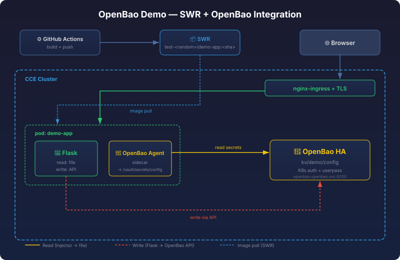

# Demo App

A Python web app ("OpenBao Demo") that reads and writes secrets from OpenBao, demonstrating the full SWR → CCE → OpenBao integration.

## Architecture



## What It Shows

- **OpenBao Agent Injector** — the sidecar renders all keys of `kv/demo/config` into a file (re-rendered every 30s)
- **Live vs. injected** — each key shows the live API value next to the injected file value, with a sync indicator (header pill: *Sidecar in sync* / *catching up* / *unreachable*)
- **Edit secrets** — change values, add new keys, delete keys; every save creates a new KV v2 version
- **Check-and-set** — saves use `cas=<current version>`, so concurrent edits are rejected instead of silently overwritten
- **Version history** — timeline of the last 10 versions with one-click *Restore* (writes the old data as a new version)
- **SWR** — container image hosted on OTC Software Repository for Container

| Component | Version |
|---|---|
| Base image | `python:3.15-slim` |
| Flask | 3.1.3 |
| gunicorn | 27.0.1 |
| requests | 2.34.2 |

## Prerequisites

- Infra deployed (`tofu apply` in `infra/` — creates the SWR organization `test-<random>`, see output `swr_organization`)
- OpenBao initialized and unsealed (see [OpenBao docs](openbao.md))

## Setup

### Option A: Script (recommended)

```bash
./scripts/demo-app-openbao-setup.sh
```

Checks OpenBao health, logs in via userpass, creates the policy `demo-app` (read/write `kv/data/demo/*`, read `kv/metadata/demo/*` for the history) and the Kubernetes role `demo-app`, and seeds `kv/demo/config` only if it does not already exist. Run it once after OpenBao initialization (manual one-time step, not part of the pipeline).

### Option B: Manual

#### 1. Create OpenBao policy + role

```bash
bao policy write demo-app - <<EOF
path "kv/data/demo/*" {
  capabilities = ["create", "read", "update", "list"]
}
path "kv/metadata/demo/*" {
  capabilities = ["read", "list"]
}
EOF

bao write auth/kubernetes/role/demo-app \
  bound_service_account_names=demo-app \
  bound_service_account_namespaces=default \
  policies=demo-app \
  ttl=1h
```

#### 2. Seed secrets (optional — can also be done via web UI)

```bash
bao kv put kv/demo/config \
  message="Hello from OpenBao 🔐" \
  api_key="sk-demo-1234567890"
```

### Build + Deploy

The deploy workflow handles everything automatically:

1. **infra** — creates SWR organization
2. **build-images** — builds Docker image, pushes it to SWR as `:<commit-sha>` and `:latest` (optional; required on a fresh SWR organization)
3. **apps** — deploys Helm chart with injector annotations; after a build it rolls out the new `:<commit-sha>` tag, otherwise it keeps the deployed tag (`demo_app_image_tag`)

The Helm deployment does not wait for the demo pod to become ready: on a fresh cluster, initialize OpenBao and run the setup script above before checking the demo rollout.

Pod annotations (the injector shipped with the OpenBao chart is vault-k8s and only understands the `vault.hashicorp.com/*` keys):

```yaml
annotations:
  vault.hashicorp.com/agent-inject: "true"
  vault.hashicorp.com/role: "demo-app"
  vault.hashicorp.com/agent-inject-secret-config: "kv/data/demo/config"
  vault.hashicorp.com/template-static-secret-render-interval: "30s"
  vault.hashicorp.com/agent-inject-template-config: |
    {{- with secret "kv/data/demo/config" -}}
    {{- range $k, $v := .Data.data }}
    {{ $k }}={{ $v }}
    {{ end }}
    {{- end }}
```

To build locally:

```bash
# Login (generate HMAC key from AK/SK)
LOGIN_KEY=$(printf "$AK" | openssl dgst -binary -sha256 -hmac "$SK" | od -An -vtx1 | sed 's/[ \n]//g' | sed 'N;s/\n//')
docker login swr.eu-de.otc.t-systems.com -u "${TF_VAR_otc_project_name}@$AK" -p "$LOGIN_KEY"

# Build + push
cd apps/demo-app
TAG=$(git rev-parse HEAD)
ORG=$(tofu -chdir=../../infra output -raw swr_organization)
docker build -t swr.eu-de.otc.t-systems.com/$ORG/demo-app:$TAG .
docker push swr.eu-de.otc.t-systems.com/$ORG/demo-app:$TAG

# Roll out
cd ../..
tofu -chdir=apps apply -var demo_app_image_tag=$TAG
```

App available at `https://demo.<zone>` (e.g. https://demo.otc.nodefall.de). Output: `demo_app_url`.

## Security

The container runs as non-root user `10001` with a read-only root filesystem (writable `/tmp` via `emptyDir`), all capabilities dropped, no privilege escalation, the `RuntimeDefault` seccomp profile and CPU/memory requests and limits (`resources` in `apps/charts/demo-app/values.yaml`).

## How It Works

```
Browser → nginx-ingress → demo-app pod
                            ├── Flask container (port 5000)
                            │   ├── reads /vault/secrets/config (injected)
                            │   └── OpenBao API: live read, history, write with check-and-set
                            │       BAO_ADDR=http://openbao.openbao.svc:8200
                            └── openbao-agent sidecar
                                └── fetches kv/demo/config → file
```

1. **OpenBao Agent Sidecar** authenticates via Kubernetes ServiceAccount JWT
2. Fetches `kv/data/demo/config` and renders every key as `key=value` into `/vault/secrets/config` (path fixed by the injector), refreshed every 30s (`vault.hashicorp.com/template-static-secret-render-interval`)
3. Flask reads the file on each request and compares it with the live value from the API
4. For live reads, history and writes, Flask authenticates via OpenBao Kubernetes auth (role `demo-app`) and calls the KV v2 API at `BAO_ADDR`
