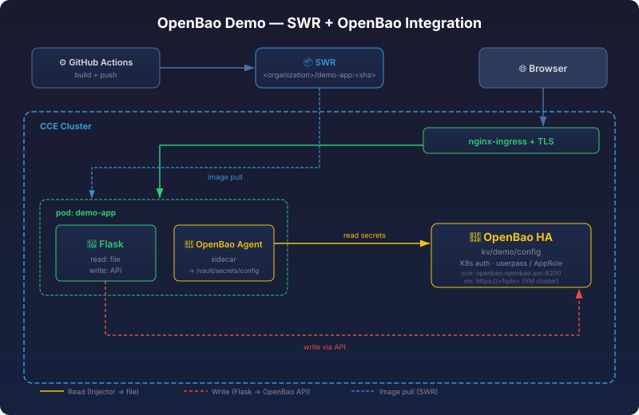

# Demo App

A Python web app ("OpenBao Demo") that reads and writes secrets from OpenBao, demonstrating the full SWR → CCE → OpenBao integration.

## Contents

- [Architecture](#architecture)
- [What It Shows](#what-it-shows)
- [Prerequisites](#prerequisites)
- [Setup](#setup)
- [Security](#security)
- [How It Works](#how-it-works)

## Architecture



## What It Shows

The page puts two ways of consuming the same secret side by side, with a small architecture diagram at the top:

| | ① Agent sidecar → file | ② Direct API (Kubernetes auth) |
|---|---|---|
| How | The injector adds an `openbao-agent` sidecar; it logs in, renders `kv/demo/config` as JSON into `/vault/secrets/config` and re-renders every `renderInterval` (30 s) | The app logs in with its ServiceAccount JWT (role `demo-app`), caches the client token until shortly before it expires and calls the KV v2 API |
| App code | reads a file — no OpenBao client, no tokens | HTTP client + token handling |
| Strengths | any language/config format; last file survives a short OpenBao outage | always current; write, versions, check-and-set, restore |
| Limits | read-only; changes arrive with up to one render interval delay | every read needs OpenBao |
| Shown on the page | file path, time of last change, read time, values | endpoint, version, token TTL left, read time, values |

- **Implementation variants** — select `agent` (only ①), `api` (only ②) or `both` with `demo_app_access_mode`
- **Compare ① vs ②** — per-key table with sync state; after a save the page shows that ② already returns the new version and polls until ① has picked it up (with the measured delay)
- **Edit secrets** — change values, add new keys, delete keys; every save creates a new KV v2 version
- **Check-and-set** — saves use `cas=<current version>`, so concurrent edits are rejected instead of silently overwritten
- **Version history** — timeline of the last 10 versions with one-click *Restore* (writes the old data as a new version)
- **SWR** — container image hosted on OTC Software Repository for Container

| Component | Version |
|---|---|
| Base image | `python:3.15-slim` |
| Flask | 3.1.3 |
| gunicorn | 27.0.1 |
| requests | 2.34.2 |

## Prerequisites

- Infra deployed (creates the name-prefixed SWR organization; see output `swr_organization`)
- OpenBao in `cce` or `vm` mode with `create_openbao = true` and `create_demo_app = true` in `workloads/envs/<env>.tfvars` (the release is skipped with `openbao_mode = "disabled"`)
- OpenBao initialized and unsealed: cce → `./scripts/openbao-init.sh` ([OpenBao on CCE](openbao.md)); vm → `sudo bao-init.sh` on the bastion ([OpenBao on VMs](openbao-vm.md))

| | cce mode | vm mode |
|---|---|---|
| `BAO_ADDR` in the pod | `http://openbao.openbao.svc:8200` | `openbao_vm_url` (`https://<fqdn>`, via CCE NAT EIP → OpenBao ELB) |
| Agent injector target | in-cluster server | `externalBaoAddr` = `openbao_vm_url` |
| TLS trust | — (in-cluster HTTP) | Let's Encrypt: system CAs; BYO: `openbao_vm_ca_cert` as ConfigMap `demo-app-bao-ca` (`REQUESTS_CA_BUNDLE`) and injector `AGENT_INJECT_VAULT_CACERT_BYTES` |
| Kubernetes auth config | `openbao-init.sh` (`kubernetes.default.svc`) | `demo-app-openbao-setup.sh` (public CCE API, CA, token reviewer JWT) |
| Setup login | userpass admin | AppRole `BAO_ROLE_ID`/`BAO_SECRET_ID` (or `BAO_TOKEN`) |

## Setup

### Option A: Script (recommended)

```bash
# cce mode: prompts for the userpass admin created by openbao-init.sh
./scripts/demo-app-openbao-setup.sh

# vm mode: AppRole printed by bao-init.sh; BAO_CACERT only with BYO TLS
export BAO_ROLE_ID=... BAO_SECRET_ID=...
./scripts/demo-app-openbao-setup.sh
```

Reads mode and URL from `tofu output` in `workloads/` (initialize it for your environment), checks OpenBao health and logs in with `BAO_TOKEN`, AppRole (`BAO_ROLE_ID`/`BAO_SECRET_ID`) or userpass. It enables KV v2 at `kv/` if missing; in vm mode it also enables and configures the Kubernetes auth method (`openbao_kubernetes_host`, `openbao_kubernetes_ca_cert`, `openbao_token_reviewer_jwt`). Then it creates the policy `demo-app` (read/write `kv/data/demo/*`, read `kv/metadata/demo/*` for the history) and the Kubernetes role `demo-app`, and seeds `kv/demo/config` only if it does not already exist. Run it once after OpenBao initialization (manual one-time step, not part of the pipeline).

### Option B: Manual

#### 1. Create OpenBao policy + role

```bash
bao policy write demo-app - <<EOF
path "kv/data/demo/*" {
  capabilities = ["create", "read", "update", "list"]
}
path "kv/metadata/demo/*" {
  capabilities = ["read", "list"]
}
EOF

bao write auth/kubernetes/role/demo-app \
  bound_service_account_names=demo-app \
  bound_service_account_namespaces=default \
  policies=demo-app \
  ttl=1h
```

#### 2. Seed secrets (optional — can also be done via web UI)

```bash
bao kv put kv/demo/config \
  message="Hello from OpenBao 🔐" \
  api_key="sk-demo-1234567890"
```

### Build + Deploy

The deploy workflow handles everything automatically:

1. **infra** — creates SWR organization
2. **build-images** — builds Docker image, pushes it to SWR as `:<commit-sha>` and `:latest` (optional; required on a fresh SWR organization)
3. **workloads** — deploys Helm chart; injector annotations are enabled for `agent`/`both`; after a build it rolls out the new `:<commit-sha>` tag, otherwise it keeps the deployed tag (`demo_app_image_tag`)

The Helm deployment does not wait for the demo pod to become ready: on a fresh cluster, initialize OpenBao and run the setup script above before checking the demo rollout.

Pod annotations (the injector shipped with the OpenBao chart is vault-k8s and only understands the `vault.hashicorp.com/*` keys):

```yaml
annotations:
  vault.hashicorp.com/agent-inject: "true"
  vault.hashicorp.com/role: "demo-app"
  vault.hashicorp.com/agent-inject-secret-config: "kv/data/demo/config"
  vault.hashicorp.com/template-static-secret-render-interval: "30s"
  vault.hashicorp.com/agent-inject-template-config: |
    {{- with secret "kv/data/demo/config" -}}{{ .Data.data | toJSON }}{{- end -}}
```

To build locally:

```bash
# Login (generate HMAC key from AK/SK)
SWR=$(tofu -chdir=infra output -raw swr_endpoint)
LOGIN_KEY=$(printf '%s' "$AK" | openssl dgst -binary -sha256 -hmac "$SK" | od -An -vtx1 | tr -d ' \n')
echo "$LOGIN_KEY" | docker login "$SWR" -u "${TF_VAR_otc_project_name}@$AK" --password-stdin

# Build + push
cd workloads/demo-app
TAG=$(git rev-parse HEAD)
ORG=$(tofu -chdir=../../infra output -raw swr_organization)   # infra initialized for the environment
docker build -t $SWR/$ORG/demo-app:$TAG .
docker push $SWR/$ORG/demo-app:$TAG

# Roll out
cd ../..
tofu -chdir=workloads apply -var-file=envs/dev.tfvars -var demo_app_image_tag=$TAG
```

App available at the configured `demo_app_hostname` under your DNS zone. Output: `demo_app_url`.

## Security

Forms (save, restore) carry a CSRF token bound to a `SameSite=Strict` session cookie; POSTs without it are rejected. The UI itself has no login — anyone who can reach the hostname can edit `kv/demo/config` (demo data only; the `demo-app` policy covers `kv/demo/*` only).

The container runs as non-root user `10001` with a read-only root filesystem (writable `/tmp` via `emptyDir`), all capabilities dropped, no privilege escalation, the `RuntimeDefault` seccomp profile and CPU/memory requests and limits (`resources` in `workloads/charts/demo-app/values.yaml`).

## How It Works

```
Browser → nginx-ingress → demo-app pod
                            ├── Flask container (port 5000)
                            │   ├── reads /vault/secrets/config (injected)
                            │   └── OpenBao API: live read, history, write with check-and-set
                            │       BAO_ADDR=http://openbao.openbao.svc:8200 (cce)
                            │                or https://<fqdn> (vm)
                            └── openbao-agent sidecar
                                └── fetches kv/demo/config → file
```

1. **OpenBao Agent Sidecar** authenticates via Kubernetes ServiceAccount JWT
2. Fetches `kv/data/demo/config` and renders the data as JSON into `/vault/secrets/config` (any value survives: multi-line, `=`, quotes) (path fixed by the injector), refreshed every 30s (`vault.hashicorp.com/template-static-secret-render-interval`)
3. Flask reads the file on each request and compares it with the live value from the API
4. For live reads, history and writes, Flask authenticates via OpenBao Kubernetes auth (role `demo-app`), caches the token (re-login shortly before expiry or on 403) and calls the KV v2 API at `BAO_ADDR`
