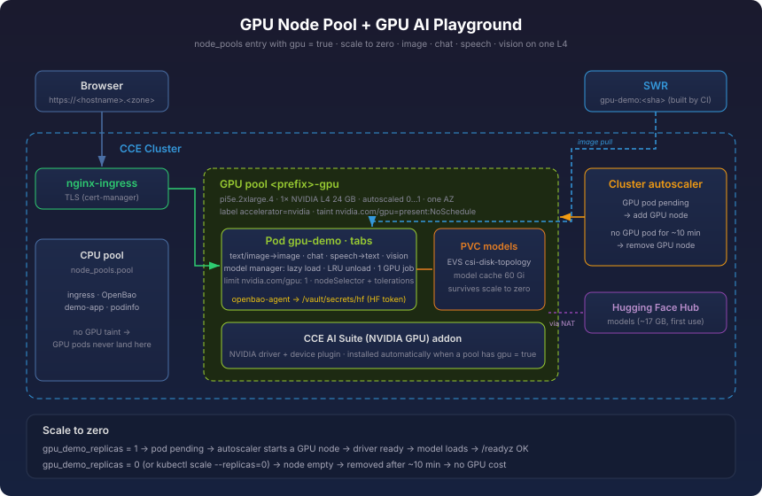
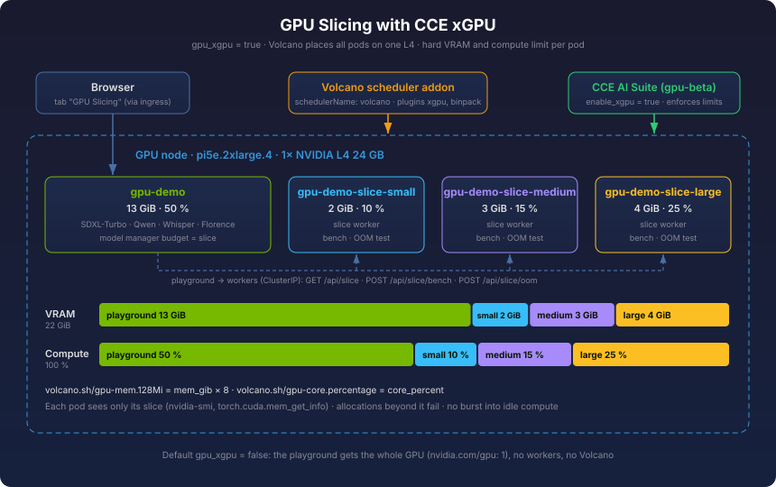

# GPU Node Pool + GPU Demo

An optional, autoscaling GPU node pool (a `node_pools` entry with `gpu = true`) and a **GPU AI Playground** that runs on it: text→image, image→image, chat, speech→text and image understanding, sharing one NVIDIA L4.

**URL:** configured `gpu_demo_hostname` under your DNS zone — output `gpu_demo_url`.

## Contents

- [Overview](#overview)
- [Enable](#enable)
- [Costs and Scale to Zero](#costs-and-scale-to-zero)
- [The Demo App](#the-demo-app)
  - [Hugging Face token](#hugging-face-token-optional-via-openbao)
  - [API](#api)
- [GPU Slicing](#gpu-slicing)
- [Troubleshooting](#troubleshooting)
- [License](#license)

## Overview



| Component | Value |
|---|---|
| Node flavor | `pi5e.2xlarge.4` — 1× NVIDIA L4 (24 GB), 8 vCPU, 32 GB RAM |
| Pool | `node_pools.gpu` → `<name_prefix>-gpu` (dev: `test-gpu`), 100 GB root volume |
| Node OS | HCE OS 2.0 (`node_os` unless the pool sets `os`) |
| AZ | `eu-de-01` (pool `az`; switch to `eu-de-03` if sold out) |
| Scaling | `min_count` 0 … `max_count` 1 (`autoscaling = true`), CCE autoscaler addon 1.35.8 |
| Taint / label | `nvidia.com/gpu=present:NoSchedule` / `accelerator=nvidia` (defaults for `gpu = true`; override with `taints` / `labels`) |
| GPU addon | CCE AI Suite (NVIDIA GPU), template `gpu-beta` 2.15.6 |
| NVIDIA driver | 580.196.07 (LTS branch, `nvidia_driver_url`; CUDA 13.x needs ≥ 580) |
| Demo image | `pytorch/pytorch:2.15.0-cuda13.2-cudnn9-runtime`, diffusers 0.43.0, FastAPI |
| Models | `gpu_demo_models`: image `stabilityai/sdxl-turbo`, chat `Qwen/Qwen2.5-3B-Instruct`, stt `openai/whisper-large-v3-turbo`, vision `florence-community/Florence-2-base` |

> CCE Turbo clusters (`container_network_type = "eni"`) only support the GPU flavor families `g7`, `pi5e` and `p5e`; the `node_pools` validation enforces this. At least one non-GPU pool is required.

## Enable

`infra/envs/<environment>.tfvars`:

```hcl
node_pools = {
  pool = { flavor = "s7n.xlarge.2", count = 3 }
  gpu = {
    flavor           = "pi5e.2xlarge.4" # 1x NVIDIA L4 24 GB
    gpu              = true             # GPU addon + NVIDIA label/taint defaults
    autoscaling      = true             # installs the cluster autoscaler
    min_count        = 0
    max_count        = 1
    az               = "eu-de-01"
    root_volume_size = 100              # driver installation needs headroom
  }
}
```

This is the dev configuration. Infra exposes `gpu_node_pool_enabled`, `gpu_node_selector` (labels of the first GPU pool) and `gpu_node_tolerations` (`Exists` tolerations for its taints); the `gpu-demo` release uses them as `nodeSelector` / `tolerations`, so custom labels/taints keep working.

`workloads/envs/<environment>.tfvars`:

```hcl
create_gpu_demo   = true
gpu_demo_replicas = 1   # 0 = GPU node is scaled down
```

Then run **Actions → Deploy** with "Apply" and "Build Images" (the GPU image is only built when the infra output `gpu_node_pool_enabled` is `true`). dev has the GPU pool and the demo enabled (`gpu_demo_replicas = 1`).

## Costs and Scale to Zero

A GPU node only exists while a GPU pod needs it:

- `gpu_demo_replicas = 1` → the pod is pending → the autoscaler creates the GPU node.
- `gpu_demo_replicas = 0` → the node becomes empty → the autoscaler removes it after ~10 minutes.

Quick toggle without a pipeline run:

```bash
kubectl scale deployment gpu-demo --replicas=0   # stop GPU node
kubectl scale deployment gpu-demo --replicas=1   # start GPU node
```

(The next Deploy resets it to `gpu_demo_replicas`.) With [GPU slicing](#gpu-slicing) the slice workers also run on the GPU node; `gpu_demo_replicas` scales them too, with kubectl scale them as well: `kubectl scale deployment -l app=gpu-demo-slice --replicas=0`.

**Cold start:** new node (~3–5 min) + NVIDIA driver installation (~5 min) + model load. The first start downloads the model (~7 GB; all tabs ~17 GB) into the PVC `gpu-demo-models` (`csi-disk-topology`, 60 Gi); later starts load it from disk. The PVC is bound to the AZ of the first GPU node and is kept when the release is removed (`helm.sh/resource-policy: keep`).

## The Demo App

One FastAPI app with tabs; all models share the single GPU:

| Tab | Model (default) | What it does | VRAM (est.) |
|---|---|---|---|
| Text → Image | SDXL-Turbo | prompt, 1–4 steps, seed, gallery | ~9 GB |
| Image → Image | SDXL-Turbo (same weights) | upload + prompt + strength | — (shared) |
| Chat | Qwen2.5-3B-Instruct | streamed answers (SSE), history in the browser, optional system prompt | ~7 GB |
| Speech → Text | Whisper large-v3-turbo | microphone (HTTPS) or upload, language auto/de/en, transcribe/translate | ~2 GB |
| Vision | Florence-2-base (native transformers port) | caption, detailed caption, OCR, object detection with boxes | ~1.5 GB |
| GPU | — | live utilisation, VRAM, temperature, power; loaded models with load/unload; CPU-vs-GPU matmul benchmark | — |
| GPU Slicing | — | only with [GPU slicing](#gpu-slicing): slices of the L4 per pod, parallel benchmark, isolation test; otherwise an explanation | — |

**Model manager:** SDXL-Turbo is preloaded (`PRELOAD`); the other models load on first use (the tab shows *loading*, the API answers `409` meanwhile). Before a load the least-recently-used idle model is unloaded if free VRAM is short (SDXL-Turbo is kept longest). Only one GPU job runs at a time; a second request gets `429 GPU busy`. All four models fit together on the L4 (~20 GB).

**Storage:** model downloads (~17 GB in total) are cached in the PVC `gpu-demo-models` (60 Gi, expandable); pod limit 28 Gi RAM.

**Security notes:** uploads are limited (image 10 MB, audio 25 MB / 5 min), only `image/*` and `audio/*` are accepted, temp files are removed. The vision model uses the native transformers implementation — no `trust_remote_code`; remote code only runs if you explicitly set a `microsoft/Florence-2-*` model (pin `VISION_MODEL_REVISION` to a commit then). Non-root (uid 10001), read-only root filesystem. The UI has no login.

### Hugging Face token (optional, via OpenBao)

Anonymous downloads work but are rate-limited. With a token the limit goes away:

1. Create a **Read** token at huggingface.co → *Settings → Access Tokens* and export it locally as `HUGGING_FACE_TOKEN` (or `HF_TOKEN`), e.g. via direnv.
2. Run `./scripts/gpu-demo-openbao-setup.sh` (same login options as `demo-app-openbao-setup.sh`). It stores the token at `kv/gpu-demo/hf` and creates the policy and Kubernetes auth role `gpu-demo`.
3. `kubectl rollout restart deployment/gpu-demo`

With `gpu_demo_openbao = true` (default, needs OpenBao) the pod uses the ServiceAccount `gpu-demo` and the OpenBao agent sidecar renders the token to `/vault/secrets/hf`; the app reads it before each model download. The token never appears in OpenTofu variables or state. The GPU tab shows whether a token is configured (never its value).

### API

```bash
H=https://aidemo.<your-domain>
curl -s $H/api/status | jq '.models'
curl -s $H/api/generate -H 'Content-Type: application/json' \
  -d '{"prompt":"a lighthouse in a storm","steps":2,"seed":7}' | jq -r .image | base64 -d > out.png
curl -s -X POST $H/api/models/chat/load                            # preload a model
curl -sN $H/api/chat -H 'Content-Type: application/json' \
  -d '{"messages":[{"role":"user","content":"Explain CCE in one sentence"}]}'   # SSE stream
curl -s $H/api/stt -F audio=@speech.wav -F language=de | jq -r .text
curl -s $H/api/vision -F image=@photo.jpg -F task=ocr | jq -r .text
curl -s $H/api/gpu | jq '.gpu'
```

## GPU Slicing



GPU slicing shares one physical GPU between several pods. The options:

| Option | Isolation | On this setup |
|---|---|---|
| Whole GPU (`nvidia.com/gpu: 1`) | full card per pod | default |
| Time-slicing (NVIDIA device plugin) | none — pods take turns, no VRAM or fault isolation | not offered by the CCE addon |
| MIG (Multi-Instance GPU) | hardware partitions | A100/H100/A30 only, **not the L4** |
| **CCE xGPU** | hard VRAM limit (128 MiB steps) and compute limit (percent) per pod, up to 20 slices per card | `gpu_xgpu = true` |

> **Not available on the L4 — therefore off in dev (`gpu_xgpu = false`).** Tested in dev (gpu-beta 2.15.6, HCE OS 2.0, driver 580): the device plugin reports `current gpu name is not supported, use legacy shared mode`, the node keeps `enableXGPU: false`, no `volcano.sh/gpu-*` resources appear and the slicing pods stay pending.

**Where xGPU works:** CCE xGPU supports only **NVIDIA Tesla T4 and V100**. Matching flavors in eu-de (all GPU flavors with availability: [gpu-flavors.md](gpu-flavors.md)):

| Flavor | GPU | vCPU / RAM | AZ (status at time of writing) |
|---|---|---|---|
| `pi2.2xlarge.4` | 1× T4 16 GB | 8 / 32 GB | eu-de-01, eu-de-03 |
| `pi2.4xlarge.4`, `pi2.8xlarge.4` | 2× / 4× T4 16 GB | 16 / 64 GB, 32 / 128 GB | eu-de-01, eu-de-03 |
| `p2s.2xlarge.8` (… `16xlarge`) | 1× (…8×) V100 PCIe 32 GB | 8 / 64 GB | eu-de-01 |
| `p2v.2xlarge.8` (… `16xlarge`) | 1× (…8×) V100 SXM2 16 GB | 8 / 64 GB | eu-de-01, eu-de-03 |

Not supported: L4 (`pi5e`), A40 (`g7`), A100 (`p3`), H100 (`p5e`, `p5s`). Availability changes; check with the ECS flavor API (`os_extra_specs`: `pci_passthrough:gpu_specs`, `cond:operation:az`).

**Consequences of switching to T4/V100:**

- **No CCE Turbo.** Turbo clusters (`container_network_type = "eni"`, as in dev/prod) only run the GPU families `g7`, `pi5e` and `p5e` (enforced by the `node_pools` validation; other network types also allow `pi2`, `p2s`, `p2v`). T4/V100 need a cluster with VPC network (`container_network_type = "vpc-router"` or `overlay_l2`). The network type cannot be changed later, so this means a **new cluster** (destroy and recreate the infra stack; pods no longer get VPC IPs from ENIs).
- **Less VRAM:** a T4 has 16 GB — the playground models need ~20 GB together, so models are swapped more often and the slices must be smaller (e.g. playground 9 GiB, workers 1–2 GiB, total ≤ ~14.5 GiB; adjust the `gpu_slicing` validation limit). The V100 PCIe has 32 GB but is only available in eu-de-01.
- **Older GPUs:** T4 (Turing) and V100 (Volta) are slower than the L4 and have no bf16 (the app falls back to fp16); SDXL-Turbo and the small models still work.
- **Driver/CUDA:** check that the NVIDIA driver (`nvidia_driver_url`) supports the card and that the image's CUDA version (13.x) still supports it.

CCE xGPU is part of the CCE AI Suite addon (`gpu-beta` ≥ 2.0.5, parameter `enable_xgpu`) and needs the **Volcano** scheduler addon (≥ 1.10.5, plugin `xgpu`). Pods set `schedulerName: volcano` and request

```yaml
resources:
  limits:
    volcano.sh/gpu-mem.128Mi: 16          # 2 GiB VRAM
    volcano.sh/gpu-core.percentage: 10    # 10 % of the compute time
```

Inside the pod the driver reports only the slice (`nvidia-smi`, `torch.cuda.mem_get_info()`); allocations beyond it fail without affecting the other pods. All other pods keep using the default scheduler.

**Enable** (both stacks, then Deploy with "Apply" and "Build Images"):

```hcl
# infra/envs/<environment>.tfvars
gpu_xgpu = true   # enable_xgpu in the GPU addon + Volcano addon (volcano_version, default 1.22.5)

# workloads/envs/<environment>.tfvars — optional, the default follows infra (output gpu_xgpu_enabled)
gpu_slicing = {
  playground = { mem_gib = 13, core_percent = 50 }
  workers = [
    { name = "small", mem_gib = 2, core_percent = 10 },
    { name = "medium", mem_gib = 3, core_percent = 15 },
    { name = "large", mem_gib = 4, core_percent = 25 },
  ]
}
```

With slicing, the playground runs in its own slice (the model manager keeps its VRAM budget inside `mem_gib` via `VRAM_LIMIT_GB`, so it unloads models earlier) and each worker is a small pod (`gpu-demo-slice-<name>`, same image, `MODE=slice-worker`, no models, no PVC, no ingress). The sum of all slices is validated against one L4 (≤ 22 GiB, ≤ 100 %). The **GPU Slicing** tab shows:

- the VRAM and compute split of the card per pod;
- per pod the slice as seen from inside (`mem_get_info`) and the last benchmark;
- **Run on all slices:** every pod runs fp16 matmuls for ~6 s at the same time — with enforced compute limits the throughput follows `core_percent`;
- **Isolation test** (workers only): allocates VRAM in 256 MiB steps until the driver refuses; it stops 1 GiB above the slice, so a missing limit is reported instead of starving the other pods.

API: `GET /api/slicing`, `POST /api/slicing/bench`, `POST /api/slicing/oom/<worker>`.

**Limits and checks after enabling:**

- Verify: `kubectl describe node -l accelerator=nvidia | grep volcano.sh` shows allocatable `volcano.sh/gpu-mem.128Mi`; the node annotation `node-status.volcano.sh/nvidia` contains `"enableXGPU":true`.
- xGPU support depends on GPU model (the L4 is not supported, see above), driver and OS (HCE OS 2.0 is supported; Ubuntu needs `enable_xgpu_support_ubuntu`). If the L4 or the driver is not supported, the slice resources never become allocatable and the pods stay pending — set `gpu_xgpu = false` again.
- **Scale to zero:** whether the autoscaler creates a GPU node for pending pods with `volcano.sh/*` requests is not guaranteed. If pods stay pending with zero GPU nodes, set `min_count = 1` on the GPU pool (the node then runs permanently and costs money) or scale the node up once.
- Without `enable_xgpu_burst` a slice cannot use idle compute of other slices, so a single benchmark also shows the cap.

## Troubleshooting

```bash
kubectl get nodes -l accelerator=nvidia                         # GPU node present?
kubectl describe pod -l app=gpu-demo | tail -20                 # pending reason / scale-up events
kubectl -n kube-system get pods | grep -E 'nvidia|autoscaler'   # GPU addon + autoscaler
kubectl logs deploy/gpu-demo                                    # model download / load
```

- **Pod pending, no scale-up:** GPU capacity in the AZ may be sold out → set `az = "eu-de-03"` on the GPU pool in `node_pools`.
- **`nvidia.com/gpu` not allocatable:** the driver is still installing (~5 min after the node is ready).
- **Slicing pods pending:** `kubectl get pods -l app=gpu-demo-slice`, `kubectl -n kube-system get pods | grep volcano`; see [GPU Slicing](#gpu-slicing).

## License

SDXL-Turbo is published under the Stability AI *Non-Commercial Research Community License*; Qwen2.5-3B-Instruct (Qwen Research License, non-commercial), Whisper (MIT) and Florence-2 (MIT) have their own licenses. That is fine for this POC; for other use cases set `gpu_demo_models.image` to a model with a suitable license (any `AutoPipelineForText2Image`-compatible model; adjust steps/guidance in `workloads/gpu-demo/app.py` for non-turbo models).
