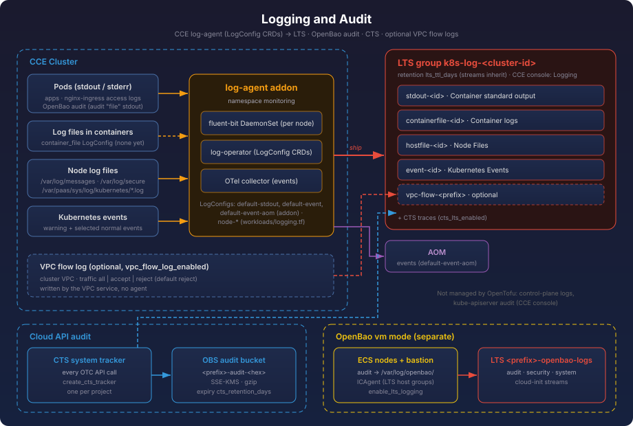

# Logging and Audit

## Contents

- [Architecture](#architecture)
- [What Goes Where](#what-goes-where)
- [Configuration](#configuration)
- [Viewing Logs](#viewing-logs)
- [OpenBao Audit](#openbao-audit)
- [Notes and Limits](#notes-and-limits)

## Architecture



## What Goes Where

Collection runs through the CCE **log-agent** addon (fluent-bit + log-operator + OTel collector), the successor of the legacy ICAgent. Collection rules are `LogConfig` resources (`logging.openvessel.io/v1`); the addon creates the defaults, `workloads/logging.tf` adds node log files. All cluster logs go to the LTS group `k8s-log-<cluster-id>` (retention `lts_ttl_days`, inherited by the streams).

| Source | How | Destination |
|---|---|---|
| Container stdout/stderr (all pods, incl. nginx-ingress access logs) | log-agent default LogConfig `default-stdout` | LTS stream `stdout-<cluster-id>` |
| Kubernetes events | log-agent default LogConfigs `default-event`, `default-event-aom` | LTS stream `event-<cluster-id>`, AOM |
| Node logs (`/var/log/messages` incl. kubelet/containerd, `/var/log/secure`, CCE agent logs) | `node_log_files` → `host_file` LogConfigs (`workloads/logging.tf`) | LTS stream `hostfile-<cluster-id>` |
| Log files inside containers | none yet (all workloads log to stdout); add a `container_file` LogConfig when needed | LTS stream `containerfile-<cluster-id>` |
| OpenBao audit (cce mode) | declarative `audit "file" "stdout"` in the server config (`openbao_audit_enabled`) | via stdout → LTS stream `stdout-<cluster-id>` (container `openbao`) |
| OpenBao audit/system (vm mode) | `audit "file"` to `/var/log/openbao/audit.log`, ICAgent on the ECS nodes | LTS group `<prefix>-openbao-logs` |
| Cloud API audit (who changed what in OTC) | CTS system tracker (`create_cts_tracker`) | KMS-encrypted OBS bucket `<prefix>-audit-<hex>` + LTS (`cts_lts_enabled`) |
| Network flows (optional) | `vpc_flow_log_enabled` | LTS stream `vpc-flow-<prefix>` |

## Configuration

| Stack | Variable | Default | dev | Description |
|---|---|---|---|---|
| infra | `create_lts` | `false` | `true` | LTS group + streams + log-agent addon |
| infra | `lts_ttl_days` | `7` | `7` | Retention of the group (streams inherit) |
| infra | `log_agent_version` | pinned | pinned | log-agent addon version or `"latest"` |
| infra | `create_cts_tracker` | `false` | `true` | CTS system tracker + KMS-encrypted OBS bucket |
| infra | `cts_retention_days` | `365` | `90` | Expiry of CTS files in OBS |
| infra | `cts_lts_enabled` | `false` | `true` | Also ship CTS traces to LTS |
| infra | `vpc_flow_log_enabled` | `false` | `false` | Flow log of the cluster VPC into `vpc-flow-<prefix>` |
| infra | `vpc_flow_log_traffic` | `reject` | — | `all`, `accept` or `reject` |
| infra | `openbao_vm.enable_lts_logging` / `lts_ttl_days` | `false` / `30` | `true` / `30` | vm mode: ICAgent + LTS group `<prefix>-openbao-logs` |
| workloads | `node_log_collection` | `true` | `true` | `host_file` LogConfigs for node logs |
| workloads | `node_log_files` | messages, secure, CCE agent logs | default | Map LogConfig name → `path` + `pattern` |
| workloads | `openbao_audit_enabled` | `true` | `true` | cce mode: declarative audit device to stdout |

Outputs: `lts_group_id`, `lts_hostfile_stream_id`, `cts_audit_bucket` (infra).

Additional node log files, e.g. in `workloads/envs/<env>.tfvars`:

```hcl
node_log_files = {
  "node-messages" = { path = "/var/log", pattern = "messages" }
  "node-audit"    = { path = "/var/log/audit", pattern = "audit.log" }
}
```

## Viewing Logs

| What | CCE console (cluster → *Logging* → *Data Plane Logs*) | LTS stream |
|---|---|---|
| App logs (demo-app, gpu-demo, podinfo, OpenBao) | *Container standard output*, filter namespace / workload | `stdout-<cluster-id>` |
| Log files inside containers | *Container logs* | `containerfile-<cluster-id>` |
| Node logs | *Node Files* | `hostfile-<cluster-id>` |
| Kubernetes events | *Kubernetes Events* | `event-<cluster-id>` |
| Cloud API audit | CTS console → *Trace List* | OBS bucket, LTS (with `cts_lts_enabled`) |

Live, without LTS:

```bash
kubectl logs deploy/demo-app -c demo-app -f
kubectl logs deploy/gpu-demo -f
kubectl -n openbao logs openbao-0 -c openbao | grep '"type":"request"'   # audit entries
kubectl get logconfigs -n kube-system                                    # active collection rules
```

## OpenBao Audit

- **cce mode**: `audit "file" "stdout"` in the server config (`workloads/openbao.tf`), so every request/response lands as JSON in the stdout stream. Secret values and tokens appear only as HMAC hashes. The StatefulSet uses `OnDelete`: after a config change restart the pods one by one (`openbao-2`, `openbao-1`, then `openbao-0`); auto-unseal brings them back. See [openbao.md](openbao.md#audit-log).
- **vm mode**: `audit "file"` to `/var/log/openbao/audit.log` on each ECS node; the ICAgent ships it to the `audit` stream of `<prefix>-openbao-logs`. See [openbao-vm.md](openbao-vm.md).

## Notes and Limits

- **CTS**: a project has exactly one system tracker; set `create_cts_tracker = false` if one already exists.
- **Not managed by OpenTofu**: CCE control-plane logs (kube-apiserver audit, scheduler, controller-manager) have no provider resource — enable them in the CCE console (*Logging → Control plane logs*) if needed. ELB access logs (`opentelekomcloud_lb_lts_log_v3`) require a dedicated ELB; with the shared ingress ELB, use the nginx-ingress access logs in the stdout stream.
- Alarms (LTS keyword alarms + SMN) are intentionally not configured.
- The legacy ICAgent is only used on the OpenBao ECS nodes (vm mode); the cluster uses the log-agent addon.
