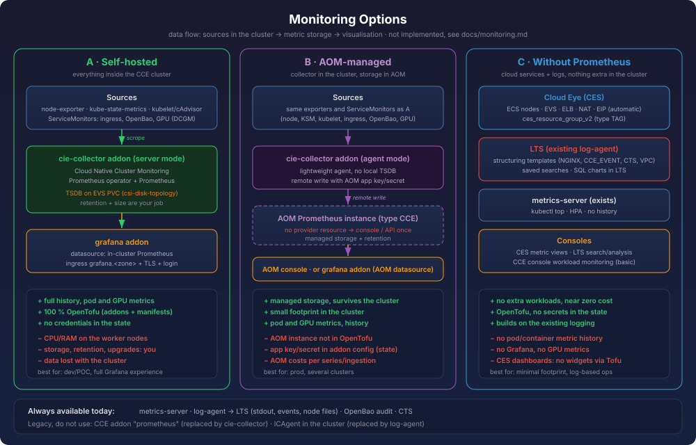

# Monitoring Options

> **Status:** decision document — none of the options below is implemented yet. Today the cluster has `metrics-server` and the logging described in [logging.md](logging.md).

## Contents

- [Current State](#current-state)
- [Options at a Glance](#options-at-a-glance)
- [Option A: Self-hosted Prometheus + Grafana](#option-a-self-hosted-prometheus--grafana)
- [Option B: AOM-managed Prometheus](#option-b-aom-managed-prometheus)
- [Option C: Without Prometheus (CES + LTS)](#option-c-without-prometheus-ces--lts)
- [Comparison](#comparison)
- [Recommendation](#recommendation)
- [What to Monitor](#what-to-monitor)
- [Legacy Components](#legacy-components)

## Current State

| Capability | Today | Gap |
|---|---|---|
| Resource usage now (`kubectl top`, HPA) | `metrics-server` addon | no history |
| Container logs, events, node logs | log-agent → LTS ([logging.md](logging.md)) | — |
| Audit (OpenBao, cloud API) | OpenBao audit device, CTS | — |
| Infrastructure metrics (ECS, EVS, ELB, NAT, EIP) | collected by Cloud Eye automatically | no grouped view |
| Pod/container metrics over time, Grafana, GPU metrics | — | needs Prometheus (A or B) |
| Application metrics (nginx-ingress, OpenBao telemetry) | exposed, not scraped | needs Prometheus (A or B) |

## Options at a Glance

All three options are possible with OpenTofu; they differ in where metrics are stored and what remains outside of code.

## Option A: Self-hosted Prometheus + Grafana

Everything runs inside the cluster: the CCE addon **Cloud Native Cluster Monitoring** (`cie-collector`, a packaged kube-prometheus-stack) in *server mode* stores metrics in a Prometheus TSDB on an EVS volume; the **grafana** addon visualises them.

**OpenTofu building blocks**

| Piece | Resource | Notes |
|---|---|---|
| Prometheus stack | `opentelekomcloud_cce_addon_v3` `cie-collector` | `deploy_mode = server`, `storage_class = csi-disk-topology`, `storage_size`, `retention`, flavor *Demo*/*Small*; version via the existing addon lookup in `modules/cce/addon-versions.tf` |
| Grafana | `opentelekomcloud_cce_addon_v3` `grafana` | Service ClusterIP, datasource = in-cluster Prometheus, anonymous access off |
| Access | `kubernetes_ingress_v1` + cert-manager | `grafana.<zone>` with Let's Encrypt; admin password from `random_password` in a Kubernetes secret |
| Scrape targets | `kubernetes_manifest` ServiceMonitor/PodMonitor | nginx-ingress controller, OpenBao (`telemetry` stanza, `/v1/sys/metrics?format=prometheus`), GPU (DCGM exporter of the AI Suite addon) |
| Dashboards | ConfigMaps for Grafana provisioning or the `grafana` OpenTofu provider | cluster/nodes, ingress, OpenBao, GPU |

| Pros | Cons |
|---|---|
| Full metric history incl. pod, container and GPU metrics | Prometheus, Grafana, KSM and node-exporter use CPU/RAM on the worker nodes |
| 100 % OpenTofu, no credentials in the state | Retention, disk size and upgrades are your responsibility |
| Rich Grafana dashboards, PromQL | Metrics are lost when the cluster is destroyed |
| Works offline from AOM pricing | Grafana must be secured (TLS, login, ingress allow-list) |

**Cost:** one EVS volume (e.g. 20–50 GB) plus roughly 1–2 vCPU / 2–4 GB RAM on the existing CPU pool for the *Demo* flavor.

## Option B: AOM-managed Prometheus

The same collector runs in *agent mode*: it scrapes the same targets but keeps no local TSDB and remote-writes to a managed **AOM Prometheus instance**. Visualisation happens in the AOM console or in the grafana addon with an AOM datasource.

**OpenTofu building blocks**

| Piece | Resource | Notes |
|---|---|---|
| AOM Prometheus instance (type CCE) | — | **no provider resource**: create once in the AOM console or via the AOM API; the project currently only has `Prometheus_AOM_Default` |
| Collector | `opentelekomcloud_cce_addon_v3` `cie-collector` | agent mode with `aom_enable`, `aom_instance_id`, remote-write URL and **AOM app key/secret** in the addon config |
| Grafana (optional) | `grafana` addon | AOM datasource (`aom_enable`, `aom_prometheus_endpoint`) |
| Scrape targets, dashboards | as in option A | |

| Pros | Cons |
|---|---|
| Managed storage and retention, independent of the cluster lifecycle | AOM instance is created outside OpenTofu |
| Small footprint in the cluster | App key/secret end up in the addon config and therefore in the OpenTofu state |
| Several clusters in one place | Billed per series/ingestion; costs grow with cardinality |
| Pod and GPU metrics with history | Two consoles (CCE/AOM) or an additional Grafana |

**Cost:** AOM pricing for ingested samples and storage, plus a small agent footprint in the cluster.

## Option C: Without Prometheus (CES + LTS)

No new workloads in the cluster. Infrastructure metrics come from **Cloud Eye (CES)**, operational insight from the existing **LTS** logs.

**OpenTofu building blocks**

| Piece | Resource | Notes |
|---|---|---|
| Grouped infrastructure view | `opentelekomcloud_ces_resource_group_v2` | type `TAG` (e.g. `environment`, `project`) collects ECS nodes, EVS, ELB, NAT and EIPs with their metrics |
| Log fields for analysis | `opentelekomcloud_lts_structuring_template_v3` | built-in templates `NGINX` (own ingress stream via an extra LogConfig), `CCE_EVENT`, `CTS`, `VPC` (flow logs) → SQL queries and charts in LTS |
| Saved searches | `opentelekomcloud_lts_quick_search_criteria_v1` | e.g. ingress 5xx, Kubernetes warnings, OOMKilled/BackOff, OpenBao `permission denied`, kubelet errors |
| Live usage | `metrics-server` (exists) | `kubectl top`, HPA |

| Pros | Cons |
|---|---|
| No extra workloads, almost no cost | No pod/container metric history, no PromQL |
| OpenTofu only, no secrets in the state | No Grafana, no GPU utilisation metrics |
| Builds on the existing logging | `ces_dashboard_v2` has no widget support in the provider; dashboards would be empty |
| Cloud resource metrics without agents | Log-based "metrics" are approximations (counts, rates) |

**Cost:** LTS storage for structured fields (already paid for the raw logs), CES basic metrics are free.

## Comparison

| Criterion | A · Self-hosted | B · AOM-managed | C · Without Prometheus |
|---|---|---|---|
| Pod/container metric history | ✅ | ✅ | ❌ |
| GPU metrics (DCGM) | ✅ | ✅ | ❌ |
| Grafana | ✅ addon | ✅ AOM or addon | ❌ |
| Cloud resource metrics (ELB, NAT, EIP) | via CES | via CES | ✅ CES |
| 100 % OpenTofu | ✅ | ❌ AOM instance | ✅ |
| Credentials in the state | none | AOM app key/secret | none |
| Survives cluster destroy | ❌ | ✅ | ✅ |
| Load on worker nodes | medium | low | none |
| Running cost | EVS + node capacity | AOM usage | ~0 |
| Operating effort | medium (retention, upgrades) | low | low |

## Recommendation

| Scenario | Option |
|---|---|
| dev / POC, full Grafana experience, everything as code | **A** |
| prod with several clusters or long retention | **B**, once the AOM instance and credential handling (e.g. OpenBao instead of the state) are decided |
| Minimal footprint, logs are enough | **C** — can be combined with A or B at any time |

A and B share the same collector addon, scrape targets and dashboards; switching later is a configuration change (`deploy_mode`, AOM settings), not a rebuild.

## What to Monitor

| Area | Signals | Source |
|---|---|---|
| Nodes | CPU, memory, disk, network, pressure | node-exporter (A/B), CES `SYS.ECS` (C) |
| Workloads | restarts, OOMKilled, pending pods, resource usage vs. requests | kube-state-metrics, cAdvisor (A/B), events in LTS (C) |
| Ingress | request rate, 4xx/5xx, latency | nginx-ingress metrics (A/B), structured access logs (C) |
| OpenBao | sealed state, leader changes, request latency, audit failures | OpenBao telemetry (A/B), audit log in LTS (all) |
| GPU | utilisation, memory, temperature, scale-up/down | DCGM exporter (A/B), autoscaler events (C) |
| Cloud resources | ELB connections, NAT SNAT usage, EIP bandwidth, EVS IOPS | CES (all) |

Alarms (AOM/CES/LTS + SMN) are out of scope for all options.

## Legacy Components

| Do not use | Replacement |
|---|---|
| CCE addon `prometheus` | `cie-collector` (Cloud Native Cluster Monitoring) |
| ICAgent for cluster logs | `log-agent` addon (already in use) |
