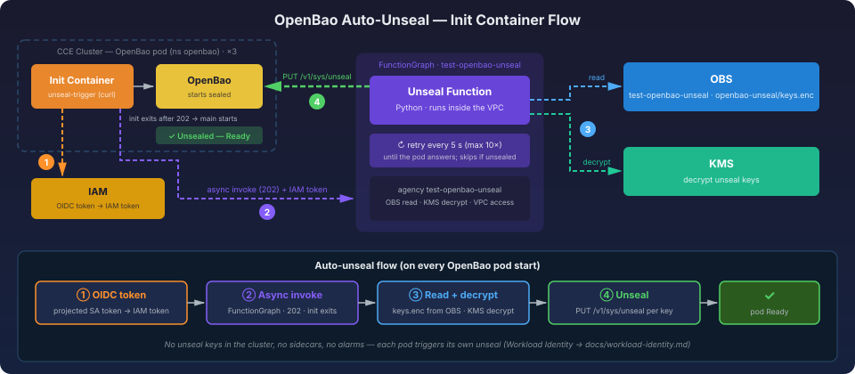

# OpenBao Auto-Unseal

Automatic unsealing for the in-cluster OpenBao (`openbao_mode = "cce"`) with a native sidecar, KMS and [Workload Identity](workload-identity.md). The VM variant unseals itself with KMS via an ECS agency instead — see [OpenBao on VMs](openbao-vm.md#operations).

## Contents

- [Architecture](#architecture)
- [How It Works](#how-it-works)
- [Components](#components)
- [Prerequisites](#prerequisites)
- [Setup](#setup)
- [Alternative: OpenBao `tcloudpublic` seal](#alternative-openbao-tcloudpublic-seal)
- [Variables](#variables)
- [Security](#security)

## Architecture



## How It Works

Each OpenBao server pod runs a small **native sidecar** (`auto-unseal`, an init container with `restartPolicy: Always`). It starts before the server and runs for the lifetime of the pod:

1. Every 30 s it reads `GET http://127.0.0.1:8200/v1/sys/seal-status` (every 3 s while the server is not listening yet).
2. Only if the server is **initialized and sealed**:
   - exchanges its projected ServiceAccount token for an IAM token (workload identity, `X-Idp-Id`); the project ID comes from the token response,
   - decrypts the ciphertext from the Secret `openbao-unseal-keys` with **KMS** `decrypt-data` (allowed only for the unseal key),
   - sends the shares to `PUT http://127.0.0.1:8200/v1/sys/unseal` until the server reports `sealed: false`; before every share it checks that the Secret is still mounted.
3. Uninitialized servers (before `openbao-init.sh` / raft join) and unsealed servers are left alone.

The unseal keys never leave the pod and never cross the network in plaintext. A restart of only the OpenBao container (same pod) is unsealed as well, because the sidecar keeps running.

## Components

| Resource | Stack | Purpose |
|---|---|---|
| KMS key `${name_prefix}-openbao-unseal-<suffix>` | infra | Encrypts/decrypts the unseal keys (application-level) |
| Custom IAM role `${name_prefix}-kms-decrypt` | infra | `kms:cmk:get`, `kms:cmk:crypto`, resource-scoped to `kms:::KeyId:<unseal key>` |
| Workload identity mapping | infra | `system:serviceaccount:openbao:openbao` → IAM group with the KMS decrypt role |
| Secret `openbao/openbao-unseal-keys` | `upload-unseal-keys.py` | KMS ciphertext (`keys.enc`); without plaintext, useless without KMS access |
| ConfigMap `openbao-unseal-script` | workloads | [`workloads/files/openbao-auto-unseal.py`](../workloads/files/openbao-auto-unseal.py) (Python standard library only, real JSON parsing) |
| Sidecar `auto-unseal` | workloads | `python:3.12-alpine`, 5m CPU / 24 Mi requests, read-only root filesystem, no capabilities |
| Projected volume `oidc-token` | workloads | ServiceAccount token with the workload identity audience |

## Prerequisites

- `openbao_mode = "cce"` in infra (the module is skipped in other modes)
- [Workload Identity](workload-identity.md) enabled (`create_workload_identity = true`, requires `bind_api_eip = true`)
- OpenBao deployed (`create_openbao = true`)
- OTC project name set via `TF_VAR_otc_project_name` (GitHub Actions: environment variable `OTC_PROJECT_NAME`)

## Setup

### 1. Enable in tfvars

```hcl
# infra/envs/<env>.tfvars
openbao_mode             = "cce"
bind_api_eip             = true
create_openbao_unseal    = true
create_workload_identity = true

# workloads/envs/<env>.tfvars
create_openbao = true
```

dev already has these settings.

### 2. Apply infra first, then workloads

The Deploy workflow does this in one run. Locally:

```bash
export TF_VAR_environment=dev
bash scripts/init-stack.sh infra
tofu -chdir=infra apply -var-file=envs/dev.tfvars
bash scripts/init-stack.sh workloads
tofu -chdir=workloads apply -var-file=envs/dev.tfvars
```

The sidecar is added when infra provides `openbao_unseal_kms_key_id` and the workload identity provider (both exist in older states as well, so the first deploy renders it). The StatefulSet uses `OnDelete`: delete the pods one by one (standbys first) to roll the sidecar in — with the Secret in place (step 3) each pod unseals itself.

### 3. Store the unseal keys

After the initial OpenBao setup (see [openbao.md](openbao.md)):

```bash
# openbao-init.sh offers this as its last step, or run manually:
export TF_VAR_environment=dev   # infra/ initialized for this environment
python3 scripts/upload-unseal-keys.py ./openbao.keys.ABC123
```

The script encrypts the keys with the infra KMS key and writes only the ciphertext to the Secret `openbao/openbao-unseal-keys`. Safety checks against the infra state of `TF_VAR_environment`:

- the state belongs to `TF_VAR_environment` and `TF_VAR_otc_project_name` and is in cce mode;
- the key file names this environment and CCE cluster ID (`Environment:` / `CCE Cluster ID:` lines written by `openbao-init.sh`); for files from before that binding pass `--legacy-source-cluster-id <verified original cluster ID>`;
- the key file contains at least 3 valid, distinct shares with unique numbers (threshold 3 of 5) — an incomplete set never replaces a working Secret;
- the Secret goes to the cluster from the infra state; a set `KUBECONFIG` must point to the same API endpoint and CA, otherwise the script refuses.

The Secret carries the environment, cluster ID and KMS key ID as annotations. The sidecars pick it up within about a minute (Secret volume update).

`scripts/test-kms.py` checks the KMS encrypt/decrypt round-trip with the same format.

### 4. Test

```bash
kubectl delete pod -n openbao openbao-2
kubectl logs -n openbao openbao-2 -c auto-unseal -f     # "... unsealed"
kubectl get pod -n openbao openbao-2 -w
```

### Seal on purpose (emergency)

The sidecar re-unseals a manually sealed server within ~30 s, and deleting the Secret reaches the pods only with a delay. Only the active node can be sealed via the API; standbys are sealed by a restart. Use the script:

```bash
export TF_VAR_environment=dev TF_VAR_otc_project_name=<project> BAO_TOKEN=<token with sys/seal>
./scripts/openbao-seal.sh
```

It checks the infra state (environment, project, cluster), deletes the Secret, **waits until every sidecar no longer sees the key file**, then repeats until every running server reports `sealed=true`: the active node is sealed via the API (leadership moves to a standby, which is then sealed the same way), a node that refuses is restarted and comes back sealed. With `OrderedReady` the StatefulSet may hold back recreated pods while lower ordinals are sealed — a pod that is not running serves nothing.

Auto-unseal stays paused until `upload-unseal-keys.py` stores the Secret again.

## Alternative: OpenBao `tcloudpublic` seal

OpenBao now offers a native T Cloud Public KMS auto-unseal: the [`tcloudpublic` seal](https://openbao.org/docs/configuration/seal/tcloudpublic/) (external KMS plugin from the [openbao-plugins](https://github.com/openbao/openbao-plugins) collection). With it, OpenBao wraps its root key with a T Cloud KMS key and unseals itself — no Shamir shares to store and no sidecar.

It is not used here (yet), because:

- **AK/SK only:** the plugin authenticates to IAM exclusively with an access key and secret key (`TCLOUDPUBLIC_ACCESS_KEY` / `TCLOUDPUBLIC_SECRET_KEY` or in the config). There is no support for workload identity (OIDC token exchange), an ECS agency or temporary credentials, so a long-lived AK/SK of an IAM user would have to live in the cluster (Kubernetes Secret) and be rotated manually. The sidecar needs no static credentials.
- **Plugin binary:** the seal is not built into the official image; the plugin has to be added to the image or downloaded and registered (`plugin "kms" ...` with checksum).
- **Seal migration:** switching an initialized cluster from Shamir to an auto seal is a [seal migration](https://openbao.org/docs/concepts/seal/#seal-migration) (`disabled = "true"` on the old seal, `bao operator unseal -migrate` with the current shares); afterwards the Shamir shares become recovery keys. Going back is another migration.
- **Permissions:** it needs `kms:cmk:crypto` on the key — the same as the sidecar, so the key-scoped role could be reused for the IAM user.

When the plugin gains workload identity (or agency) support, it is the cleaner option: replace the sidecar by the seal configuration, migrate once, and drop `openbao-unseal-keys`, `upload-unseal-keys.py` and `openbao-seal.sh` (keeping OpenBao sealed on purpose then means revoking its KMS access).

## Variables

| Variable | Default | Description |
|---|---|---|
| `create_openbao_unseal` | `false` | KMS key + decrypt role for the sidecar (infra; only with `openbao_mode = "cce"`) |
| `create_workload_identity` | `false` | OIDC identity provider the sidecar uses for its IAM token |
| `otc_project_name` | — (required) | Project for the IAM token scope (from `TF_VAR_otc_project_name`, passed to workloads via remote state) |

## Security

- The unseal keys are stored only as **KMS ciphertext** (Secret); decrypting needs an IAM token of the OpenBao ServiceAccount (workload identity) with the KMS decrypt role, which is **scoped to the unseal key** (`kms:::KeyId:<id>`) — other KMS keys in the project cannot be used with it.
- Plaintext keys exist only in the sidecar's memory and go to `127.0.0.1` through a proxy-free client (ignores `HTTP(S)_PROXY`) — no network path, no listener, no address taken from a request.
- Secrets are passed to `curl` via stdin (`-K -`), never as process arguments or files; the sidecar has a read-only root filesystem and no capabilities.
- Trust boundary: whoever can use the identity `system:serviceaccount:openbao:openbao` (run a pod with it, or create tokens for it via `serviceaccounts/token`) **and** read the Secret can decrypt the shares. That does not require `pods/exec`; restrict pod creation and `serviceaccounts/token` in the namespace `openbao` accordingly.
- The KMS permission is held by a cluster identity; the key scope limits the impact to the unseal key.
- No AK/SK in the cluster.
