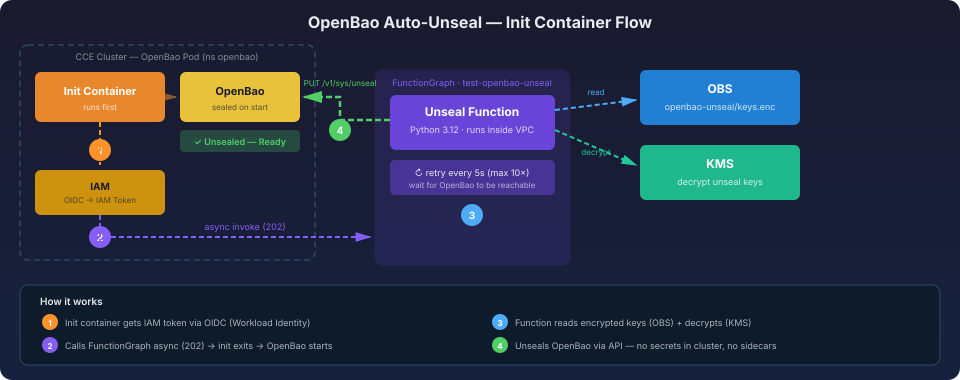

# OpenBao Auto-Unseal

Automatic unsealing for OpenBao on OTC CCE using an Init Container, FunctionGraph, KMS, and OBS.

## Architecture



## How It Works

1. **OpenBao pod starts** → Init Container runs first
2. **Init Container** exchanges its projected OIDC token for an IAM token via [Workload Identity](workload-identity.md)
3. Init Container invokes **FunctionGraph async** (`202 Accepted`) with the pod's address (`bao_addr`)
4. Init Container exits → **OpenBao main process starts** (sealed)
5. **FunctionGraph** function (after 5s wait):
   - Checks if OpenBao is sealed (skips if already unsealed or not initialized)
   - Reads KMS-encrypted unseal keys from **OBS**
   - Decrypts keys via **KMS**
   - Calls `/v1/sys/unseal` on that pod for each key
6. **OpenBao unseals** — pod becomes Ready

No LTS alarms, no SMN subscriptions, no sidecars — the pod triggers its own unseal.

## Components

All resources are named `${name_prefix}-openbao-unseal` (module `infra/modules/openbao-unseal`); the KMS key alias additionally gets a random suffix because deleted keys keep their alias for the 7-day pending-deletion period.

| Resource | Purpose |
|---|---|
| KMS Key | Encrypts/decrypts unseal keys (application-level) |
| OBS Bucket | Stores encrypted unseal keys (`openbao-unseal/keys.enc`) |
| IAM Agency | Grants FunctionGraph access to KMS, OBS, and VPC |
| FunctionGraph | Python 3.12 function — waits, checks status, reads OBS, decrypts KMS, unseals |
| Custom IAM Policies | Least-privilege OBS read + KMS decrypt + FG invoke + VPC access |
| Workload Identity mapping | `system:serviceaccount:openbao:openbao` → IAM group with FunctionGraph invoke policy |
| Init Container | `curlimages/curl:8.23.0` — exchanges OIDC token for IAM token, invokes FG async |
| ConfigMap | Shell script for the init container |
| Projected Volume | OIDC ServiceAccount token for Workload Identity |

## Prerequisites

- [Workload Identity](workload-identity.md) must be enabled (`create_workload_identity = true`)
- OpenBao must be deployed (`create_openbao = true`)
- OTC project name set via `TF_VAR_otc_project_name` (GitHub Actions: repository variable `OTC_PROJECT_NAME`)

## Setup

### 1. Enable in tfvars

```hcl
# infra/terraform.tfvars
create_openbao_unseal    = true
create_workload_identity = true

# apps/terraform.tfvars
create_openbao = true
```

The apps project reads the project name from the infra remote state output `otc_project_name`.

### 2. Apply infra first, then apps

```bash
cd infra && tofu apply
cd ../apps && tofu apply
```

Infra creates the KMS key, OBS bucket, IAM agency, FunctionGraph function, and Workload Identity.
Apps creates the OpenBao Helm release with the init container, ConfigMap, and projected volume.

Infra outputs: `openbao_unseal_kms_key_id`, `openbao_unseal_obs_bucket`, `openbao_unseal_function_urn`.

### 3. Upload Unseal Keys

After initial OpenBao setup (see [openbao.md](openbao.md)), upload the unseal keys:

```bash
# openbao-init.sh does this automatically, or run manually:
export TF_VAR_otc_project_name="eu-de_<project>"
python3 scripts/upload-unseal-keys.py ./openbao.keys.ABC123
```

This reads the unseal keys from the file, encrypts each with KMS, and uploads
the encrypted blob to OBS at `openbao-unseal/keys.enc`.

### 4. Test

Restart an OpenBao pod and watch it unseal automatically:

```bash
kubectl delete pod -n openbao openbao-0
kubectl logs -n openbao openbao-0 -c unseal-trigger -f
kubectl get pod -n openbao openbao-0 -w
```

Or manually invoke the function:

```bash
curl -s -X POST \
  "https://functiongraph.eu-de.otc.t-systems.com/v2/<project-id>/fgs/functions/<function-urn>/invocations-async" \
  -H "X-Auth-Token: $TOKEN" \
  -H "Content-Type: application/json" \
  -d '{"bao_addr":"http://<openbao-pod-ip>:8200"}'
```

## Function Parameters

| Parameter | Source | Required | Description |
|---|---|---|---|
| `bucket` | user_data | No | OBS bucket name (auto-configured by OpenTofu) |
| `object_key` | user_data | No | OBS key for encrypted keys (default: `openbao-unseal/keys.enc`) |
| `bao_addr` | event | **Yes** | OpenBao API address (e.g. `http://10.248.x.x:8200`) |
| `wait` | event | No | Seconds to wait before unsealing (default: `5`) |
| `max_retries` | event | No | Max retry attempts before giving up (default: `10`) |

## Variables

| Variable | Default | Description |
|---|---|---|
| `create_openbao_unseal` | `false` | Deploy auto-unseal infrastructure (infra) |
| `otc_project_name` | — (required) | OTC project name for IAM token exchange (infra; from `TF_VAR_otc_project_name` / repository variable `OTC_PROJECT_NAME`, passed to apps via remote state) |

## Security

- Unseal keys are **never stored in plaintext** — KMS-encrypted at rest in OBS
- FunctionGraph uses an **IAM agency** with least-privilege custom policies
- OBS bucket has ACL `private` — no public access
- Function runs **inside the VPC** to reach OpenBao pod IPs
- Init container uses **Workload Identity** (OIDC) — no AK/SK credentials
- Async invoke — init container doesn't wait for unseal to complete
- KMS key rotation is supported (re-upload keys after rotation)
