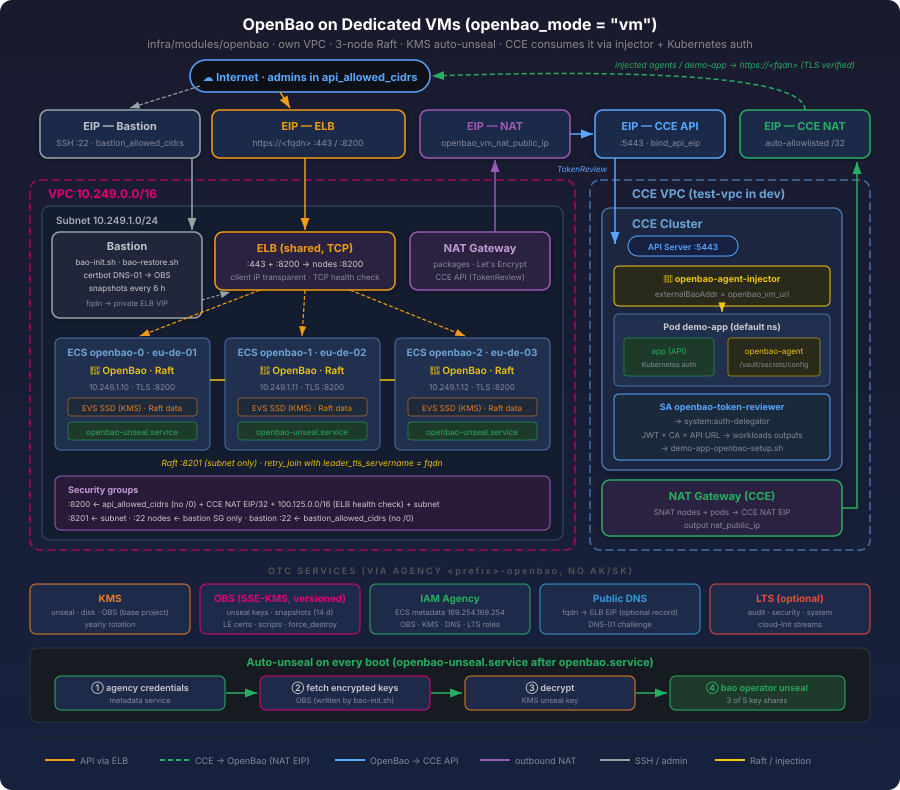

# OpenBao on Dedicated VMs (`openbao_mode = "vm"`)

OpenBao runs as a 3-node Raft cluster on dedicated ECS instances in its own VPC, independent of the CCE cluster. Workloads in CCE consume it through the OpenBao agent injector and the Kubernetes auth method. The module lives in `infra/modules/openbao`.

For the in-cluster variant see [OpenBao on CCE](openbao.md).

## Contents

- [Architecture](#architecture)
- [What Gets Created](#what-gets-created)
- [Configuration](#configuration)
- [Reachability](#reachability)
- [Deploy and Initialize](#deploy-and-initialize)
- [Kubernetes Auth and the Injector](#kubernetes-auth-and-the-injector)
- [Operations](#operations)
- [Security Notes](#security-notes)
- [Troubleshooting](#troubleshooting)

## Architecture



| Decision | Rationale |
|---|---|
| Own VPC (`10.249.0.0/16`) | Isolation from the CCE VPC; no peering, all traffic via public EIPs + allowlists |
| 3 ECS nodes, one per AZ, integrated Raft | HA without external storage; node IPs fixed at `.10`, `.11`, `.12` of the subnet |
| Shared ELB, TCP `:443` and `:8200` → backend `:8200` | Single entry point; client IP transparency so the security group can filter sources |
| KMS auto-unseal via ECS agency | Nodes unseal themselves on every boot; no AK/SK on the VMs |
| Bastion | Initialization, Let's Encrypt, snapshots and restore run there |
| OBS (versioned, SSE-KMS) | Encrypted unseal keys, Raft snapshots, certificates, helper scripts |

## What Gets Created

| Resource | Details |
|---|---|
| VPC + subnet | `openbao_vm.vpc_cidr` / `openbao_vm.subnet_cidr` (`<name_prefix>-openbao-vpc`) |
| NAT gateway + EIP | Outbound internet for the VMs (packages, binary download, Let's Encrypt, CCE API). Output `openbao_vm_nat_public_ip` |
| Security group | `8200` from `api_allowed_cidrs`, from the ELB health-check range `100.125.0.0/16` and from the subnet; `8201` (Raft) subnet only; `22` only from the bastion SG |
| ELB + EIP | Listeners TCP `:8200` and `:443` (both → `:8200`), TCP health monitor, `transparent_client_ip_enable`. Output `openbao_vm_elb_public_ip` |
| ECS × AZs | `ecs_flavor`, `image_name` (Ubuntu 22.04), KMS-encrypted 40 GB system disk |
| EVS × AZs | `evs_size` GB SSD data volume per node (Raft), KMS-encrypted, kept on VM replacement |
| Bastion + EIP | `s3.medium.2`, SSH from `bastion_allowed_cidrs`, fail2ban. Output `openbao_vm_bastion_public_ip` |
| KMS keys | `-openbao-unseal` (auto-unseal), `-openbao-disk` (disks), `-openbao-obs` (OBS SSE-KMS, base project) — all yearly rotated |
| OBS bucket | `<name_prefix>-openbao-<random>`, versioned, SSE-KMS, `force_destroy = true` |
| IAM agency + custom roles | `<name_prefix>-openbao` for ECS: OBS object access, KMS crypto, `kms_admin_role_name`, DNS (Let's Encrypt), `LTS FullAccess` (LTS) |
| Public DNS record | `fqdn` → ELB EIP when `enable_public_dns_record = true` |
| LTS | Optional group (`lts_ttl_days`) with audit, security, system and cloud-init streams |
| SSH key pair | Shared `ssh_public_key` of infra, or a generated RSA 4096 key (sensitive output `openbao_vm_ssh_private_key`) |

In vm mode `create_openbao_unseal` and `create_workload_identity` have no effect (they belong to cce mode).

## Configuration

All settings live in the `openbao_vm` object in `infra/envs/<env>.tfvars` (defaults from `infra/variables.tf`):

| Field | Default | Description |
|---|---|---|
| `vpc_cidr` / `subnet_cidr` | `10.249.0.0/16` / `10.249.1.0/24` | OpenBao network (must not overlap the CCE VPC) |
| `availability_zones` | `["eu-de-01","eu-de-02","eu-de-03"]` | One node per AZ (≥ 1) |
| `ecs_flavor` | `s3.large.2` | Node flavor |
| `image_name` | `Standard_Ubuntu_22.04_latest` | Node/bastion image |
| `evs_size` | `20` | Raft data volume (GB) |
| `version` | `2.7.3` | OpenBao version installed on the VMs |
| `fqdn` | `""` | Let's Encrypt domain and name of the public DNS record |
| `public_dns_zone_id` | `""` | Public zone for the DNS-01 challenge and the optional record |
| `enable_public_dns_record` | `false` | Create `fqdn` → ELB EIP |
| `api_allowed_cidrs` | `[]` | Client CIDRs for the API (required, no `/0`); the CCE NAT EIP is allowed automatically via its own rule (do not list it) |
| `tls_cert_pem`, `tls_key_pem`, `tls_ca_cert_pem`, `tls_fqdn` | `""` | BYO TLS (all four required without Let's Encrypt) |
| `enable_auto_unseal` | `true` | KMS auto-unseal |
| `kms_admin_role_name` | `KMS Administrator` | Additional role for the VM agency |
| `enable_bastion` | `true` | **Must be `true` in vm mode** (initialization runs on the bastion) |
| `bastion_allowed_cidrs` | `[]` | SSH sources for the bastion (no `/0`) |
| `enable_letsencrypt` | `false` | Let's Encrypt via DNS-01 on the bastion |
| `letsencrypt_email` | `""` | ACME account email |
| `enable_lts_logging` | `false` | Ship logs to LTS (dev: `true`) |
| `lts_ttl_days` | `30` | LTS retention |
| `elb_eip_bandwidth`, `nat_eip_bandwidth`, `bastion_eip_bandwidth` | `100`, `100`, `10` | EIP bandwidths (Mbit/s) |

Validation (plan fails otherwise) when `openbao_mode = "vm"`:

- at least one AZ and a non-empty `api_allowed_cidrs`
- `enable_bastion = true`
- either Let's Encrypt (`enable_letsencrypt`, `fqdn`, `letsencrypt_email`, `public_dns_zone_id`, `enable_bastion`, non-empty `bastion_allowed_cidrs`) **or** all four BYO TLS fields
- `api_allowed_cidrs` and `bastion_allowed_cidrs` must be valid CIDRs and never `/0`
- with Let's Encrypt: `enable_public_dns_record = true` (pods and admins resolve `https://<fqdn>` via public DNS)

Further prerequisites:

- **DNS with BYO TLS:** `tls_fqdn` must resolve to the ELB EIP from the CCE cluster and from admin machines (external DNS); only the bastion maps it to the private ELB VIP.
- **`EVSAccessKMS` agency:** the VM system and data disks are KMS-encrypted. The agency is created by the CCE module only with `node_volume_encryption = true` and `reuse_existing_evs_kms_agency = false`; otherwise it must already exist with `KMS Administrator` in the target project.
- **Agency scope:** the `<prefix>-openbao` agency gets OBS object access and KMS crypto in **all projects** (the bucket's SSE-KMS key lives in the region base project), plus the project-scoped roles (KMS Administrator, DNS, LTS) in `otc_project_name`.
- KMS key aliases carry a random suffix and use `pending_days = 7`, so a rebuild right after a destroy does not collide with keys pending deletion.

Example (Let's Encrypt; dev already contains the object with `version = "2.7.3"`):

```hcl
openbao_mode = "vm"

openbao_vm = {
  subnet_cidr              = "10.249.1.0/24"
  vpc_cidr                 = "10.249.0.0/16"
  availability_zones       = ["eu-de-01", "eu-de-02", "eu-de-03"]
  ecs_flavor               = "s3.large.2"
  image_name               = "Standard_Ubuntu_22.04_latest"
  evs_size                 = 20
  version                  = "2.7.3"
  fqdn                     = "bao.example.org"
  public_dns_zone_id       = "<public-zone-id>"
  enable_public_dns_record = true
  api_allowed_cidrs        = ["203.0.113.10/32"] # your admin IP(s)
  tls_cert_pem             = ""
  tls_key_pem              = ""
  tls_ca_cert_pem          = ""
  tls_fqdn                 = ""
  enable_auto_unseal       = true
  kms_admin_role_name      = "KMS Administrator"
  enable_bastion           = true
  bastion_allowed_cidrs    = ["203.0.113.10/32"]
  enable_letsencrypt       = true
  letsencrypt_email        = "platform@example.org"
  enable_lts_logging       = true
  lts_ttl_days             = 30
  elb_eip_bandwidth        = 100
  nat_eip_bandwidth        = 100
  bastion_eip_bandwidth    = 10
}
```

With **BYO TLS**, set `tls_fqdn` to the certificate name and `fqdn` to the same name if the module should create the DNS record. Keep private keys out of Git: pass them only in local runs, e.g. `TF_VAR_openbao_vm='{...}'` or an untracked `-var-file` outside the repository. CI has no secret input for the key, so use Let's Encrypt for CI-driven vm deployments.

## Reachability

| From → To | Path | Requirement |
|---|---|---|
| Admin / `demo-app-openbao-setup.sh` → OpenBao API | `https://<fqdn>` (ELB EIP `:443`, or `:8200`) | Your IP in `api_allowed_cidrs`, DNS for `fqdn` |
| CCE pods (injector agents, demo app) → OpenBao | CCE NAT EIP → ELB EIP `:443` | CCE `nat_public_ip/32` is **allowed automatically** (own security group rule, not part of `api_allowed_cidrs`) |
| OpenBao VMs → CCE API (TokenReview) | OpenBao NAT EIP → CCE API EIP `:5443` | `bind_api_eip = true`; with `api_access_trustlist` add `openbao_vm_nat_public_ip` |
| Bastion → OpenBao | `fqdn` resolved to the **private ELB VIP** via `/etc/hosts`, `:8200` | Nothing — keeps the private source address (the public path would come from the OpenBao NAT EIP, which is not allowlisted) |
| ELB health checks → nodes | `100.125.0.0/16` → `:8200` | Allowed by a fixed rule |
| You → bastion | `ssh ubuntu@<openbao_vm_bastion_public_ip>` | Your IP in `bastion_allowed_cidrs` |
| Bastion → nodes | SSH `:22` | Bastion security group |

TLS is verified on every path: public Let's Encrypt chains via the system CA store, BYO certificates via `/etc/openbao/tls/ca.pem` (nodes, bastion, Raft `retry_join` with `leader_tls_servername`) and via `openbao_vm_ca_cert` for clients. Connections to node IPs verify the FQDN certificate via `BAO_TLS_SERVER_NAME` / `curl --connect-to` instead of skipping verification.

## Deploy and Initialize

1. **Apply infra and workloads** (`create_openbao = true` in `workloads/envs/<env>.tfvars`): Deploy workflow or locally

   ```bash
   tofu -chdir=infra init -reconfigure -backend-config=envs/dev.backend.tfvars
   tofu -chdir=infra apply -var-file=envs/dev.tfvars
   tofu -chdir=workloads init -reconfigure -backend-config=envs/dev.backend.tfvars
   tofu -chdir=workloads apply -var-file=envs/dev.tfvars
   ```

   With Let's Encrypt the bastion requests the certificate (DNS-01) after boot and uploads it to OBS; the nodes wait up to 30 minutes for it before OpenBao starts.

2. **SSH to the bastion** (use `openbao_vm_ssh_private_key` if no `ssh_public_key` is set):

   ```bash
   tofu -chdir=infra output -raw openbao_vm_ssh_private_key > bao.pem && chmod 600 bao.pem   # only if generated
   ssh -i bao.pem ubuntu@$(tofu -chdir=infra output -raw openbao_vm_bastion_public_ip)
   ```

3. **Initialize** on the bastion:

   ```bash
   sudo bao-init.sh                          # root token revoked at the end
   sudo KEEP_ROOT_TOKEN=true bao-init.sh     # keep and print the root token (revoke it yourself)
   ```

   `bao-init.sh` initializes node 0 (5 key shares, threshold 3), encrypts each unseal key with KMS and uploads them to OBS, unseals all nodes (`bao-unseal.sh`), creates the AppRole `workloads-tofu` (policy for auth methods, mounts, ACL policies, `kv/*`), sets up the snapshot token and cron, and **revokes the root token** unless `KEEP_ROOT_TOKEN=true`. Save the printed unseal keys outside the cluster.

4. **Configure the demo app / Kubernetes auth** from your machine (IP in `api_allowed_cidrs`):

   ```bash
   export BAO_ROLE_ID=...     # printed by bao-init.sh
   export BAO_SECRET_ID=...
   # BYO TLS only: tofu -chdir=infra output -raw openbao_vm_ca_cert > bao-ca.pem; export BAO_CACERT=bao-ca.pem
   ./scripts/demo-app-openbao-setup.sh
   ```

`scripts/openbao-init.sh` is for cce mode only and refuses to run in vm mode.

## Kubernetes Auth and the Injector

Workloads in vm mode deploy (no OpenBao server in the cluster):

- the OpenBao Helm chart (`openbao_chart_version`, default `0.30.8`) with `server.enabled = false` and `global.externalBaoAddr = openbao_vm_url`; with BYO TLS the injected agents trust the CA via `AGENT_INJECT_VAULT_CACERT_BYTES`
- ServiceAccount `openbao/openbao-token-reviewer` with a long-lived token Secret, bound to `system:auth-delegator`

`scripts/demo-app-openbao-setup.sh` reads `tofu output` from `workloads/` and, in vm mode:

1. logs in with `BAO_TOKEN`, AppRole (`BAO_ROLE_ID`/`BAO_SECRET_ID`) or userpass
2. enables KV v2 at `kv/` and the `kubernetes` auth method if missing
3. writes `auth/kubernetes/config` with `kubernetes_host` = `openbao_kubernetes_host` (public CCE API), `kubernetes_ca_cert` = `openbao_kubernetes_ca_cert`, `token_reviewer_jwt` = `openbao_token_reviewer_jwt`, `disable_local_ca_jwt = true`
4. creates the policy and Kubernetes role `demo-app` and seeds `kv/demo/config`

Pods then use the usual `vault.hashicorp.com/*` annotations (see [Demo App](demo-app.md)).

## Operations

```bash
bao-status.sh                         # cluster / Raft status (bastion)
sudo bao-unseal.sh                    # manual unseal from the KMS-encrypted keys in OBS
sudo bao-snapshot.sh                  # snapshot now (cron: every 6 h, 14 days retention in OBS snapshots/)
sudo BAO_TOKEN=... bao-approle.sh     # re-create the AppRole / new secret_id
```

**Auto-unseal:** every node runs `openbao-unseal.service` after `openbao.service`: agency credentials from the metadata service → encrypted keys from OBS → KMS decrypt → `bao operator unseal`.

**Certificate refresh (Let's Encrypt):** the bastion renews daily (`certbot renew`, 03:17 + random delay) and uploads the certificate to OBS (`certs/<fqdn>/`); the nodes install it daily at 04:41 (`openbao-cert-refresh.sh`) and reload OpenBao (SIGHUP) when it changed. A rebuilt bastion restores the certbot state from OBS. BYO certificates are written at VM creation; change them via OpenTofu (VM replacement).

**Restore** (bastion):

```bash
sudo bao-restore.sh --dry-run               # list snapshots in OBS, change nothing
sudo BAO_TOKEN=... bao-restore.sh           # interactive: pick snapshot (default newest), type RESTORE
sudo BAO_TOKEN=... bao-restore.sh --yes 2   # non-interactive, snapshot #2 of the list
sudo bao-restore.sh ./raft.snap             # local file
```

If the cluster is not initialized (disaster recovery), the script performs a temporary init and force-restores; the original cluster's unseal keys apply afterwards. Without a terminal it refuses to run unless `--yes` is given.

**Root token:** not kept by default. Generate one when needed with a key quorum:

```bash
bao operator generate-root -init
bao operator generate-root -nonce=<nonce> <key>   # × 3
bao operator generate-root -decode=<encoded> -otp=<otp>
# … use it, then: bao token revoke -self
```

**Destroy:** the Destroy workflow removes `module.openbao_vm` before the rest of infra. The OBS bucket has `force_destroy = true` — snapshots and keys are deleted with it (their KMS key goes too), so copy snapshots elsewhere first if they must survive.

## Security Notes

- `api_allowed_cidrs` and `bastion_allowed_cidrs` reject `/0`; only the CCE NAT EIP and the ELB health-check range are added automatically
- Raft (`8201`) only within the subnet; node SSH only from the bastion; bastion with fail2ban
- TLS verification everywhere (no `-tls-skip-verify`)
- Unseal keys and the snapshot token are stored KMS-encrypted in OBS (SSE-KMS bucket); the VMs use an agency instead of AK/SK
- Root token revoked after initialization (unless `KEEP_ROOT_TOKEN=true`); administration via the AppRole `workloads-tofu` (token TTL 1 h, max 4 h)
- All disks KMS-encrypted; keys rotated yearly
- Audit log on every node (`/var/log/openbao/audit.log`), shipped to LTS with `enable_lts_logging`

## Troubleshooting

| Symptom | Check |
|---|---|
| `curl https://<fqdn>` times out | Your IP in `api_allowed_cidrs`? DNS record → `openbao_vm_elb_public_ip`? |
| Injector agents / demo app cannot reach OpenBao | `nat_public_ip` of infra (CCE) is allowlisted automatically — check it did not change outside OpenTofu; `openbao_vm_url` must resolve publicly |
| Kubernetes login fails (`permission denied`, TokenReview errors) | `bind_api_eip = true`; `api_access_trustlist` contains `openbao_vm_nat_public_ip`; re-run `demo-app-openbao-setup.sh` after a cluster rebuild (new CA / token) |
| Nodes never start OpenBao (Let's Encrypt) | Bastion cert issuance: `journalctl -u bao-cert-init` on the bastion; DNS zone ID and delegation |
| ELB members unhealthy (TCP check on `:8200`) | OpenBao not running on the node (`journalctl -u openbao`, e.g. still waiting for the Let's Encrypt certificate) |
| Requests fail with `503`/sealed | Node not unsealed: `bao-status.sh`, `sudo bao-unseal.sh` on the bastion, `journalctl -u openbao-unseal` on the node |
| x509 errors with BYO TLS | Export `BAO_CACERT` with `openbao_vm_ca_cert`; certificate must match `tls_fqdn` |
