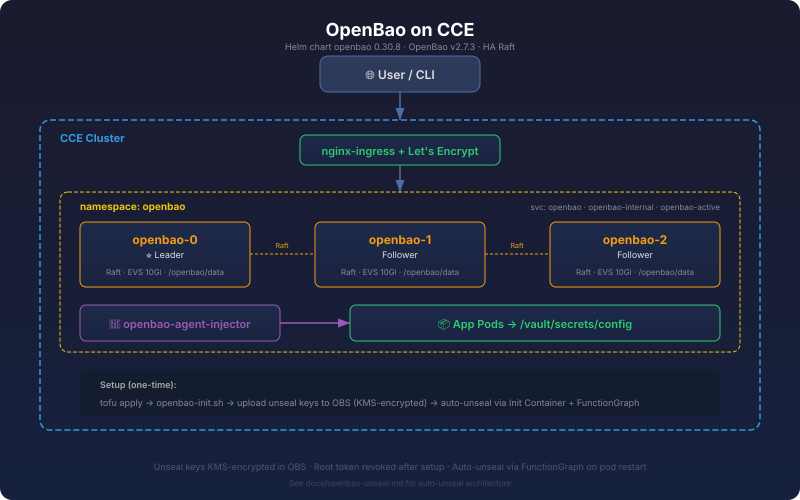

# OpenBao on CCE

OpenBao deployed as a HA cluster with Raft storage on OTC CCE.

## Architecture



## What You Get

| Component | Details |
|---|---|
| Helm chart | `openbao` 0.30.8 (OpenBao v2.7.3) from `https://openbao.github.io/openbao-helm` |
| OpenBao Server | 3 replicas (`openbao-0..2`, HA), Raft consensus |
| Storage | Integrated Raft on EVS PVCs (`csi-disk`), data path `/openbao/data` |
| Injector | `openbao-agent-injector` — sidecar injector for automatic secret injection |
| Services | `openbao`, `openbao-internal`, `openbao-active` |
| UI | Web interface at `https://openbao.<zone>` |
| TLS | Let's Encrypt via cert-manager + nginx-ingress |

Helm release, namespace and ServiceAccount are all named `openbao`.

## Deploy

```bash
cd apps
tofu apply
```

After apply, all OpenBao pods will be `Running` but `0/1 Ready` — this is normal.
OpenBao is not yet initialized.

---

## Initial Setup (one-time, ~10 minutes)

Initialization is a manual one-time step after the deploy workflow — it is not part of the pipeline.
Pick one of the options below:

### Option A: Web UI

```bash
kubectl port-forward -n openbao openbao-0 8200:8200
```

Open `http://localhost:8200`:

1. **Initialize** — choose 5 key shares, 3 threshold → download keys
2. **Unseal** — enter 3 of the 5 keys
3. Log in with root token → configure (see Step 4 below)

### Option B: CLI

#### Step 1: Initialize

```bash
kubectl exec -n openbao openbao-0 -c openbao -- bao operator init \
  -key-shares=5 -key-threshold=3
```

This outputs 5 unseal keys + 1 root token.

#### Step 2: Unseal openbao-0

```bash
kubectl exec -n openbao openbao-0 -c openbao -- bao operator unseal <key-1>
kubectl exec -n openbao openbao-0 -c openbao -- bao operator unseal <key-2>
kubectl exec -n openbao openbao-0 -c openbao -- bao operator unseal <key-3>
```

### Option C: Script (recommended)

```bash
./scripts/openbao-init.sh
```

Does everything automatically: init → unseal → raft join → configure KV v2 + auth → create admin user → revoke root → optionally upload unseal keys to OBS.
The script uses `KUBECONFIG` only if it points to a non-empty file with a current context; otherwise (unset, missing or stale file) it reads the kubeconfig from the infra state (`infra/` must be initialized locally). It checks API connectivity first and prints the cluster endpoint. The StatefulSet uses `OrderedReady`, so `openbao-1`/`openbao-2` only start once the previous pod is unsealed; the script waits for each peer (up to 10 minutes) before joining it. Keys are saved immediately after initialization to a new `openbao.keys.XXXXXX` file (gitignored), without overwriting existing files. Copy them to your password manager, then delete the file. The admin password is not saved to disk.

### Step 3: Join + unseal Raft peers (Options A/B)

```bash
# Join
kubectl exec -n openbao openbao-1 -c openbao -- bao operator raft join http://openbao-0.openbao-internal:8200
kubectl exec -n openbao openbao-2 -c openbao -- bao operator raft join http://openbao-0.openbao-internal:8200

# Unseal openbao-1
kubectl exec -n openbao openbao-1 -c openbao -- bao operator unseal <key-1>
kubectl exec -n openbao openbao-1 -c openbao -- bao operator unseal <key-2>
kubectl exec -n openbao openbao-1 -c openbao -- bao operator unseal <key-3>

# Unseal openbao-2
kubectl exec -n openbao openbao-2 -c openbao -- bao operator unseal <key-1>
kubectl exec -n openbao openbao-2 -c openbao -- bao operator unseal <key-2>
kubectl exec -n openbao openbao-2 -c openbao -- bao operator unseal <key-3>
```

### Step 4: Configure (Options A/B)

```bash
kubectl exec -n openbao openbao-0 -c openbao -- sh -c '
  export BAO_ADDR=http://127.0.0.1:8200

  # Login with root token
  bao login <root-token>

  # Enable KV v2 secrets engine
  bao secrets enable -version=2 kv

  # Create admin policy
  bao policy write admin - <<EOF
path "*" {
  capabilities = ["create", "read", "update", "delete", "list", "sudo"]
}
EOF

  # Enable userpass auth + create admin user
  bao auth enable userpass
  bao write auth/userpass/users/<your-name> password="<your-password>" policies="admin"

  # Enable Kubernetes auth (for Injector)
  bao auth enable kubernetes
  bao write auth/kubernetes/config kubernetes_host="https://kubernetes.default.svc"

  # Revoke root token
  bao token revoke -self
'
```

> ⚠️ **Save the unseal keys + root token immediately in your password manager.**
> These keys are the ONLY way to unseal OpenBao. If you lose them, your data is gone.

### Step 5: Verify

Open `https://openbao.<zone>` → Login with **Username** method → your user + password.

---

## After Pod Restarts

OpenBao seals itself on restart. With [Auto-Unseal](openbao-unseal.md) enabled,
this is handled automatically via FunctionGraph + KMS.

Without auto-unseal, unseal manually:

```bash
# Check which pods are sealed
kubectl exec -n openbao openbao-0 -c openbao -- bao status
kubectl exec -n openbao openbao-1 -c openbao -- bao status
kubectl exec -n openbao openbao-2 -c openbao -- bao status

# Unseal each sealed pod (3 keys per pod)
kubectl exec -n openbao openbao-<N> -c openbao -- bao operator unseal <key-1>
kubectl exec -n openbao openbao-<N> -c openbao -- bao operator unseal <key-2>
kubectl exec -n openbao openbao-<N> -c openbao -- bao operator unseal <key-3>
```

---

## Using the Injector

For a working example, see the [Demo App](demo-app.md) which uses the Injector to read and write secrets.

Inject secrets into application pods via annotations:

```yaml
annotations:
  vault.hashicorp.com/agent-inject: "true"
  vault.hashicorp.com/role: "myapp"
  vault.hashicorp.com/agent-inject-secret-config: "kv/data/myapp/config"
```

> The OpenBao Helm chart ships the vault-k8s injector (`hashicorp/vault-k8s` image, OpenBao agent image), which only understands the `vault.hashicorp.com/*` annotation keys.

Create a role + policy for your app:

```bash
bao policy write myapp - <<EOF
path "kv/data/myapp/*" {
  capabilities = ["read"]
}
EOF

bao write auth/kubernetes/role/myapp \
  bound_service_account_names=myapp \
  bound_service_account_namespaces=default \
  policies=myapp \
  ttl=1h
```

The Injector mutates the pod spec to add an agent sidecar that fetches secrets
from OpenBao and writes them to files such as `/vault/secrets/config` (path fixed by the injector).

---

## Backup & Recovery

```bash
export BAO_ADDR="https://openbao.<zone>"
bao login -method=userpass username=<user>

# Create Raft snapshot
bao operator raft snapshot save backup.snap

# Restore (disaster recovery)
bao operator raft snapshot restore backup.snap
```

---

## Emergency: Generate New Root Token

```bash
# Start generation
bao operator generate-root -init
# → gives nonce + OTP

# Submit 3 unseal keys
bao operator generate-root -nonce=<nonce> <key-1>
bao operator generate-root -nonce=<nonce> <key-2>
bao operator generate-root -nonce=<nonce> <key-3>
# → last one gives encoded token

# Decode
bao operator generate-root -decode=<encoded-token> -otp=<otp>

# Use it, then revoke when done
bao login <new-root-token>
bao token revoke -self
```

---

## Variables

| Variable | Default | Description |
|---|---|---|
| `create_openbao` | `false` | Deploy OpenBao |
| `openbao_chart_version` | `0.30.8` | Helm chart version (OpenBao v2.7.3) |
| `openbao_replicas` | `3` | Server replicas (odd for quorum) |
| `openbao_hostname` | `openbao` | Subdomain (`openbao.<zone>`) |
| `openbao_storage_size` | `10Gi` | PVC size per replica |

Output: `openbao_url`.
