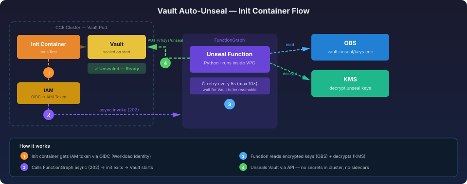

# Vault Auto-Unseal

Automatic unsealing for Vault on OTC CCE using an Init Container, FunctionGraph, KMS, and OBS.

## Architecture



## How It Works

1. **Vault pod starts** → Init Container runs first
2. **Init Container** obtains an IAM token via [Workload Identity](workload-identity.md) (OIDC)
3. Init Container calls **FunctionGraph async** (`202 Accepted`) with the pod's IP
4. Init Container exits → **Vault main process starts** (sealed)
5. **FunctionGraph** function (after 5s wait):
   - Checks if Vault is sealed (skips if already unsealed or not initialized)
   - Reads KMS-encrypted unseal keys from **OBS**
   - Decrypts keys via **KMS**
   - Calls Vault's `/v1/sys/unseal` API for each key
6. **Vault unseals** — pod becomes Ready

No LTS alarms, no SMN subscriptions, no sidecars — the pod triggers its own unseal.

## Components

| Resource | Purpose |
|---|---|
| KMS Key | Encrypts/decrypts unseal keys (application-level) |
| OBS Bucket | Stores encrypted unseal keys (`vault-unseal/keys.enc`) |
| IAM Agency | Grants FunctionGraph access to KMS, OBS, and VPC |
| FunctionGraph | Python function — waits, checks status, reads OBS, decrypts KMS, unseals |
| Custom IAM Policies | Least-privilege OBS read + KMS decrypt + FG invoke + VPC access |
| Init Container | `curlimages/curl:8.5.0` — exchanges OIDC token for IAM token, calls FG async |
| ConfigMap | Shell script for the init container |
| Projected Volume | OIDC ServiceAccount token for Workload Identity |

## Prerequisites

- [Workload Identity](workload-identity.md) must be enabled (`create_workload_identity = true`)
- Vault must be deployed (`create_vault = true`)

## Setup

### 1. Enable in tfvars

```hcl
# infra/terraform.tfvars
create_vault_unseal      = true
create_workload_identity = true

# apps/terraform.tfvars
otc_project_name = "eu-de_MIC_POC"  # your OTC project name
```

### 2. Apply infra first, then apps

```bash
cd infra && tofu apply
cd ../apps && tofu apply
```

Infra creates the KMS key, OBS bucket, IAM agency, FunctionGraph function, and Workload Identity.
Apps creates the Vault Helm release with the init container, ConfigMap, and projected volume.

### 3. Upload Unseal Keys

After initial Vault setup (see [vault.md](vault.md)), upload the unseal keys:

```bash
# vault-init.sh does this automatically, or run manually:
python3 scripts/upload-unseal-keys.py vault.keys
```

This reads the unseal keys from the file, encrypts each with KMS, and uploads
the encrypted blob to OBS at `vault-unseal/keys.enc`.

### 4. Test

Restart a Vault pod and watch it unseal automatically:

```bash
kubectl delete pod -n vault vault-0
kubectl logs -n vault vault-0 -c unseal-trigger -f
kubectl get pod -n vault vault-0 -w
```

Or manually invoke the function:

```bash
curl -s -X POST \
  "https://functiongraph.eu-de.otc.t-systems.com/v2/<project-id>/fgs/functions/<function-urn>/invocations-async" \
  -H "X-Auth-Token: $TOKEN" \
  -H "Content-Type: application/json" \
  -d '{"vault_addr":"http://<vault-pod-ip>:8200"}'
```

## Function Parameters

| Parameter | Source | Required | Description |
|---|---|---|---|
| `bucket` | user_data | No | OBS bucket name (auto-configured by Terraform) |
| `object_key` | user_data | No | OBS key for encrypted keys (default: `vault-unseal/keys.enc`) |
| `vault_addr` | event | **Yes** | Vault API address (e.g. `http://10.248.x.x:8200`) |
| `wait` | event | No | Seconds to wait before unsealing (default: `5`) |
| `max_retries` | event | No | Max retry attempts before giving up (default: `10`) |

## Variables

| Variable | Default | Description |
|---|---|---|
| `create_vault_unseal` | `false` | Deploy auto-unseal infrastructure (infra) |
| `otc_project_name` | — | OTC project name for IAM token exchange (apps) |

## Security

- Unseal keys are **never stored in plaintext** — KMS-encrypted at rest in OBS
- FunctionGraph uses an **IAM agency** with least-privilege custom policies
- OBS bucket has ACL `private` — no public access
- Function runs **inside the VPC** to reach Vault pod IPs
- Init container uses **Workload Identity** (OIDC) — no AK/SK credentials
- Async invoke — init container doesn't wait for unseal to complete
- KMS key rotation is supported (re-upload keys after rotation)
