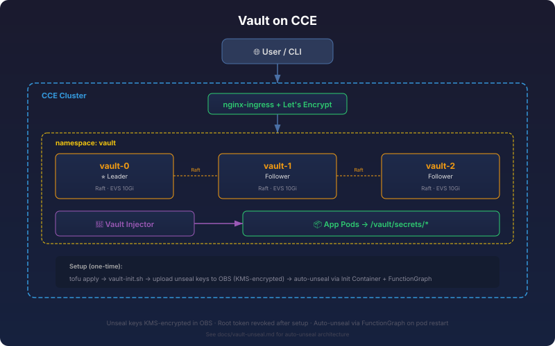

# Vault on CCE

HashiCorp Vault deployed as a HA cluster with Raft storage on OTC CCE.

## Architecture



## What You Get

| Component | Details |
|---|---|
| Vault Server | 3 replicas (HA), Raft consensus |
| Storage | Integrated Raft on EVS PVCs (`csi-disk`) |
| Injector | Sidecar injector for automatic secret injection |
| UI | Web interface at `https://vault.<zone>` |
| TLS | Let's Encrypt via cert-manager + nginx-ingress |

## Deploy

```bash
cd apps
tofu apply
```

After apply, all Vault pods will be `Running` but `0/1 Ready` — this is normal.
Vault is not yet initialized.

---

## Initial Setup (one-time, ~10 minutes)

Two options — pick whichever you prefer:

### Option A: Web UI

```bash
kubectl port-forward -n vault vault-0 8200:8200
```

Open `http://localhost:8200`:

1. **Initialize** — choose 5 key shares, 3 threshold → download keys
2. **Unseal** — enter 3 of the 5 keys
3. Log in with root token → configure (see Step 4 below)

### Option B: CLI

#### Step 1: Initialize

```bash
kubectl exec -n vault vault-0 -- vault operator init \
  -key-shares=5 -key-threshold=3
```

This outputs 5 unseal keys + 1 root token.

#### Step 2: Unseal vault-0

```bash
kubectl exec -n vault vault-0 -- vault operator unseal <key-1>
kubectl exec -n vault vault-0 -- vault operator unseal <key-2>
kubectl exec -n vault vault-0 -- vault operator unseal <key-3>
```

### Option C: Script (recommended)

```bash
./scripts/vault-init.sh
```

Does everything automatically: init → unseal → raft join → configure auth → create user → revoke root.
Keys are saved to `vault.keys` (gitignored). Copy them to your password manager, then delete the file.

### Step 3: Join + unseal Raft peers (Options A/B)

```bash
# Join
kubectl exec -n vault vault-1 -- vault operator raft join http://vault-0.vault-internal:8200
kubectl exec -n vault vault-2 -- vault operator raft join http://vault-0.vault-internal:8200

# Unseal vault-1
kubectl exec -n vault vault-1 -- vault operator unseal <key-1>
kubectl exec -n vault vault-1 -- vault operator unseal <key-2>
kubectl exec -n vault vault-1 -- vault operator unseal <key-3>

# Unseal vault-2
kubectl exec -n vault vault-2 -- vault operator unseal <key-1>
kubectl exec -n vault vault-2 -- vault operator unseal <key-2>
kubectl exec -n vault vault-2 -- vault operator unseal <key-3>
```

### Step 4: Configure (Options A/B)

```bash
kubectl exec -n vault vault-0 -- sh -c '
  export VAULT_ADDR=http://127.0.0.1:8200

  # Login with root token
  vault login <root-token>

  # Enable KV v2 secrets engine
  vault secrets enable -version=2 kv

  # Create admin policy
  vault policy write admin - <<EOF
path "*" {
  capabilities = ["create", "read", "update", "delete", "list", "sudo"]
}
EOF

  # Enable userpass auth + create admin user
  vault auth enable userpass
  vault write auth/userpass/users/<your-name> password="<your-password>" policies="admin"

  # Enable Kubernetes auth (for Injector)
  vault auth enable kubernetes
  vault write auth/kubernetes/config kubernetes_host="https://kubernetes.default.svc"

  # Revoke root token
  vault token revoke -self
'
```

> ⚠️ **Save the unseal keys + root token immediately in your password manager.**
> These keys are the ONLY way to unseal Vault. If you lose them, your data is gone.

### Step 5: Verify

Open `https://vault.<zone>` → Login with **Username** method → your user + password.

---

## After Pod Restarts

Vault seals itself on restart. With [Auto-Unseal](vault-unseal.md) enabled,
this is handled automatically via FunctionGraph + KMS.

Without auto-unseal, unseal manually:

```bash
# Check which pods are sealed
kubectl exec -n vault vault-0 -- vault status
kubectl exec -n vault vault-1 -- vault status
kubectl exec -n vault vault-2 -- vault status

# Unseal each sealed pod (3 keys per pod)
kubectl exec -n vault vault-<N> -- vault operator unseal <key-1>
kubectl exec -n vault vault-<N> -- vault operator unseal <key-2>
kubectl exec -n vault vault-<N> -- vault operator unseal <key-3>
```

---

## Using the Injector

For a working example, see the [Demo App](demo-app.md) which uses the Injector to read and write secrets.


Inject secrets into application pods via annotations:

```yaml
annotations:
  vault.hashicorp.com/agent-inject: "true"
  vault.hashicorp.com/role: "myapp"
  vault.hashicorp.com/agent-inject-secret-config: "kv/data/myapp/config"
```

Create a role + policy for your app:

```bash
vault policy write myapp - <<EOF
path "kv/data/myapp/*" {
  capabilities = ["read"]
}
EOF

vault write auth/kubernetes/role/myapp \
  bound_service_account_names=myapp \
  bound_service_account_namespaces=default \
  policies=myapp \
  ttl=1h
```

The Injector mutates the pod spec to add a sidecar that fetches secrets
from Vault and writes them to `/vault/secrets/`.

---

## Backup & Recovery

```bash
export VAULT_ADDR="https://vault.<zone>"
vault login -method=userpass username=<user>

# Create Raft snapshot
vault operator raft snapshot save backup.snap

# Restore (disaster recovery)
vault operator raft snapshot restore backup.snap
```

---

## Emergency: Generate New Root Token

```bash
# Start generation
vault operator generate-root -init
# → gives nonce + OTP

# Submit 3 unseal keys
vault operator generate-root -nonce=<nonce> <key-1>
vault operator generate-root -nonce=<nonce> <key-2>
vault operator generate-root -nonce=<nonce> <key-3>
# → last one gives encoded token

# Decode
vault operator generate-root -decode=<encoded-token> -otp=<otp>

# Use it, then revoke when done
vault login <new-root-token>
vault token revoke -self
```

---

## Variables

| Variable | Default | Description |
|---|---|---|
| `create_vault` | `false` | Deploy Vault |
| `vault_chart_version` | `0.29.1` | Helm chart version |
| `vault_replicas` | `3` | Server replicas (odd for quorum) |
| `vault_hostname` | `vault` | Subdomain (`vault.<zone>`) |
| `vault_storage_size` | `10Gi` | PVC size per replica |
