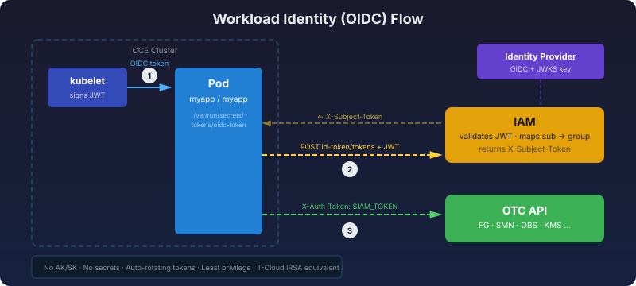

# Workload Identity (OIDC)

Secure pod-to-cloud-service authentication without AK/SK credentials.
OTC equivalent of AWS IRSA (IAM Roles for Service Accounts).

## Architecture



## How It Works

1. **Pod** mounts a projected ServiceAccount token with a custom audience
2. **kubelet** auto-generates and rotates a signed JWT (OIDC token)
3. Pod exchanges the OIDC token for an **IAM token** via the IAM federation API
4. Pod uses the IAM token to call **OTC APIs** (FunctionGraph, OBS, KMS, etc.)

No AK/SK. No secrets. No node agency. Token auto-rotates every 24h.

## Components

| Resource | Purpose |
|---|---|
| Identity Provider | OIDC provider linked to the CCE cluster's signing key |
| Identity Protocol | OIDC protocol with access config (provider URL, client ID, JWKS) |
| Identity Mapping | Maps `system:serviceaccount:<ns>:<sa>` → IAM group |
| IAM Group | Per-workload group with role assignments |
| Custom Policies | Least-privilege per workload |

## Setup

### 1. Get JWKS from cluster

```bash
kubectl get --raw /openid/v1/jwks
```

### 2. Enable in tfvars

```hcl
create_workload_identity = true
```

The JWKS is fetched automatically via `data.external` when `create_workload_identity = true`.

### 3. Apply

```bash
cd infra
tofu apply
```

### 4. Add projected volume to pod spec

```yaml
spec:
  serviceAccountName: myapp
  containers:
    - name: myapp
      volumeMounts:
        - name: oidc-token
          mountPath: /var/run/secrets/tokens
          readOnly: true
  volumes:
    - name: oidc-token
      projected:
        sources:
          - serviceAccountToken:
              audience: otc-workload-identity  # must match client_id
              expirationSeconds: 3600
              path: oidc-token
```

### 5. Exchange token in application code

```bash
# Read OIDC token
OIDC=$(cat /var/run/secrets/tokens/oidc-token)

# Exchange for IAM token
IAM_TOKEN=$(curl -si -X POST \
  "https://iam.eu-de.otc.t-systems.com/v3.0/OS-AUTH/id-token/tokens" \
  -H "Content-Type: application/json" \
  -H "X-Idp-Id: <prefix>-workload-id" \
  -d '{"auth":{"id_token":{"id":"'"$OIDC"'"},"scope":{"project":{"name":"<project>"}}}}' \
  | grep X-Subject-Token | awk '{print $2}' | tr -d '\r')

# Use IAM token for OTC API calls
curl -H "X-Auth-Token: $IAM_TOKEN" https://<service>.eu-de.otc.t-systems.com/...
```

## Adding Workloads

Each module that needs OTC API access exports a `workload` output:

```hcl
output "workload" {
  value = {
    namespace       = "myapp"
    service_account = "myapp"
    role_ids        = [opentelekomcloud_identity_role_v3.my_policy.id]
  }
}
```

Wire it in `resources.tf`:

```hcl
module "workload_identity" {
  ...
  workloads = [
    for w in [
      module.myapp.workload,
      module.another_module.workload,
    ] : w if w != null
  ]
}
```

The workload-identity module is generic — it handles OIDC setup, group creation,
mapping rules, and role assignments for any number of workloads.

## Token Details

| Property | Value |
|---|---|
| Issuer (`iss`) | `https://kubernetes.default.svc.cluster.local` |
| Audience (`aud`) | `otc-workload-identity` (configurable via `client_id`) |
| Subject (`sub`) | `system:serviceaccount:<namespace>:<sa-name>` |
| Expiry | 1 hour (configurable via `expirationSeconds`) |
| Rotation | kubelet auto-rotates after 24h or 80% of expiry |

## Security

- **No long-lived credentials** — tokens are short-lived and auto-rotated
- **Least privilege** — each workload gets its own IAM group with specific roles
- **No node-level access** — credentials are scoped to the ServiceAccount, not the node
- **IAM validates JWT signature** — JWKS signing key is registered with the Identity Provider
- **Virtual users** — federated identities, no IAM user accounts created

## Variables

| Variable | Default | Description |
|---|---|---|
| `create_workload_identity` | `false` | Enable OIDC workload identity |

## References

- [OTC Best Practice: Using OIDC to Authenticate Workloads in a CCE Cluster](https://docs.otc.t-systems.com/cloud-container-engine/umn/best_practice/security/using_oidc_to_authenticate_workloads_in_a_cce_cluster.html)
- [AWS IRSA concept](https://docs.aws.amazon.com/eks/latest/userguide/iam-roles-for-service-accounts.html) (similar pattern)
